# Sessions 1 & 2 — Model Selection, Validation Design & Performance Metrics

**Course:** Advanced Machine Learning in Business Transformation (BDA/IDA, Term II, AY 2026-27)
**Faculty:** Dr. S. Sanyal  |  **Mode:** Offline  |  **CLO covered:** CLO 1 — *Apply model selection techniques to compare alternative ML models and choose appropriate models for business analytics problems* (Bloom Level 3: Apply)
**Suggested reading:** ISLR Ch. 6 (subset selection) — plus ISLR Ch. 5 (cross-validation) and Ch. 4 (logistic regression / LDA / QDA / KNN) as background. *(The course outline lists only Ch. 6, but the CV and classifier material in these slides comes from Ch. 5 and Ch. 4 of ISLR.)*

---

## Table of Contents

1. [The Big Picture](#1-the-big-picture)
2. [What Exactly Are We Selecting?](#2-what-exactly-are-we-selecting)
3. [Training Error Is Optimistic (Overfitting)](#3-training-error-is-optimistic-overfitting)
4. [The Bias–Variance Trade-off](#4-the-biasvariance-trade-off)
5. [KNN as the Flexibility Example](#5-knn-as-the-flexibility-example)
6. [Prediction vs Interpretation](#6-prediction-vs-interpretation)
7. [Training, Validation and Test Sets](#7-training-validation-and-test-sets)
8. [The Validation-Set Approach](#8-the-validation-set-approach)
9. [When Random Splitting Is Wrong](#9-when-random-splitting-is-wrong)
10. [Data Leakage](#10-data-leakage)
11. [Cross-Validation](#11-cross-validation)
12. [Choosing Predictors: Subset Selection](#12-choosing-predictors-subset-selection)
13. [Why RSS Can't Choose Model Size — and What Can](#13-why-rss-cant-choose-model-size--and-what-can)
14. [Performance Metrics for Regression](#14-performance-metrics-for-regression)
15. [Performance Metrics for Classification](#15-performance-metrics-for-classification)
16. [Hyperparameter Tuning (KNN)](#16-hyperparameter-tuning-knn)
17. [R Code Walkthroughs](#17-r-code-walkthroughs)
18. [The Complete Workflow (Summary Diagram)](#18-the-complete-workflow-summary-diagram)
19. [Cheat Sheet](#19-cheat-sheet)
20. [Practice Questions with Answers](#20-practice-questions-with-answers)
21. [Glossary](#21-glossary)

---

## 1. The Big Picture

Many different models can be fitted to the same business data. The model that fits the *past* best is **not automatically** the one that will work best on *future* customers.

> **The one question of these two sessions:**
> *Which model will perform reliably on future business cases?*

**Analogy — hiring a new employee.** Two candidates attend an interview. Candidate A has memorised the answers to last year's interview questions and scores 100% on them. Candidate B understands the subject and scores 85%. If the company next year asks *new* questions, B will probably do better. Training error is like scoring candidates on questions they have already seen. We want to score them on *new* questions — that is what validation and test data do.

**Roadmap of the two sessions**

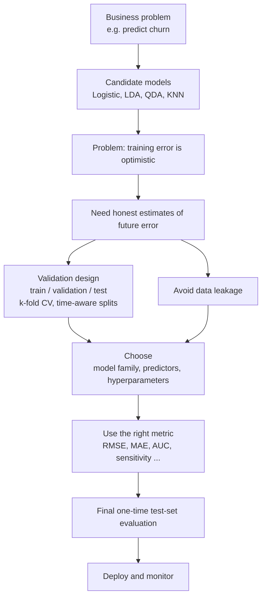

---

## 2. What Exactly Are We Selecting?

"Model selection" is not one decision, it is several:

| Selection question | Business example |
|---|---|
| **Model family** | Logistic regression, LDA, QDA or KNN for churn prediction? |
| **Predictor set** | Should we include tenure, complaints, monthly spend, support calls? |
| **Model complexity** | How many predictors should enter a regression model? |
| **Hyperparameter** | What value of K in KNN? |
| **Performance metric** | Accuracy, sensitivity, AUC, RMSE or MAE? |

**Why it matters for management:** a team will usually try several reasonable models. They can give different future performance, and management needs the one that supports *future decisions*, not the one that best describes the past.

---

## 3. Training Error Is Optimistic (Overfitting)

**Training error** = error measured on the same data used to fit the model.
A more flexible model (more predictors, smaller K, deeper tree …) almost always lowers training error. But:

$$\text{Training error} \downarrow \;\;\not\Rightarrow\;\; \text{Test error} \downarrow$$

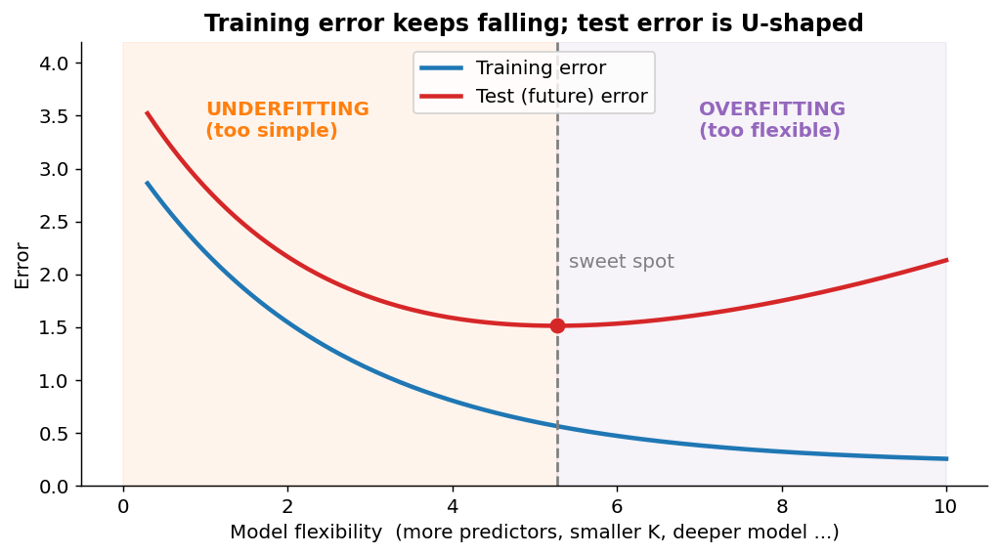

**How to read the chart**

* **Blue line (training error)** only goes down as flexibility rises — a flexible model can always "memorise" a bit more.
* **Red line (test error)** falls at first (the model is learning real signal), reaches a minimum (**sweet spot**), then rises again because the model starts fitting *noise*.
* **Left of the sweet spot → underfitting**, right → **overfitting**.

### Seeing overfitting with your own eyes

Same 15 noisy data points, three polynomial models:

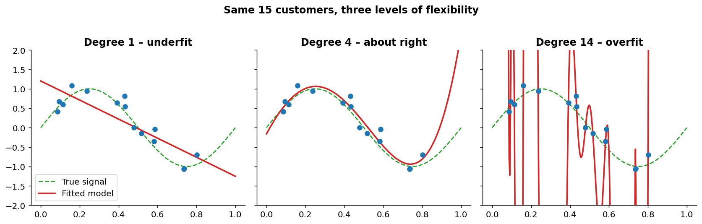

* **Degree 1** (a straight line): too rigid, misses the curve → *underfit*.
* **Degree 4**: captures the real S-shape → *about right*.
* **Degree 14**: passes through every point (training error ≈ 0) but wiggles wildly between them → *overfit*. It will predict new points badly.

**Business example (from the slide):** a regression with many predictors fits historical customers very well, but it has learned random quirks (e.g., one customer who happened to buy twice in a week). On new customers it performs poorly.

---

## 4. The Bias–Variance Trade-off

Expected test error decomposes as

$$\text{Test Error} = \text{Bias}^2 + \text{Variance} + \text{Irreducible Error}$$

| Term | Meaning | Simple analogy (darts) |
|---|---|---|
| **Bias** | Error from a model that is too simple to capture the true pattern | All darts land far from the bullseye, but tightly clustered |
| **Variance** | How much the fitted model would change if trained on a different sample | Darts are scattered everywhere, though their average may be near the bullseye |
| **Irreducible error** | Noise that no model can remove (customers behave randomly) | The dartboard is slightly shaking |

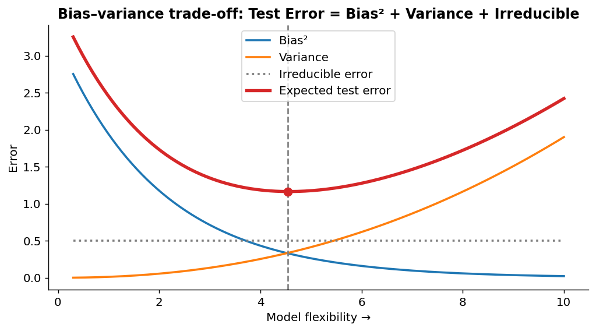

| | Simple model | Highly flexible model |
|---|---|---|
| Bias | **Higher** | Lower |
| Variance | Lower | **Higher** |

Total error is **U-shaped** because bias² falls and variance rises as flexibility increases. **Model selection = finding the useful middle.**

> **Memory hook:** *Simple = stubborn (biased but stable). Flexible = gullible (follows every bit of noise).*

---

## 5. KNN as the Flexibility Example

**K-Nearest Neighbours (KNN)** predicts a new customer's class by looking at the K most similar customers (nearest in predictor space) and taking a majority vote (or an average for regression).

**Analogy — asking for restaurant advice.**
* **K = 1**: you ask only your single closest friend. If they have unusual taste, you get a weird recommendation. (*High variance, low bias.*)
* **K = 50**: you poll fifty people in your area. Reasonable, stable advice. (*Balanced.*)
* **K = everybody**: you just follow the city-wide most popular restaurant, no matter what *you* like. (*High bias, low variance.*)

| | Small K | Large K |
|---|---|---|
| Uses | A few nearby observations | Many nearby observations |
| Flexibility | High — follows local patterns | Low — averages them away |
| Bias | Lower | **Higher** (real local patterns get smoothed out) |
| Variance | **Higher** (changing a few points changes predictions a lot) | Lower |
| Risk | **Overfitting** | **Underfitting** |

**What it looks like** — the course's simulated data (two classes: "Yes" inside a disk, "No" in a ring around it):

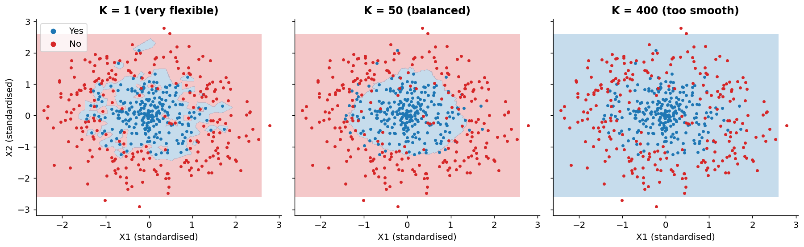

* **K = 1:** jagged, island-filled boundary that chases individual points → overfits.
* **K = 50:** smooth, near-circular boundary matching the true structure → best.
* **K = 400** (of 500 points): the model averages over nearly everybody, and the boundary disappears → underfits.

**K controls the flexibility of KNN → K is a tuning parameter → choose it with cross-validation.**

---

## 6. Prediction vs Interpretation

* Some models are easy to explain; others predict better but explain worse.
* **Logistic regression:** coefficients → odds-ratio interpretation. *("Each additional complaint multiplies the odds of churn by 1.4.")*
* **KNN:** flexible boundaries, but "why was this customer flagged?" is hard to answer.
* In business, a *slightly less accurate but interpretable* model may be preferred — for example when you must justify decisions to regulators, customers or senior management.

> **Model selection is both a statistical and a managerial decision.**

---

## 7. Training, Validation and Test Sets

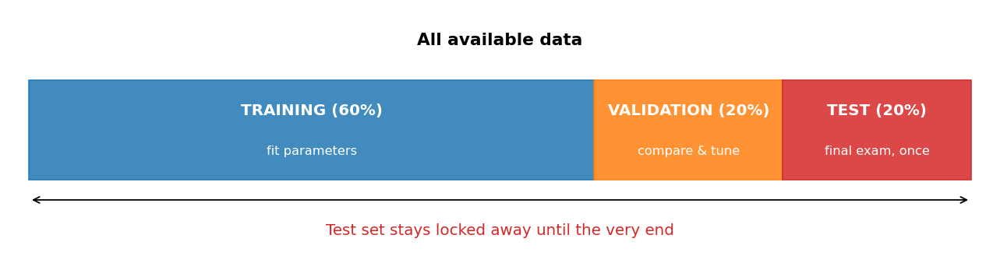

| Set | Used for | Analogy (exam preparation) |
|---|---|---|
| **Training** | Fit model parameters | Studying the textbook |
| **Validation** | Compare models, tune choices | Taking mock tests to decide which study method works |
| **Test** | Final evaluation **only** | The real exam — you get to sit it once |

> **Golden rule:** the test set must not be used during model development. If you peek and adjust, it stops being a fair exam.

*(The 60/20/20 proportions shown are only illustrative — the slide specifies no fixed percentages.)*

### Why do we need validation data at all?

Suppose we compare regression models with 2, 4, 6 and 8 predictors. Training RSS will usually *fall* as predictors are added — but that does **not** prove the bigger model predicts better. Validation data estimate performance on observations that were **not used for fitting**, which is what lets us choose complexity honestly.

---

## 8. The Validation-Set Approach

**Steps**

1. Randomly split the data into a **training** set and a **validation** set.
2. Fit each candidate model (different complexity) on the **same training set** — e.g., KNN with K = 1, 3, 5, 10, 20, or regressions with 2, 4, 6, 8 predictors.
3. Compute the validation error of each:

$$\widehat{\text{Err}}_{\text{val}} = \frac{1}{n_{\text{val}}}\sum_{i\in \text{val}} L(y_i,\hat y_i)$$

   (*L* is a loss function: squared error for regression, 0/1 misclassification for classification.)
4. Pick the complexity with the **lowest validation error**.

**Worked example (from the slide)**

| K | 1 | 3 | 5 | 10 | 20 |
|---|---|---|---|---|---|
| Validation error | 0.18 | 0.14 | **0.11** | 0.13 | 0.17 |

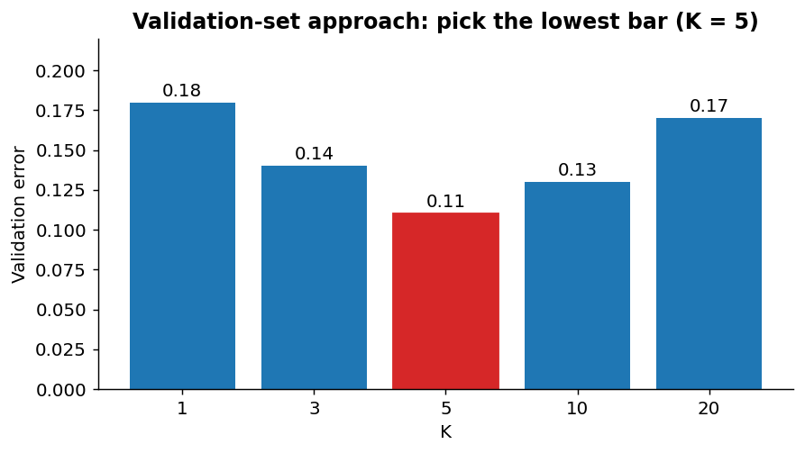

→ **Select K = 5.** K = 1 and 3 are too flexible (overfit); K = 10 and 20 start to smooth too much (underfit). K = 5 generalises best on unseen data.

| ✅ Advantage | ⚠️ Limitation |
|---|---|
| Simple, fast, easy to explain | The chosen complexity can depend strongly on the **particular random split** |

### One split can be misleading

If the validation set happens to be unusual, model comparison becomes unstable — a model that looks best on one split may not on another. This matters most when:

* the sample size is small,
* the outcome is **imbalanced** (e.g., 2% fraud),
* there are **influential observations**,
* the data contain **subgroups**.

> A single split gives only **one noisy estimate** of future error.
> *Analogy: judging a cricketer on a single innings.*

This weakness is exactly why **cross-validation** (Section 11) exists.

---

## 9. When Random Splitting Is Wrong

Random splitting assumes every row is independent and "exchangeable". That is false when data have structure:

* time-ordered demand data,
* repeated transactions by the same customer,
* multiple records from the same firm,
* store-level / region-level clustering.

**Example — sales forecasting.** A random split puts some *later* months into training and some *earlier* months into validation/test. The model is then "predicting the past using the future", which can never happen in real life, so the performance estimate is unrealistically good.

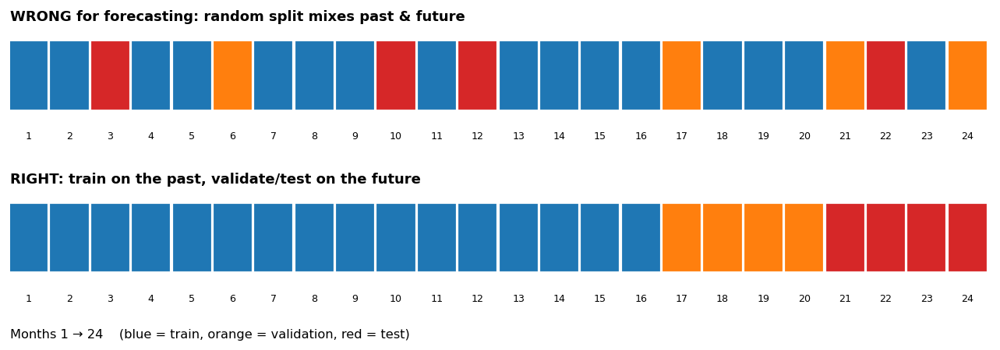

**Better design:** *Past training data → future validation/test data.*

**Other structured-data fixes (same principle):**
* **Repeated customers:** keep **all** rows of one customer in the same set (group-wise split), otherwise the model "recognises" the customer rather than learning general patterns.
* **Store/region clusters:** split by store or region if you want to predict for *new* stores.

---

## 10. Data Leakage

> **Data leakage** occurs when information that would **not be available at prediction time** influences model building.
> **Consequence:** validation or test performance looks artificially good because the development process has indirectly "seen" the data it is evaluated on.

**Analogy:** a student who got a glimpse of the exam paper. Their score is high, but it says nothing about how much they actually know.

### Common leakage sources (with business flavour)

| Leak | What goes wrong | Example |
|---|---|---|
| **Standardising before splitting** | Mean & SD computed from *all* data, so validation/test rows influence the training transformation | Scaling "monthly spend" using all customers before the split |
| **Imputing before splitting** | Missing values filled using statistics from the full dataset | Filling missing income with the mean of the *whole* file |
| **Selecting predictors on the full dataset** | Variables chosen partly because they relate to outcomes in rows later treated as "unseen" | Keeping the 10 variables most correlated with churn across all customers, *then* cross-validating |
| **Tuning on the test set** | Repeatedly choosing the K or model that scores best on test makes test part of selection | Trying 20 models, reporting the best one's test score |
| **Using future information** | Using data from after the prediction date | Predicting an April churn using May support calls |

> **Leakage can make a weak model appear to generalise well.**

### Wrong vs right pipeline

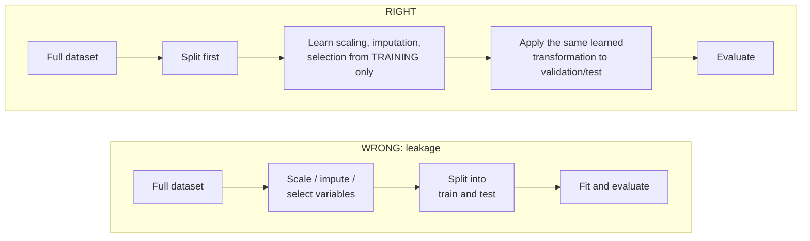

**Practical rule:**

$$\text{Split first} \;\longrightarrow\; \text{learn from training data} \;\longrightarrow\; \text{apply to validation/test data}$$

**Inside cross-validation:** preprocessing, imputation, scaling and variable selection should normally be done **within each training fold**, not once on the entire dataset.

> **Anything learned from the data must be learned without looking at the observations used for evaluation.**

*Link to the R code later:* when you write `preProcess = c("center","scale")` **inside** `caret::train()`, caret re-computes the centring/scaling inside each CV fold — the leakage-safe way. Scaling the whole dataset manually *before* calling `train()` would be leakage.

---

## 11. Cross-Validation

**Idea:** instead of one split, create many train/validation splits and average the results — every observation gets to be "unseen" exactly once.

### k-fold cross-validation

1. Split data into **k folds** (equal parts).
2. Train on **k − 1** folds, validate on the remaining one.
3. Repeat until each fold has served as validation once.
4. Average:

$$CV_{(k)} = \frac{1}{k}\sum_{j=1}^{k} \text{Err}_j$$

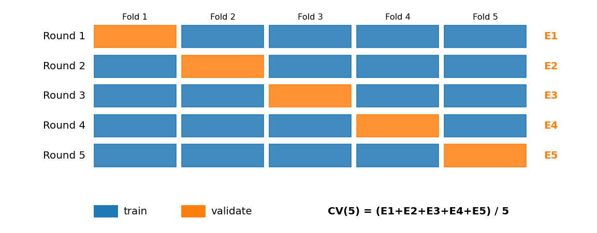

**Five-fold in words:** each observation is used **once for validation** and **four times for training**.

**Worked numerical example.** Suppose the five fold errors (misclassification rates) for a KNN with K = 15 are

| Fold | 1 | 2 | 3 | 4 | 5 |
|---|---|---|---|---|---|
| Error | 0.12 | 0.15 | 0.10 | 0.14 | 0.11 |

$$CV_{(5)} = \frac{0.12+0.15+0.10+0.14+0.11}{5} = \frac{0.62}{5} = 0.124$$

Repeat for K = 25, 50, … with the **same folds**, and pick the K with the lowest CV error. Compared with a single validation split this is **more stable** because it averages five (noisy) estimates.

### Comparison of methods

| Method | Training size per fit | Number of fits | Comment |
|---|---|---|---|
| Validation split | A fraction of data | 1 | Fast but split-dependent |
| 5-fold CV | ≈ 80% | 5 | Common practical choice |
| 10-fold CV | ≈ 90% | 10 | Common practical choice |
| **LOOCV** (leave-one-out) | n − 1 | n | Can be expensive |

* **LOOCV** trains on almost all data each time, so it has **low bias**, but it is **computationally costly** and its estimates can be **highly variable** (the n training sets are nearly identical, so the n errors are strongly correlated).
* 5- or 10-fold is the usual compromise between bias, variance and computing time.

> **Practical add-on (not on slides):** for imbalanced classification use **stratified** k-fold so each fold keeps the same class proportions. Remember also that for time-ordered data, use time-aware CV (rolling/expanding windows) rather than random folds.

---

## 12. Choosing Predictors: Subset Selection

**Central question:** *which predictors should be in the model?*

**Business example — predicting customer expenditure.** Candidates: income, age, tenure, monthly visits, product ownership, complaints, previous purchases. We want a model that predicts well **and remains usable**.

### 12.1 Best subset selection

For each model size *k* = 1, …, p:
1. Fit **all** models with exactly *k* predictors.
2. Keep the one with the smallest training RSS (best of size *k*).

Then compare the p "best-of-each-size" models using **validation, CV, or a complexity-adjusted criterion** (AIC/BIC/Cp/adj-R²).

$$\text{Number of possible models} = 2^p$$

**Tiny example with p = 3** (income, tenure, complaints) → 2³ = 8 models:

```
{} (intercept only)
{income} {tenure} {complaints}
{income, tenure} {income, complaints} {tenure, complaints}
{income, tenure, complaints}
```

For p = 20, that is **over one million models** (1,048,576).

### 12.2 Forward stepwise selection

* Start with the intercept-only model.
* Add **one predictor at a time** — each time the one giving the **largest improvement**.

$$\text{Intercept} \to +X_1 \to +X_2 \to +X_3 \to \cdots$$

*Analogy: building a team — keep hiring whoever adds the most value.*

* Much faster than best subset: only $1 + p(p+1)/2$ models (7 for p = 3; **211 for p = 20**).
* Does **not guarantee** the globally best subset (an early choice can't be undone).

### 12.3 Backward stepwise selection

* Start with **all** predictors; remove one at a time — each time the one whose removal hurts fit **least**.
* Useful when p is not too large and **n > p**.
* *Analogy: start with a big team and let go of the least useful person each round.*
* Business reading: begin with all available customer variables and gradually simplify.

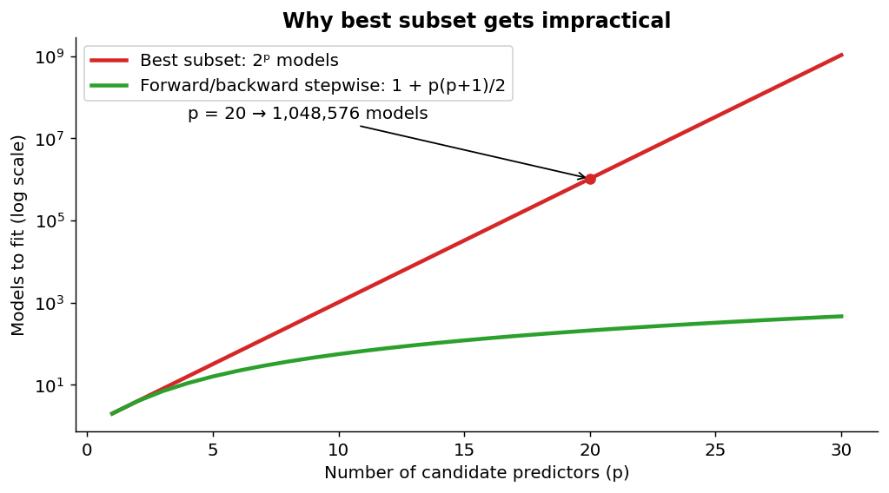

| Method | Models fitted | Guarantees best subset? | Works when p > n? |
|---|---|---|---|
| Best subset | 2ᵖ | Yes (best of each size, by training RSS) | Impractical |
| Forward stepwise | 1 + p(p+1)/2 | No | Yes |
| Backward stepwise | 1 + p(p+1)/2 | No | **No** (needs n > p) |

> **Stepwise methods are search strategies, not guarantees of truth.** A selected variable is "useful for prediction", not proven "causal".

---

## 13. Why RSS Can't Choose Model Size — and What Can

Training RSS **never increases** as predictors are added:

$$RSS_{k+1} \le RSS_k$$

So choosing the lowest training RSS always picks the **largest** model → overfitting. We need criteria that either **penalise complexity** or **estimate future error directly**.

### 13.1 Indirect adjustments: Adjusted R², Cp, AIC, BIC

General idea:

$$\text{Score} = \text{measure of fit} + \text{penalty for unnecessary complexity}$$

For a model with *d* predictors fitted on *n* observations, with $\hat\sigma^2$ an estimate of the error variance (ISLR forms):

| Criterion | Formula | Choose |
|---|---|---|
| **Adjusted R²** | $1-\dfrac{RSS/(n-d-1)}{TSS/(n-1)}$ | **Largest** |
| **Mallows' Cp** | $\dfrac{1}{n}\left(RSS + 2d\hat\sigma^2\right)$ | Smallest |
| **AIC** | $\dfrac{1}{n\hat\sigma^2}\left(RSS + 2d\hat\sigma^2\right)$ *(proportional to Cp for least squares)* | Smallest |
| **BIC** | $\dfrac{1}{n}\left(RSS + \log(n)\, d\,\hat\sigma^2\right)$ | Smallest |

* Plain R² always increases with more predictors; **adjusted R²** penalises predictors that don't improve fit enough.
* **BIC penalty (log n) is heavier than AIC/Cp penalty (2) whenever n > 7**, so BIC usually picks a **smaller** model.

> A simpler model may be preferred if extra predictors add little value.

### 13.2 Direct estimates: validation / cross-validation

Instead of adding a penalty, estimate the test error itself. Slide example (cross-validated RMSE):

| Number of predictors | 2 | 4 | **6** | 8 | 10 |
|---|---|---|---|---|---|
| CV RMSE | 8.1 | 6.7 | **6.2** | 6.3 | 6.5 |

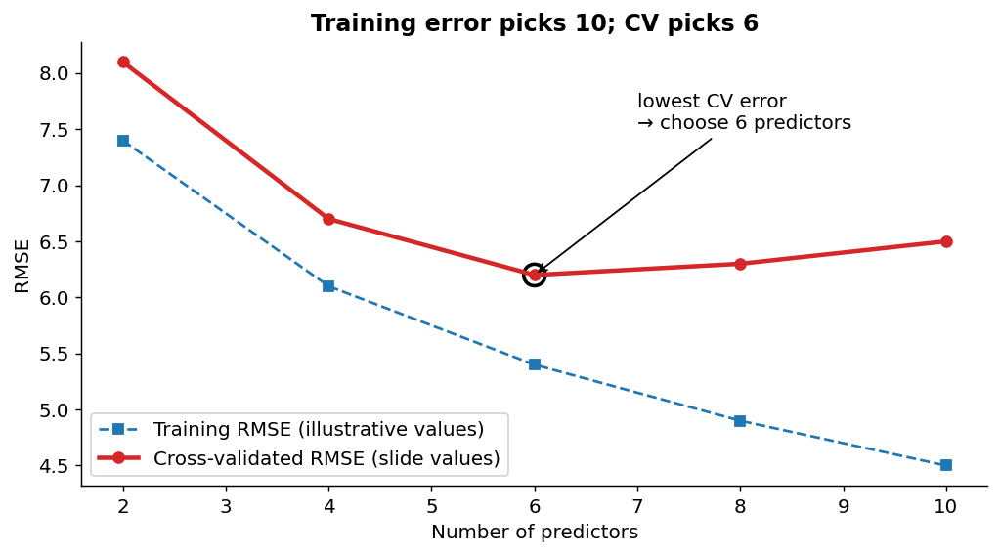

* Training error is lowest with **10** predictors (dashed line — illustrative values, since the slide gives only the CV row).
* **CV error is lowest at 6** → choose the **6-predictor** model.

> **Do not select model size using training error alone.**

---

## 14. Performance Metrics for Regression

| Metric | Formula | Notes |
|---|---|---|
| **MSE** | $\frac1n\sum (y_i-\hat y_i)^2$ | Penalises large errors heavily |
| **RMSE** | $\sqrt{\text{MSE}}$ | **Same units as the target** (e.g., ₹) |
| **MAE** | $\frac1n\sum \lvert y_i-\hat y_i\rvert$ | Easy to interpret, less sensitive to large errors |
| **R²** | $1-\dfrac{RSS}{TSS}$ | Share of variance explained |

**Worked example — effect of one outlier.** Daily demand forecasting errors (units) for 5 days: 2, 3, 1, 2, **12** (last day had a big miss).

| | Without day 5 (2,3,1,2) | With day 5 (2,3,1,2,12) |
|---|---|---|
| MAE | (2+3+1+2)/4 = **2.00** | 20/5 = **4.00** |
| MSE | (4+9+1+4)/4 = 4.5 | (4+9+1+4+144)/5 = **32.4** |
| RMSE | √4.5 ≈ **2.12** | √32.4 ≈ **5.69** |

One bad day nearly **triples** RMSE (2.12 → 5.69) but only **doubles** MAE (2 → 4).

> **The right metric depends on the business cost of error.**
> * Stock-outs are disastrous (one huge miss is far worse than several small ones) → prefer **RMSE**.
> * Cost grows proportionally with the size of the miss → prefer **MAE**.

---

## 15. Performance Metrics for Classification

### 15.1 The confusion matrix

Everything flows from four counts. Churn example: 1,000 customers, 200 actually churn.

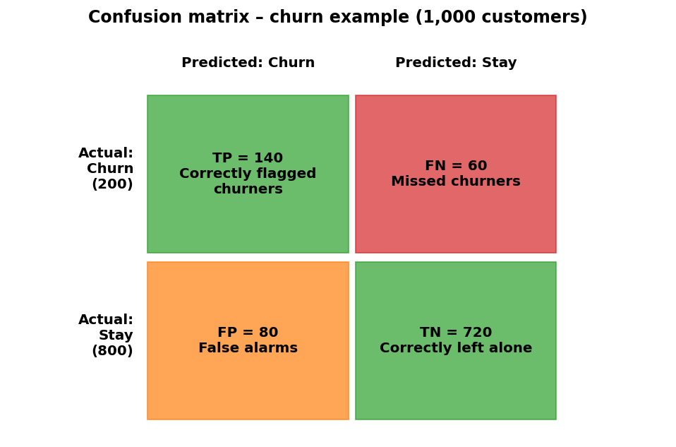

| Metric | Formula | Question it answers | Churn example |
|---|---|---|---|
| **Accuracy** | (TP+TN)/Total | Overall, how often are we right? | (140+720)/1000 = **0.86** |
| **Sensitivity / Recall** | TP/(TP+FN) | Of actual churners, how many did we catch? | 140/200 = **0.70** |
| **Specificity** | TN/(TN+FP) | Of actual stayers, how many did we correctly leave alone? | 720/800 = **0.90** |
| **Precision** | TP/(TP+FP) | Of customers we flagged, how many really churn? | 140/220 ≈ **0.64** |
| **ROC-AUC** | Area under ROC curve | Can the model rank positives above negatives across all thresholds? | see below |

*(F1 = harmonic mean of precision and recall = 2TP/(2TP+FP+FN) = 0.667 here — an extra, not on the slides.)*

**Memory aid.**
* **Sensitivity** = "of the sick, how many did the test detect?"
* **Specificity** = "of the healthy, how many did the test clear?"
* **Precision** = "when the alarm rings, is it real?"

Use these metrics for logistic regression, LDA, QDA **and** KNN alike.

### 15.2 Case: accuracy can mislead

A fraud dataset: 10,000 transactions, 100 fraudulent, 9,900 legitimate. A "model" predicts **every** transaction as legitimate.

$$\text{Accuracy}=\frac{9900}{10000}=99\% \qquad \text{Sensitivity}=\frac{0}{100}=0$$

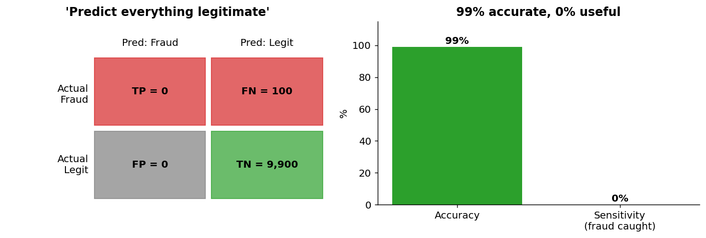

> **A high-accuracy model can be useless.** Accuracy is misleading when classes are imbalanced — look at sensitivity, precision and AUC.

### 15.3 Thresholds and business cost (extra worked example)

Classifiers output a **probability**; you choose the cut-off (default 0.5). Moving the threshold trades FN against FP.

Assume: a missed churner (FN) costs **₹10,000** in lost lifetime value; a wasted retention offer (FP) costs **₹500**.

| | Threshold 0.5 | Threshold lowered to 0.3 |
|---|---|---|
| TP / FN / FP / TN | 140 / 60 / 80 / 720 | 170 / 30 / 200 / 600 |
| Accuracy | **86%** | 77% |
| Sensitivity | 70% | **85%** |
| Total cost | 60×10,000 + 80×500 = **₹6,40,000** | 30×10,000 + 200×500 = **₹4,00,000** |

The "less accurate" setting is **₹2,40,000 cheaper**. *Moral: pick metrics (and thresholds) that reflect business costs, not the one that looks best on a slide.*

### 15.4 ROC curve and AUC

The **ROC curve** plots sensitivity (true-positive rate) against 1 − specificity (false-positive rate) as the threshold moves from 1 to 0.

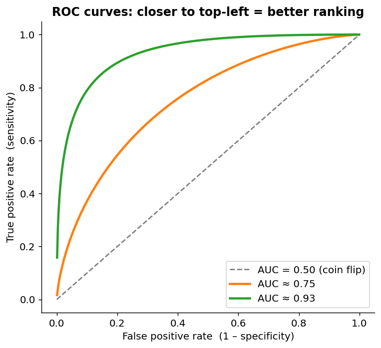

* Diagonal = random guessing (**AUC = 0.5**).
* Curve hugging the top-left corner = great separation (**AUC → 1**).
* **AUC interpretation:** the probability that a randomly chosen positive (churner) gets a higher score than a randomly chosen negative.
* AUC is **threshold-free**, which is why it is a good metric for *tuning* (as in the KNN code below).

### 15.5 Which metric should I use? (decision guide)

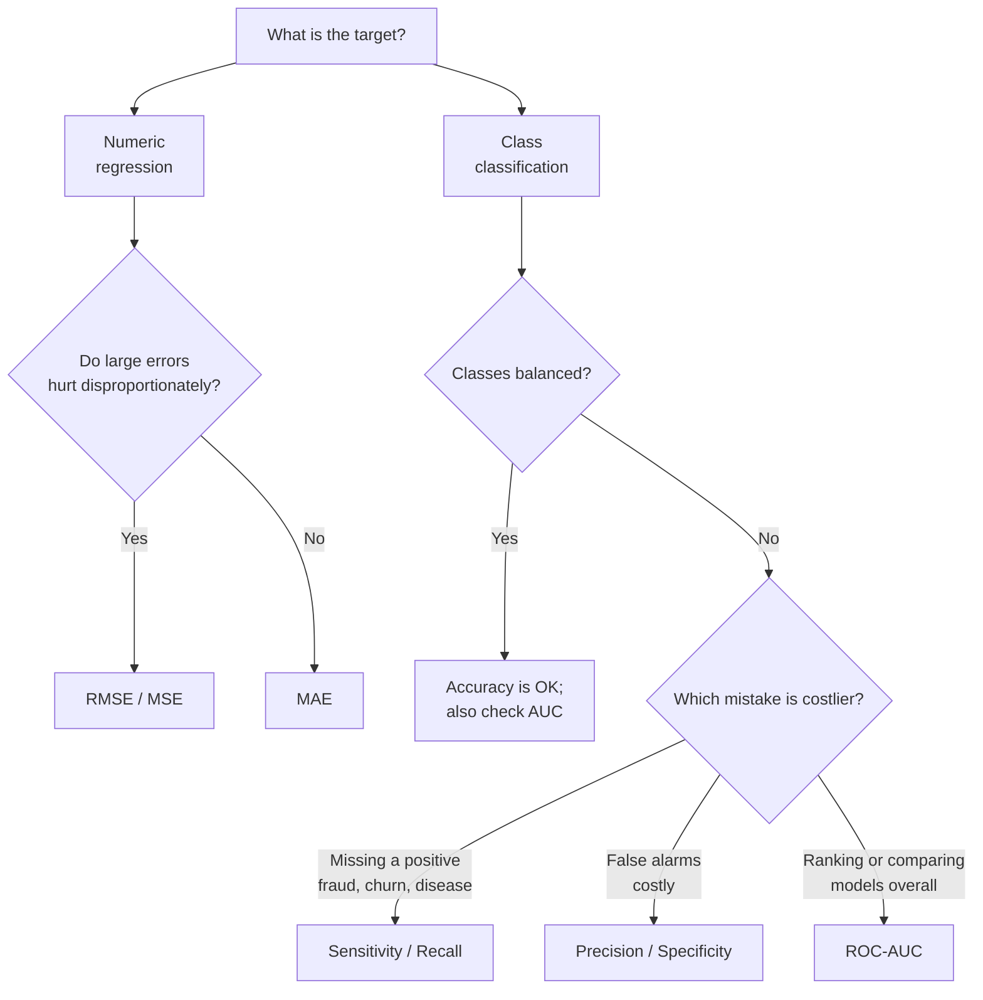

---

## 16. Hyperparameter Tuning (KNN)

| | Parameter | Hyperparameter |
|---|---|---|
| Set by | **Estimated from training data** | **Specified before fitting** |
| Role | Defines the fitted model | Controls *how* the model behaves/learns |
| Example | A regression coefficient β | **K in KNN** |

**Analogy:** the *recipe* (hyperparameter: how much heat, how long) vs the *taste measurements* the chef records after cooking (parameters).

### Tuning procedure

1. Choose a grid of candidate values, e.g. K ∈ {1, 3, 5, 7, 9, 15, 25, …}.
2. For each K, run cross-validation **using the same folds**.
3. Compute the chosen performance measure (e.g., ROC-AUC).
4. Compare across K; pick the best:

$$K_{\text{selected}} = \arg\max_K \; CV\text{-}AUC(K)$$

5. (Not in slides but standard) **Refit** on all training data with that K and evaluate **once** on the untouched test set.

CV performance typically **improves first** (variance falls) and then **declines** (model becomes too smooth).

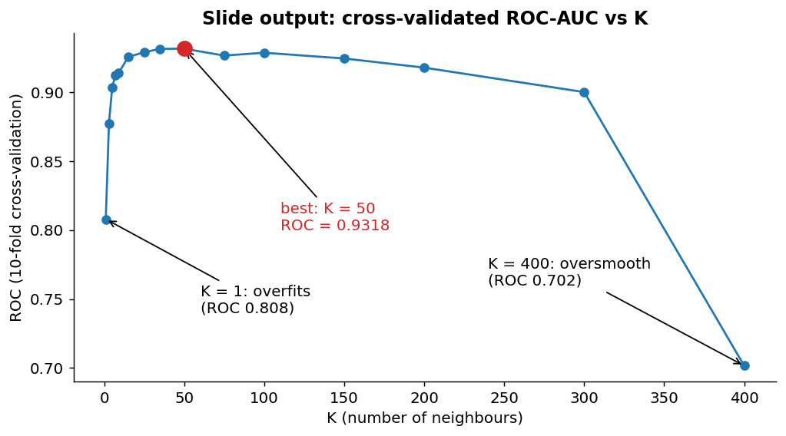

**Reading the slide output:**

| K | 1 | 5 | 15 | 35 | **50** | 100 | 300 | 400 |
|---|---|---|---|---|---|---|---|---|
| CV ROC | 0.808 | 0.903 | 0.926 | 0.932 | **0.932** | 0.929 | 0.900 | 0.702 |

* K = 1: ROC = 0.81 → **overfit**.
* K = 50: ROC = 0.9318 → **best** (`bestTune`).
* K = 400 (almost the whole dataset): ROC = 0.70 → **underfit**.
* The curve is **flat from about K = 25 to 100** — in practice any value in that range performs about equally, so you might pick a simpler/more stable one.

---

## 17. R Code Walkthroughs

### 17.1 KNN tuning with `caret`

```r
library(caret)
set.seed(123)

# Simulate two classes with a nonlinear boundary
n <- 500                                   # (on the slide this sits on the comment line — put it on its own line!)
theta1 <- runif(n/2, 0, 2*pi)
theta2 <- runif(n/2, 0, 2*pi)
r1 <- rnorm(n/2, mean = 1.5, sd = 1.1)     # "Yes": inner disk
r2 <- rnorm(n/2, mean = 4.0, sd = 1.1)     # "No" : outer ring
knn_data <- data.frame(
  X1 = c(r1*cos(theta1), r2*cos(theta2)),
  X2 = c(r1*sin(theta1), r2*sin(theta2)),
  Class = factor(c(rep("Yes", n/2), rep("No", n/2)), levels = c("Yes", "No"))
)

ctrl <- trainControl(method = "cv", number = 10,   # 10-fold CV
                     classProbs = TRUE,            # need probabilities for ROC
                     summaryFunction = twoClassSummary)

k_grid <- c(1,3,5,7,9,15,25,35,50,75,100,150,200,300,400)

set.seed(123)                                      # same folds each run
knn_fit <- train(Class ~ X1 + X2, data = knn_data,
                 method = "knn", metric = "ROC",
                 preProcess = c("center", "scale"),   # done inside each fold: no leakage
                 tuneGrid = data.frame(k = k_grid),
                 trControl = ctrl)

knn_fit$results[, c("k", "ROC")]   # CV ROC for each K
knn_fit$bestTune                   # best K  (50)
plot(knn_fit)
```

| Line | Why |
|---|---|
| `set.seed(123)` | Reproducible random numbers / folds |
| `levels = c("Yes","No")` | `twoClassSummary` treats the **first level as the positive class** |
| `trainControl(method="cv", number=10)` | 10-fold CV |
| `classProbs=TRUE` + `twoClassSummary` | Needed to compute ROC/Sens/Spec |
| `preProcess = c("center","scale")` | **KNN is distance-based**, so unscaled variables would dominate; doing it in `train()` keeps scaling inside each fold |
| `tuneGrid` | The candidate Ks |
| `metric = "ROC"` | Select K by cross-validated AUC |

**Python equivalent (scikit-learn)** — the `Pipeline` guarantees scaling is learned inside each fold:

```python
from sklearn.pipeline import Pipeline
from sklearn.preprocessing import StandardScaler
from sklearn.neighbors import KNeighborsClassifier
from sklearn.model_selection import GridSearchCV, StratifiedKFold

pipe = Pipeline([("scale", StandardScaler()),
                 ("knn", KNeighborsClassifier())])
grid = {"knn__n_neighbors": [1,3,5,7,9,15,25,35,50,75,100,150,200,300,400]}
cv = StratifiedKFold(n_splits=10, shuffle=True, random_state=123)
search = GridSearchCV(pipe, grid, scoring="roc_auc", cv=cv).fit(X_train, y_train)
print(search.best_params_, search.best_score_)
```

### 17.2 Best subset selection with `leaps` (Hitters baseball-salary data)

```r
library(ISLR2); library(leaps)
data(Hitters)
Hitters <- na.omit(Hitters)                      # drop rows with missing Salary

regfit_full <- regsubsets(Salary ~ ., data = Hitters, nvmax = 19)  # best model of each size 1..19
reg_summary <- summary(regfit_full)

best_bic <- which.min(reg_summary$bic)           # BIC: choose MIN
reg_summary$which[best_bic, ]                    # which variables are in
coef(regfit_full, id = best_bic)
```

> Note: the course uses `ISLR2::Hitters` as an *example dataset*. Think of "Salary ~ AtBat + Hits + …" as "Expenditure ~ income + age + tenure + …" in a business setting.

**Results from the slides**

| Criterion | Chooses | Predictors selected |
|---|---|---|
| **BIC** (`which.min`) | **6** predictors | AtBat, Hits, Walks, CRBI, DivisionW, PutOuts |
| **Adjusted R²** (`which.max`) | **11** predictors | AtBat, Hits, Walks, CAtBat, CRuns, CRBI, CWalks, LeagueN, DivisionW, PutOuts, Assists |

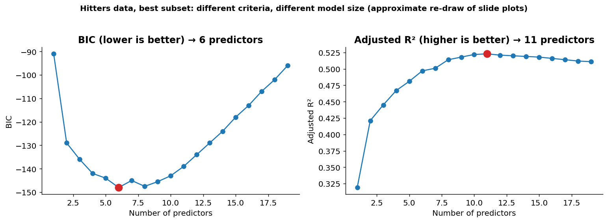
*(Re-drawn approximately from the slide plots, not recomputed.)*

**Interpretation**
* **BIC** (heavy penalty) → smaller, more parsimonious model.
* **Adjusted R²** (lighter penalty) → bigger model.
* Both curves are **flat near their optimum** (BIC at 6 is nearly equal to 8), so a simpler model costs little.
* Neither guarantees the best *future* predictions — **cross-validation** is the arbiter if prediction is the goal.
* Remember `which.min` for BIC/AIC/Cp but **`which.max` for adjusted R²** — a classic exam slip.

---

## 18. The Complete Workflow (Summary Diagram)

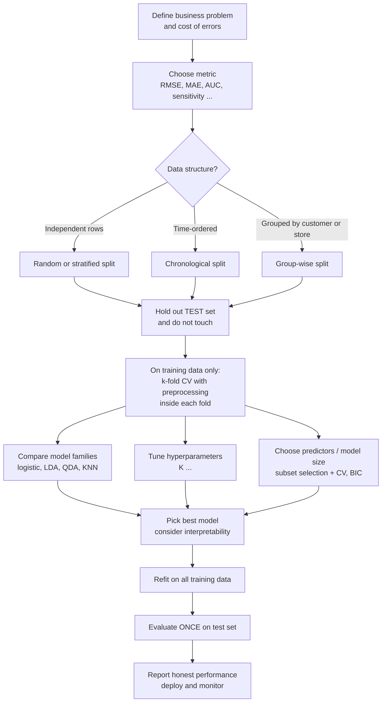

---

## 19. Cheat Sheet

| Concept | One-liner |
|---|---|
| Training error | Optimistic; falls with flexibility |
| Test error | What we actually care about; U-shaped |
| Bias | Error from being too simple (underfit) |
| Variance | Error from being too sensitive to the training sample (overfit) |
| Small K | Flexible: low bias, high variance |
| Large K | Smooth: high bias, low variance |
| Train / Val / Test | Fit / choose / final exam (once) |
| Validation set | Simple but depends on one split |
| k-fold CV | Average over k splits; 5 or 10 typical |
| LOOCV | n fits; low bias, expensive, high variability |
| Time data | Past → future, never random |
| Leakage | Evaluation data influenced model building; split first |
| Best subset | 2ᵖ models; exhaustive |
| Forward / backward | Greedy search; ~p²/2 models; not guaranteed optimal |
| Adj-R², Cp, AIC, BIC | Fit + complexity penalty (adj-R² max; others min) |
| BIC vs AIC | BIC penalises more → smaller models |
| RMSE vs MAE | RMSE punishes big misses; MAE is robust |
| Accuracy trap | 99% accurate can have 0 sensitivity |
| ROC-AUC | Threshold-free ranking quality (0.5 = random, 1 = perfect) |
| Hyperparameter | Set before fitting; tune with CV (e.g., K) |

**Top mistakes to avoid**
1. Choosing a model by training error.
2. Tuning on the test set.
3. Scaling/imputing/selecting variables before splitting.
4. Random splits on time-ordered or grouped data.
5. Using accuracy on imbalanced data.
6. Treating stepwise-selected variables as "the truth".

---

## 20. Practice Questions with Answers

**Q1.** A model has training error 2% and validation error 15%. A simpler model has training error 8% and validation error 10%. Which would you choose and why?
**A.** The simpler one. The first model's large gap between training and validation error shows overfitting; the second generalises better (lower validation error).

**Q2.** In KNN, what happens to bias and variance as K increases from 1 to 100?
**A.** Bias increases (more smoothing), variance decreases. Too small K → overfit; too large K → underfit.

**Q3.** Five-fold CV errors are 0.20, 0.18, 0.22, 0.19, 0.21. Compute CV(5).
**A.** (0.20+0.18+0.22+0.19+0.21)/5 = 1.00/5 = **0.20**.

**Q4.** A retailer standardises all variables on the full dataset, then runs 10-fold CV. What is wrong and how do you fix it?
**A.** Data leakage: each fold's validation rows influenced the mean/SD used to scale the training rows. Fix: compute the scaling within each training fold (e.g., `preProcess` inside `caret::train` or a scikit-learn `Pipeline`).

**Q5.** Monthly sales data for 36 months. A colleague randomly assigns 70% of months to training and 30% to testing. Critique, and propose a better design.
**A.** Later months may train the model that predicts earlier months, which is unrealistic and optimistic. Use the first ~24 months for training, the next 6 for validation, and the last 6 for testing (or rolling-origin CV).

**Q6.** With p = 25 candidate predictors, how many models does best subset consider? How many does forward stepwise?
**A.** 2²⁵ = 33,554,432; forward stepwise: 1 + 25×26/2 = **326**.

**Q7.** Why does training RSS always choose the largest model? What can you use instead?
**A.** Adding a predictor can never raise training RSS (RSS_{k+1} ≤ RSS_k). Use adjusted R², Cp, AIC, BIC, or validation/CV error.

**Q8.** CV RMSE for models with 2/4/6/8/10 predictors is 8.1/6.7/6.2/6.3/6.5. Which model and why?
**A.** 6 predictors — lowest CV error; larger models overfit slightly.

**Q9.** A bank's fraud model: 20,000 transactions, 40 fraudulent. Model A flags nothing; Model B catches 30 frauds with 200 false alarms. Compute accuracy and sensitivity of each.
**A.** A: accuracy = 19,960/20,000 = 99.8%, sensitivity = 0. B: TP = 30, FN = 10, FP = 200, TN = 19,760 → accuracy = 19,790/20,000 = 98.95%, sensitivity = 30/40 = **75%**. B is far more useful despite lower accuracy.

**Q10.** Compute precision, sensitivity and specificity: TP = 50, FN = 10, FP = 30, TN = 110.
**A.** Precision = 50/80 = 0.625; sensitivity = 50/60 ≈ 0.833; specificity = 110/140 ≈ 0.786.

**Q11.** BIC picks 6 predictors, adjusted R² picks 11. Why the difference, and what would you do?
**A.** BIC's penalty log(n)·d·σ̂² is heavier than adjusted R²'s, so it favours smaller models. If prediction is the goal, break the tie with cross-validation and favour the simpler model when performance is close.

**Q12.** Distinguish a parameter from a hyperparameter with a business example.
**A.** In churn logistic regression, the coefficient on "complaints" is a parameter (estimated from data). K in KNN, or the number of folds, is a hyperparameter (set beforehand, tuned by CV).

---

## 21. Glossary

| Term | Meaning |
|---|---|
| **Overfitting** | Model fits noise in training data; poor future performance |
| **Underfitting** | Model too simple to capture the real pattern |
| **Generalisation** | Performance on new, unseen data |
| **Flexibility / complexity** | Capacity of a model to fit complicated patterns |
| **Loss function** | Measures the cost of a single prediction error |
| **Validation set** | Held-out data used to compare models/tune choices |
| **Test set** | Held-out data used once for the final performance estimate |
| **Fold** | One of the k equal parts in k-fold CV |
| **LOOCV** | Leave-one-out cross-validation (k = n) |
| **Data leakage** | Evaluation information influencing model building |
| **RSS** | Residual sum of squares, Σ(yᵢ − ŷᵢ)² |
| **Subset selection** | Searching for a good subset of predictors |
| **Penalised criterion** | Fit measure plus a complexity penalty (Cp, AIC, BIC, adj-R²) |
| **Confusion matrix** | 2×2 table of TP, FP, FN, TN |
| **Sensitivity (recall)** | TP / (TP + FN) |
| **Specificity** | TN / (TN + FP) |
| **Precision** | TP / (TP + FP) |
| **ROC / AUC** | Sensitivity vs (1 − specificity) across thresholds / area under that curve |
| **Hyperparameter** | Setting fixed before training that controls model behaviour |
| **Grid search** | Trying every value on a predefined list of hyperparameters |

---

*Notes prepared from the Course Outline (AY 2026-27) and the "AMLBT Lectures 1–2" slides (draft dated 2026-09-23). Charts were generated with Python/matplotlib; figures 05 and 12 reproduce slide outputs (12 approximately), figure 11's training-RMSE line is illustrative, and the remaining figures are conceptual illustrations. Slide wording may still change since the slide deck is marked "Draft".*
