# Sessions 3, 4 & 5 — Regularization: Ridge, Lasso and Elastic Net

**Course:** Advanced Machine Learning in Business Transformation (BDA/IDA, Term II, AY 2026-27)
**Faculty:** Dr. S. Sanyal  |  **Mode:** Offline  |  **CLO covered:** CLO 2 — *Apply regularization techniques to improve model generalization and address overfitting in business prediction problems* (Bloom Level 3: Apply)
**Suggested reading:** ISLR Ch. 6 (§6.2 Shrinkage Methods: ridge regression, the lasso, selecting the tuning parameter). *Elastic net is only touched on briefly in ISLR; the glmnet documentation and the Hastie–Tibshirani–Friedman text cover it in more depth.*
**Builds on:** [Sessions 1–2 — Model selection & validation](../session-01-02-model-selection/notes.md). Cross-validation, bias–variance and data leakage from there are used constantly here.

---

## Table of Contents

1. [The Big Picture](#1-the-big-picture)
2. [Overfitting and Underfitting: How to Diagnose Them](#2-overfitting-and-underfitting-how-to-diagnose-them)
3. [Why OLS Coefficients Become Unstable](#3-why-ols-coefficients-become-unstable)
4. [From OLS and Subset Selection to Regularization](#4-from-ols-and-subset-selection-to-regularization)
5. [Ridge Regression](#5-ridge-regression)
6. [Why Standardization Matters](#6-why-standardization-matters)
7. [Ridge in R (glmnet) with Cross-Validation](#7-ridge-in-r-glmnet-with-cross-validation)
8. [Lasso Regression](#8-lasso-regression)
9. [Why Does Lasso Produce Exact Zeros? (Geometry)](#9-why-does-lasso-produce-exact-zeros-geometry)
10. [Ridge vs Lasso Compared](#10-ridge-vs-lasso-compared)
11. [Lasso in R](#11-lasso-in-r)
12. [Elastic Net](#12-elastic-net)
13. [Choosing λ: lambda.min vs lambda.1se](#13-choosing-λ-lambdamin-vs-lambda1se)
14. [Choosing Among Ridge, Lasso and Elastic Net](#14-choosing-among-ridge-lasso-and-elastic-net)
15. [Business Cases](#15-business-cases)
16. [The Regularized Model Development Workflow](#16-the-regularized-model-development-workflow)
17. [Python Equivalent](#17-python-equivalent)
18. [Cheat Sheet](#18-cheat-sheet)
19. [Practice Questions with Answers](#19-practice-questions-with-answers)
20. [Glossary](#20-glossary)
21. [Things to Watch for in the Slides and R Output](#21-things-to-watch-for-in-the-slides-and-r-output)

---

## 1. The Big Picture

**Ordinary least squares (OLS)** picks coefficients that fit the *training* data as closely as possible. That is exactly what causes trouble when there are many predictors, or predictors that overlap strongly: the coefficients become **unstable** and predictions on new customers get worse.

**Regularization** changes the fitting rule: *fit the data well, but also keep the coefficients small.* We pay a **penalty** for large coefficients.

> **Regularization constrains the fitted model to improve generalization.**

| Method | Penalty on coefficients | In one line |
|---|---|---|
| **Ridge** | $\lambda\sum\beta_j^2$ (L2) | Shrinks everything, keeps everyone |
| **Lasso** | $\lambda\sum\lvert\beta_j\rvert$ (L1) | Shrinks, and can drop variables completely |
| **Elastic net** | A mix of both | Middle ground, tuned by α |

**Analogy: a budget for coefficients.** Imagine every predictor is a team member who can "spend" influence on the prediction. OLS lets each spend without limit, so teammates with overlapping skills fight over the same work and end up making huge opposing moves (+50 and −48). Regularization puts a **spending cap** on the whole team: members must be modest, and the result is a steadier team.

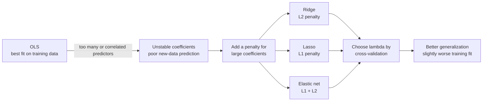

---

## 2. Overfitting and Underfitting: How to Diagnose Them

* **Overfitting:** the model adapts too strongly to sample-specific patterns or noise, so its performance on training data is substantially better than its expected performance on new data.
  *Diagnostic pattern:* **low training error, much larger validation/test error.**
* **Underfitting:** the model class (or the constraints imposed) is too restrictive to capture important predictive structure.
  *Diagnostic pattern:* **high training error and high validation/test error.**

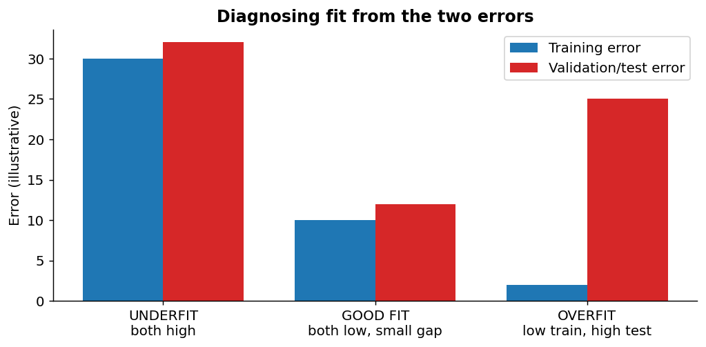

Two cautions from the slides:

* A complex model does **not necessarily** overfit, and a simple model does **not necessarily** underfit.
* The real issue is **generalization to new observations**, not complexity for its own sake.

**Why this matters for regularization:** a penalty is a *dial* that moves a model between the two failure modes. Too small a penalty → overfit (acts like OLS). Too large → underfit (all coefficients crushed towards zero). Cross-validation finds the sweet spot.

---

## 3. Why OLS Coefficients Become Unstable

**Business example:** a customer-value model with these predictors:

* annual spending, purchase frequency, number of transactions, loyalty points, website activity.

Several of these carry **similar information** (customers who transact a lot also have many loyalty points and high spend). This is **multicollinearity**. Consequences (from the slides):

* A small change in the training sample can produce **noticeably different coefficient estimates**.
* The **fitted values may remain similar** even while individual coefficients change a lot.

**Analogy: two people pulling a rope in the same direction.** The total force on the rope is clear (the prediction), but we cannot tell how much each person contributed. One may pull +50 and the other −48 and the sum is still +2; a slightly different sample gives +20 and −18. Nothing is wrong with the *sum*, but each individual number is meaningless.

**Simulation: bootstrapping two almost-identical predictors** (correlation ≈ 0.99). Each dot is the coefficient pair from one bootstrap resample of the same 60 customers:

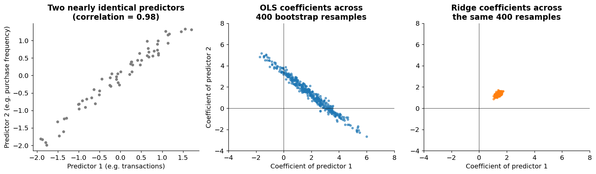

* **OLS (middle):** coefficient pairs form a long diagonal smear: the pair varies wildly (standard deviation ≈ 1.5 for each) but *along the line where their sum stays roughly constant*, which is why predictions are stable while coefficients are not.
* **Ridge (right):** the same resamples give a tight cluster (standard deviation ≈ 0.12): ridge is far less sensitive to which customers happened to be sampled.

> **Regularization can reduce this coefficient instability.**

---

## 4. From OLS and Subset Selection to Regularization

**OLS minimizes the residual sum of squares:**

$$RSS=\sum_{i=1}^{n}\Big(y_i-\beta_0-\sum_{j=1}^{p}\beta_j x_{ij}\Big)^2$$

OLS chooses coefficients **entirely from training fit**: nothing stops them from getting large.

| Approach | How complexity is controlled |
|---|---|
| **Subset selection** (Sessions 1–2) | A predictor is **in or out** (a yes/no decision) |
| **Regularization** | Coefficient **magnitudes** are constrained **continuously** |

**Analogy:** subset selection is a light **switch** (on/off); regularization is a **dimmer** (every predictor stays on, but the brightness is turned down, and with lasso the dimmer can reach zero).

> **Regularization accepts some bias in exchange for greater stability** (lower variance). That is the bias–variance trade-off from Session 1 again.

---

## 5. Ridge Regression

### 5.1 The objective

$$\underbrace{\sum_{i=1}^{n}\Big(y_i-\beta_0-\sum_{j=1}^{p}\beta_j x_{ij}\Big)^2}_{RSS:\ \text{fit the training data}} \;+\; \underbrace{\lambda\sum_{j=1}^{p}\beta_j^2}_{\text{penalize large coefficients}}$$

* **λ ≥ 0** is the **tuning parameter** (a hyperparameter, in the language of Sessions 1–2).
* The **intercept β₀ is normally not penalized** (it just sets the baseline level).
* **Larger λ → stronger shrinkage.**

### 5.2 What does λ do?

| λ | Effect |
|---|---|
| **λ = 0** | No penalty: ridge = OLS |
| **Very small λ** | Weak regularization, close to OLS |
| **Increasing λ** | Penalty on large coefficients grows: $\lambda\uparrow \Rightarrow \lvert\hat\beta_j\rvert\downarrow$ |
| **Very large λ** | Strong regularization: coefficients pushed close to (but not exactly) zero |

> **λ controls the amount of shrinkage.** Think of it as a **volume knob** for the penalty.

### 5.3 Worked example: the trade-off between fit and penalty

Take two candidate coefficient vectors with λ = 10:

| Candidate | RSS | Ridge penalty $10\sum\beta_j^2$ | **Total ridge objective** |
|---|---|---|---|
| A: β = (4, −3) | **40** (better fit) | 10 × (16 + 9) = 250 | 40 + 250 = **290** |
| B: β = (2, 1) | 50 | 10 × (4 + 1) = 50 | 50 + 50 = **100** ← wins |

Candidate A fits the training data better, but pays heavily for its large coefficients; B has a worse RSS but a far lower total. Ridge picks B-type solutions. (With a lasso penalty $10\sum|\beta_j|$: A = 40 + 70 = 110, B = 50 + 30 = 80, so B wins here too.)

### 5.4 Shrinkage and prediction (the slide's example)

| | X1 | X2 | X3 | X4 |
|---|---|---|---|---|
| OLS | 8.4 | −6.1 | 4.8 | 1.2 |
| Ridge | 5.7 | −4.0 | 3.3 | 0.8 |

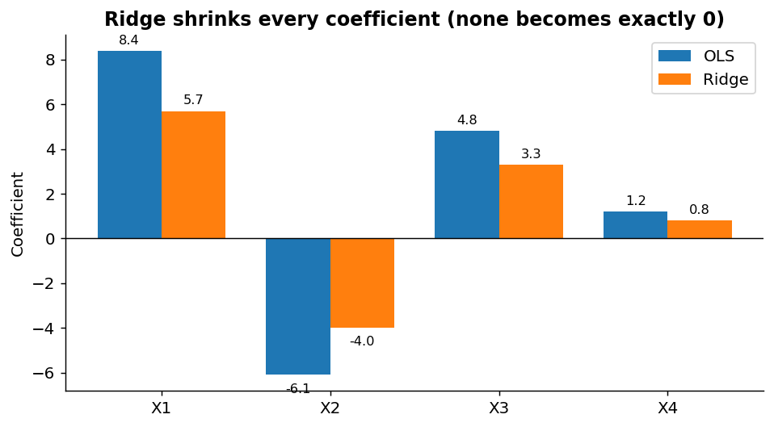

* Every coefficient is **smaller in magnitude** (each retains roughly two-thirds: 5.7/8.4 ≈ 0.68, 4.0/6.1 ≈ 0.66, 3.3/4.8 ≈ 0.69, 0.8/1.2 ≈ 0.67).
* Ridge generally **does not set coefficients exactly to zero**.
* Coefficients are estimated **jointly** under the penalty.
* Shrinkage makes estimates **less sensitive to the particular training sample**: the variance reduction can outweigh the extra bias.

> **Slightly worse training fit can produce better out-of-sample prediction.**

### 5.5 Seeing the bias–variance trade-off in ridge (simulation)

A simulation with 20 correlated predictors and only 40 training customers: the chart shows how bias², variance and total test error change with λ.

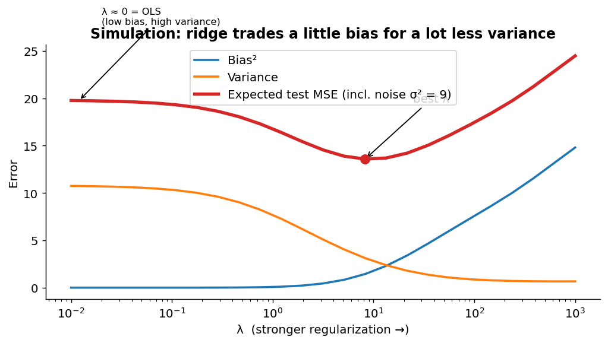

* At λ ≈ 0 (OLS) the model has almost **no bias but large variance**: expected test MSE ≈ 19.8.
* As λ rises, **bias² slowly increases** but **variance drops quickly**, so total error falls to a minimum ≈ 13.6 near λ ≈ 8 (the noise floor σ² = 9 can't be removed).
* Push λ too far and bias takes over: the model underfits.

### 5.6 Ridge and correlated predictors

**Business example (retailer):** predictors are *annual number of transactions*, *annual purchase frequency* and *number of active shopping days*, strongly correlated.

* **OLS** can give unstable or even counter-intuitive coefficients (e.g., a negative sign on "transactions") because the variables compete to explain the same variation.
* **Ridge** shrinks them **jointly** and tends to **retain information from all the correlated predictors**, sharing the credit among them.

> **Ridge is often useful when many related predictors each contain predictive signal.**

---

## 6. Why Standardization Matters

Ridge and lasso **penalize coefficient magnitudes**, but a coefficient's magnitude depends on the **units** of its predictor:

* income in **rupees** → a tiny coefficient per rupee (e.g., 0.000015),
* age in **years** → a moderate coefficient,
* transactions as **counts** → a larger coefficient.

The penalty would be nearly free for the big-unit variable and costly for the small-unit one, so shrinkage would depend on the *units chosen*, not on how useful the variables are. The fix is to **standardize** each predictor first:

$$z_{ij}=\frac{x_{ij}-\bar x_j}{s_j}$$

**Demonstration:** three predictors all having the *same* true effect on the outcome (in standardized terms):

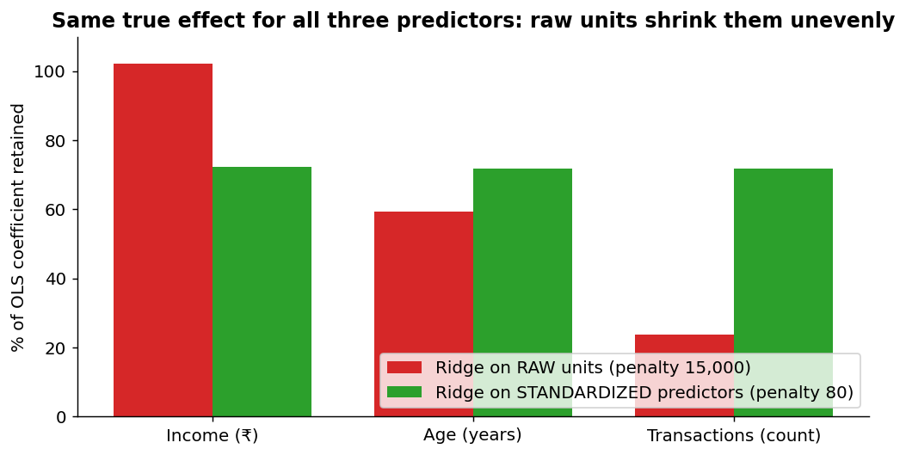

* On **raw units** the same penalty leaves income almost untouched (≈ 100% retained), shrinks age to ≈ 60% and transactions to ≈ 24%: shrinkage is *uneven for arbitrary, unit-based reasons*.
* On **standardized** predictors, all three shrink by the same ≈ 72%.

> **Regularization should normally operate on comparably scaled predictors.**
> `glmnet` standardizes predictors by default (and reports coefficients back on the original scale).

**Link to Sessions 1–2 (leakage):** the mean and standard deviation must be learned from the **training** data only. Inside CV that means within each training fold, which `glmnet`/`cv.glmnet` handles for you. If you standardize the full dataset yourself before splitting, you are leaking information.

---

## 7. Ridge in R (glmnet) with Cross-Validation

```r
library(ISLR2)
library(glmnet)
data(Hitters)
Hitters <- na.omit(Hitters)

x <- model.matrix(Salary ~ ., Hitters)[, -1]   # predictor matrix (dummies for factors, drop intercept column)
y <- Hitters$Salary

# Ridge uses alpha = 0
ridge_fit <- glmnet(x, y, alpha = 0)
plot(ridge_fit, xvar = "lambda", label = TRUE)

# Select lambda by 10-fold cross-validation
set.seed(123)
cv_ridge <- cv.glmnet(x, y, alpha = 0, nfolds = 10)
plot(cv_ridge)
cv_ridge$lambda.min
cv_ridge$lambda.1se
coef(cv_ridge, s = "lambda.min")
```

| Line | What it does |
|---|---|
| `model.matrix(...)[, -1]` | glmnet needs a numeric **matrix**, not a formula. This converts factors (League, Division, NewLeague) to 0/1 dummies and drops the intercept column |
| `alpha = 0` | **Ridge** (alpha = 1 is lasso; in between is elastic net) |
| `glmnet(x, y, alpha = 0)` | Fits ridge over a whole **sequence of λ values** (a "path") in one go |
| `plot(..., xvar = "lambda")` | **Coefficient path plot** |
| `set.seed(123)` | CV folds are random; fix the seed for reproducibility |
| `cv.glmnet(..., nfolds = 10)` | **10-fold CV over the λ sequence**; computes mean CV error and its standard error at each λ |
| `lambda.min` / `lambda.1se` | Two standard choices of λ (see [Section 13](#13-choosing-λ-lambdamin-vs-lambda1se)) |
| `coef(cv_ridge, s = "lambda.min")` | Coefficients at the chosen λ |

### 7.1 Reading the coefficient path

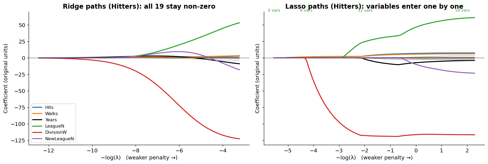
*(Re-created in Python from the real Hitters data, so it matches the slide's shape. Only a few variables are coloured.)*

**Left panel: ridge.**
* Far left (very large λ): all coefficients ≈ 0.
* Moving right (λ shrinking): coefficients **grow smoothly** towards their OLS values. A few (DivisionW, LeagueN) become large, while the rest stay close to zero.
* The **top axis in the slide shows "19" everywhere**: **ridge never removes a variable.** All 19 predictors stay in the model at every λ.

### 7.2 Reading the CV curve

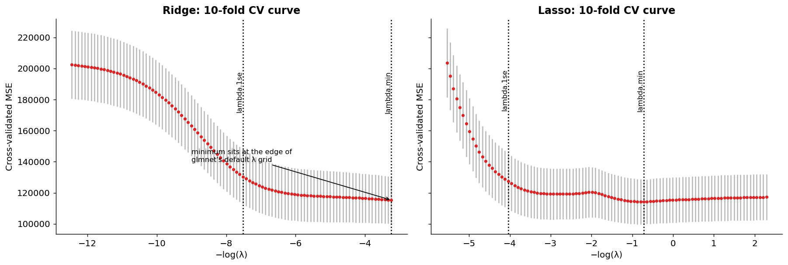
*(Re-created in Python: the details differ a little from the slide because the random folds differ.)*

* **Left side (huge λ):** CV error ≈ 200,000 (essentially the variance of Salary: the model predicts roughly the mean for everyone, i.e. **underfitting**).
* **Moving right:** error falls as the model is allowed to use the predictors.
* **Grey bars** = ± one standard error across folds. They are wide and overlap heavily, so many λ values are statistically similar (this is the idea behind `lambda.1se`).
* **Dotted lines** mark `lambda.1se` (left, stronger penalty) and `lambda.min` (right, lowest error).

### 7.3 The slide's output

| Quantity | Slide value |
|---|---|
| `lambda.min` | **25.53** |
| `lambda.1se` | **3880.06** |

* Ridge coefficients at `lambda.min` (examples): Hits +2.77, Walks +3.38, Years −9.07, LeagueN +53.2, **DivisionW −122.8**, NewLeagueN −18.1. **All 19 are non-zero**, just shrunk.
* Notice that `lambda.min` and `lambda.1se` are far apart (≈ 25 vs ≈ 3,900): the CV curve is **very flat** near its minimum, so a much stronger penalty performs almost as well.
* ⚠️ `lambda.min` = 25.53 is exactly the **smallest λ in glmnet's default grid** (the right-hand edge of the plot), which means the CV curve was still flat or falling when the grid ended. See [Section 21](#21-things-to-watch-for-in-the-slides-and-r-output).

---

## 8. Lasso Regression

**LASSO** = *Least Absolute Shrinkage and Selection Operator*.

$$\sum_{i=1}^{n}\Big(y_i-\beta_0-\sum_{j=1}^{p}\beta_j x_{ij}\Big)^2+\lambda\sum_{j=1}^{p}\lvert\beta_j\rvert$$

| | Ridge penalty | Lasso penalty |
|---|---|---|
| Formula | $\lambda\sum\beta_j^2$ | $\lambda\sum\lvert\beta_j\rvert$ |
| Name | L2 (squared) | L1 (absolute value) |

* Both methods **shrink** coefficients.
* **Lasso can also make some coefficients exactly zero.**

### 8.1 Lasso as variable selection (slide example)

| | OLS | Lasso |
|---|---|---|
| X1 | 5.8 | 4.2 |
| X2 | 3.1 | 1.9 |
| X3 | 1.2 | **0** |
| X4 | −0.7 | **0** |
| X5 | 4.4 | 3.1 |

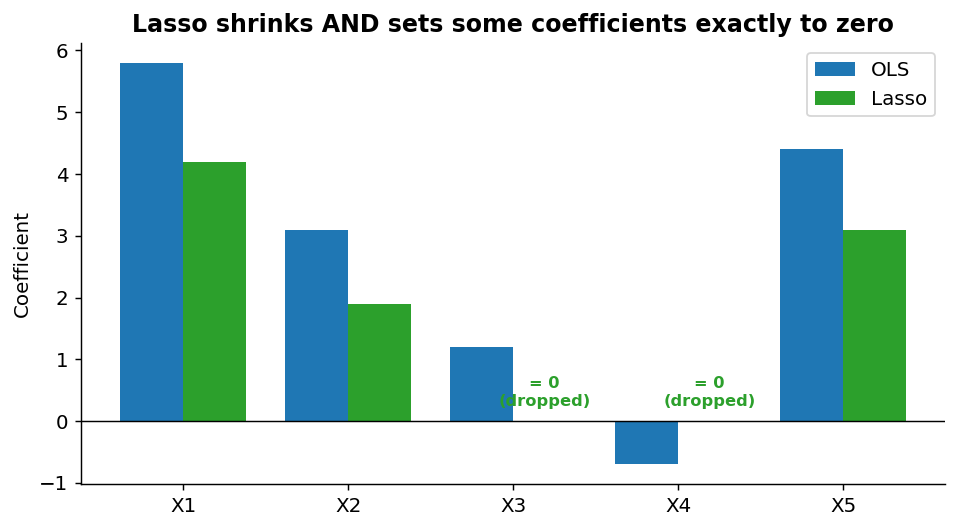

* When $\hat\beta_j = 0$, the predictor is **excluded** from the fitted model.
* X3 and X4 (the weakest predictors) are dropped; X1, X2, X5 survive but are **shrunk** (5.8 → 4.2).
* Result: a **compact model of 3 predictors** instead of 5.

> **Lasso performs shrinkage and can also perform variable selection.**

**Analogy.** Ridge is a **volume knob** on every instrument in an orchestra: all play, but quieter. Lasso also has a **mute button**: weak instruments are switched off entirely.

### 8.2 A neat closed form (orthonormal predictors)

When predictors are uncorrelated and scaled so that $X^\top X = I$, both estimators can be written directly from the OLS estimate $\hat\beta^{OLS}$ (using the ISLR form of the objective, RSS + penalty):

| Method | Solution |
|---|---|
| Ridge | $\hat\beta^{R}=\dfrac{\hat\beta^{OLS}}{1+\lambda}$ (shrink by a **constant fraction**) |
| Lasso | $\hat\beta^{L}=\text{sign}(\hat\beta^{OLS})\,\big(\lvert\hat\beta^{OLS}\rvert-\lambda/2\big)_+$ (**subtract a constant**, floor at 0: "soft-thresholding") |

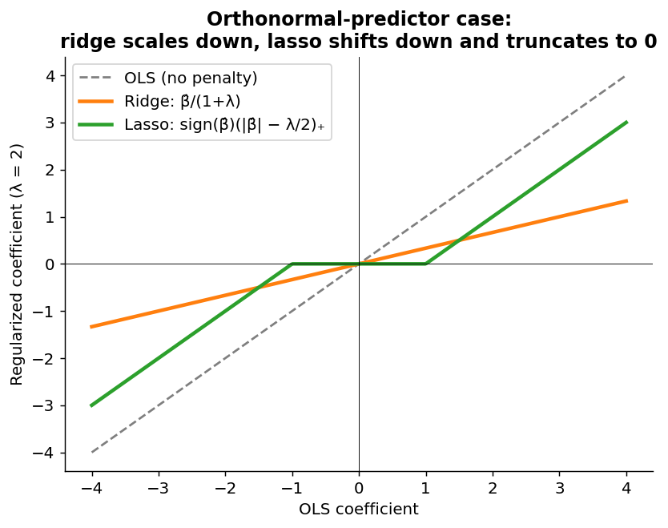

**Worked numbers with λ = 2:**

| OLS coefficient | Ridge (÷ 3) | Lasso (subtract 1, floor at 0) |
|---|---|---|
| 3.0 | 1.00 | **2.0** |
| 1.2 | 0.40 | **0.2** |
| 0.9 | 0.30 | **0** (dropped) |
| 0.4 | 0.13 | **0** (dropped) |

Ridge only ever **scales down**; lasso **pulls down by a fixed amount** and any coefficient smaller than the threshold lands exactly on zero. (This tidy formula is exact only for orthonormal predictors, but it captures the behaviour.)

---

## 9. Why Does Lasso Produce Exact Zeros? (Geometry)

Penalized regression can be rewritten as: **minimize RSS subject to a budget on the coefficients**:

* Ridge: $\sum\beta_j^2 \le s$ (a **circle**/sphere in two predictors).
* Lasso: $\sum\lvert\beta_j\rvert \le s$ (a **diamond** with **corners on the axes**).

The red ellipses are **contours of RSS** (all points on one ellipse fit the training data equally well). OLS sits at the centre of the ellipses. Starting from there, we expand the ellipses until they **first touch** the constraint region: that touching point is the regularized solution.

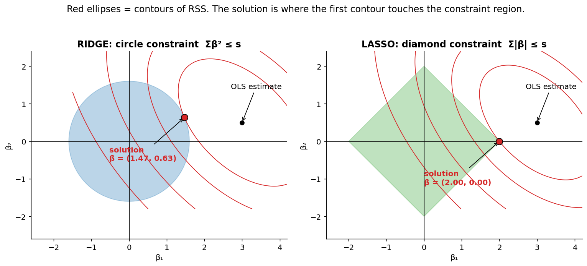

* **Ridge (left):** the circle is smooth, so the first touch is almost always at a point where **both** coordinates are non-zero: small but non-zero coefficients.
* **Lasso (right):** the diamond has **sharp corners on the axes**. Ellipses tend to hit a corner first, and at a corner one coefficient (here β₂) is **exactly zero**.

(In the chart the OLS point is (3, 0.5); ridge ends at ≈ (1.47, 0.63) while lasso ends at the corner (2, 0).)

```
Ridge  ⇒ shrinkage
Lasso  ⇒ shrinkage + possible exact zeros
```

---

## 10. Ridge and Lasso Compared

| | Ridge | Lasso |
|---|---|---|
| Penalty | $\sum\beta_j^2$ (L2) | $\sum\lvert\beta_j\rvert$ (L1) |
| Shrinks coefficients | Yes | Yes |
| Exact zeros | **Usually no** | **Yes** |
| Variable selection | No | Yes |
| Resulting model | Usually **dense** | Can be **sparse** |
| Correlated predictors | Often **retains related predictors** (shares the credit) | May **select among** related predictors (keeps one, drops the rest) |

> **Neither method universally dominates the other.**

### 10.1 A caution about lasso's selections

Suppose *app sessions*, *app minutes* and *app page views* are strongly correlated. Lasso may keep one of them and shrink the others to zero. On a **different training sample** it may keep a **different** member of the group.

$$\hat\beta_j = 0 \;\not\Rightarrow\; X_j \text{ has no business relevance}$$

* Lasso performs **predictive** variable selection: "this variable adds little *given the others kept*".
* It does **not** establish **causal** importance. The dropped variables may be just as meaningful as the retained one.
* Selections can be **unstable** across samples, so don't build business stories on which exact variable "won".

**Analogy:** three equally qualified candidates apply for one job. Lasso hires one; a different day's interview might hire another. That doesn't mean the other two had no skills.

---

## 11. Lasso in R

```r
# Lasso uses alpha = 1
lasso_fit <- glmnet(x, y, alpha = 1)
plot(lasso_fit, xvar = "lambda", label = TRUE)

set.seed(123)
cv_lasso <- cv.glmnet(x, y, alpha = 1, nfolds = 10)
plot(cv_lasso)

# Coefficients at the selected lambda
lasso_coef <- coef(cv_lasso, s = "lambda.min")
lasso_coef

# Retained predictors only
lasso_coef_mat <- as.matrix(lasso_coef)
nonzero <- lasso_coef_mat[lasso_coef_mat[, 1] != 0, , drop = FALSE]
nonzero
```

* A "`.`" in the printed sparse matrix means the coefficient is **exactly zero**.
* `as.matrix(...)` converts the sparse matrix so we can filter; `!= 0` keeps only the retained predictors.
* **Changing λ changes both the shrinkage and the number of retained predictors.**

### 11.1 Reading the lasso paths

(Right panel of the path figure in [Section 7.1](#71-reading-the-coefficient-path).)

* At the far left (huge λ) **every coefficient is zero**: the model is intercept-only.
* As λ falls, variables **enter one by one**. A few performance variables (e.g., Hits, Walks) enter first with small coefficients; DivisionW enters soon after and quickly becomes the largest; weak variables enter late.
* The **top axis of the slide plot counts non-zero coefficients**, going from 0 up to 19. Compare ridge, where it always reads 19.

### 11.2 The slide's lasso output at `lambda.min`

Zero (`.`): **HmRun, Runs, RBI, CAtBat, CHits, NewLeagueN** (6 dropped).

Retained (13 predictors):

| Predictor | Coefficient | Predictor | Coefficient |
|---|---|---|---|
| AtBat | −1.547 | CWalks | −0.529 |
| Hits | 5.661 | LeagueN | 32.065 |
| Walks | 4.730 | **DivisionW** | **−119.299** |
| Years | −9.596 | PutOuts | 0.272 |
| CHmRun | 0.511 | Assists | 0.173 |
| CRuns | 0.659 | Errors | −2.059 |
| CRBI | 0.393 | (Intercept) | 123.75 |

**Business-style reading** (treating "Salary ~ performance stats" as "customer value ~ activity measures"): the lasso keeps a 13-variable scoring formula instead of 19, and each retained coefficient is a little smaller than its OLS value. Note that the biggest single effect by far is a categorical split (DivisionW, −119): a segment indicator dominating the numeric measures is common in customer data too.

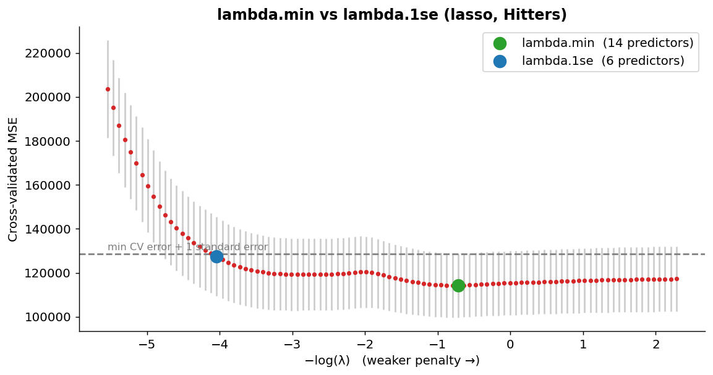

---

## 12. Elastic Net

Elastic net **combines the two penalties**:

$$RSS+\lambda\Big[\alpha\sum_{j=1}^{p}\lvert\beta_j\rvert+(1-\alpha)\sum_{j=1}^{p}\beta_j^2\Big]$$

* **λ** controls the **overall amount** of regularization.
* **α** controls the **mixture** (ridge ↔ lasso):

$$\alpha=1\Rightarrow\text{lasso}\qquad\alpha=0\Rightarrow\text{ridge}$$

* Intermediate α blends them.
* ⚠️ **Software conventions differ.** In `glmnet` the ridge part is $(1-\alpha)\tfrac12\sum\beta_j^2$ and RSS is divided by $2n$. The *behaviour* (α = 0 ridge, α = 1 lasso) is identical; only the numerical scaling of λ changes.

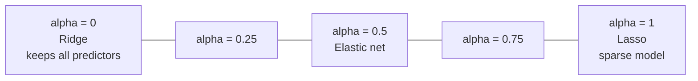

### 12.1 Why elastic net?

* Business data often have **groups of strongly related predictors**.
* **Pure lasso** may select only one member of each group (unstable).
* **Pure ridge** keeps everything and creates **no sparsity**.
* **Elastic net** gives an intermediate option: it tends to keep or drop **correlated groups together** while still allowing some zeros.

### 12.2 Two tuning parameters

* **λ**: overall amount of regularization.
* **α**: ridge–lasso mixture, e.g. α ∈ {0, 0.25, 0.50, 0.75, 1}.

**Procedure:** for each α, use cross-validation to pick the best λ; then pick the (α, λ) pair with the best validation performance.

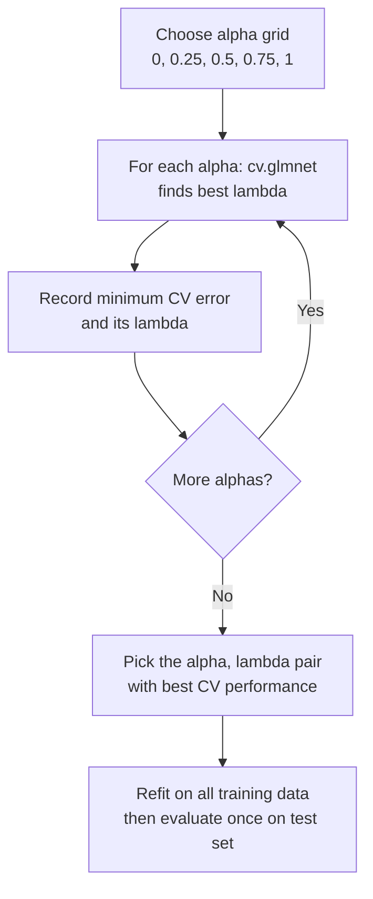

### 12.3 Elastic net in R

```r
alpha_grid <- c(0, 0.25, 0.50, 0.75, 1)
cv_error <- numeric(length(alpha_grid))
best_lambda <- numeric(length(alpha_grid))

set.seed(123)
for (i in seq_along(alpha_grid)) {
  fit <- cv.glmnet(x, y, alpha = alpha_grid[i], nfolds = 10)
  cv_error[i]    <- min(fit$cvm)          # lowest CV MSE across lambda
  best_lambda[i] <- fit$lambda.min
}
data.frame(alpha = alpha_grid, CV_MSE = cv_error, lambda = best_lambda)
```

**Slide output**

| α | CV MSE | λ (lambda.min) |
|---|---|---|
| 0.00 (ridge) | 113,127.2 | 25.528 |
| 0.25 | 116,484.0 | 2.650 |
| 0.50 | 119,929.8 | 4.046 |
| **0.75** | **112,291.7** | 3.249 |
| 1.00 (lasso) | 119,378.1 | 0.727 |

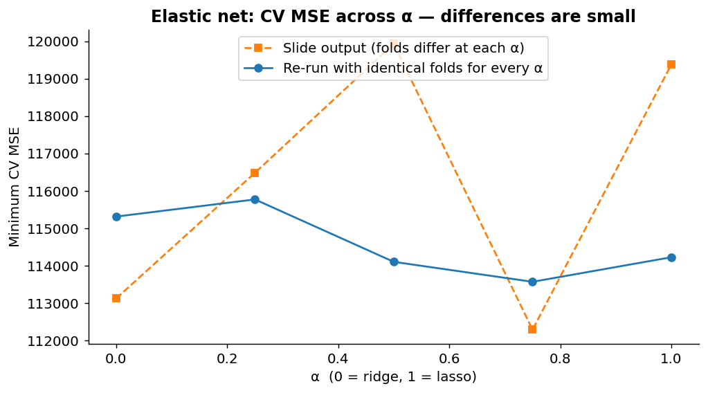

**How to read it**

* α = 0.75 has the lowest CV MSE (112,292) and α = 0.5 the highest (119,930). That is a spread of only about 7%.
* ⚠️ **Those differences are well inside the noise.** The CV standard errors in the slide plots are on the order of tens of thousands, so *no α is clearly better*. In the re-run with **identical folds for every α**, all five values land within about 2% of each other (≈ 113,600–115,800, with a standard error ≈ 14,000–15,000).
* So the honest conclusion: *for this dataset, ridge, lasso and elastic net predict about equally well; choose by business needs (sparsity, interpretability, stability).*
* In the slide's loop each `cv.glmnet` call draws **new random folds** (the seed is set once, before the loop), which adds extra noise to the comparison. For a clean comparison, fix the folds with `foldid` (see [Section 21](#21-things-to-watch-for-in-the-slides-and-r-output)).

---

## 13. Choosing λ: `lambda.min` and `lambda.1se`

`cv.glmnet()` reports two commonly used choices.

| | `lambda.min` | `lambda.1se` |
|---|---|---|
| Definition | λ with the **minimum** estimated CV error | **Largest** λ whose CV error is within **one standard error** of the minimum |
| Targets | Best estimated predictive performance | A simpler model with **statistically similar** performance |
| Regularization | Weaker | **Stronger** |
| For lasso | More predictors | Often a **sparser** model |


**Reading the chart (lasso on Hitters, re-created):**

* Green point = `lambda.min`: lowest CV error, **about 14 predictors** retained.
* Blue point = `lambda.1se`: the strongest penalty still under the dashed "min + 1 SE" line, and it keeps **only 6 predictors** (Hits, Walks, CRuns, CRBI, DivisionW, PutOuts).
* The CV error is nearly the same for both, but the second model is far smaller.

> **A slightly simpler model may have statistically similar CV performance.**

**Analogy.** Two restaurants have almost identical ratings (4.6 vs 4.5, with review noise of ±0.2). Pick the cheaper one. `lambda.1se` is that **"cheaper, practically as good"** choice.

**Rule of thumb:** use `lambda.min` when pure prediction accuracy is the goal; use `lambda.1se` when simplicity, stability, or interpretability matter (e.g., a model that front-line staff must use).

---

## 14. Choosing Among Ridge, Lasso and Elastic Net

| Situation | Reasonable starting point |
|---|---|
| Many predictors appear to contain useful signal | **Ridge** |
| Strongly correlated predictors | **Ridge or elastic net** |
| Many predictors may be unnecessary | **Lasso** |
| A compact operational model is valuable | **Lasso** |
| Correlated predictors **and** sparsity both matter | **Elastic net** |
| Prediction is the primary objective | **Compare methods using the same CV design** |

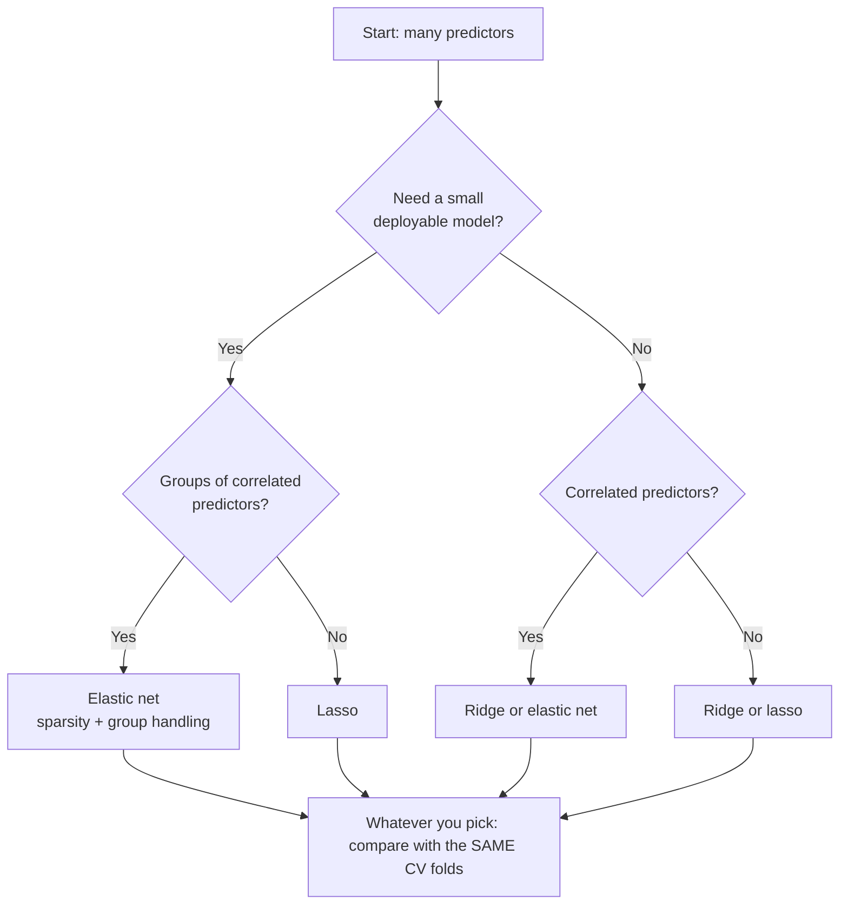

> **The preferred method should be supported by validation evidence.** The table is a *starting point*, not a rule.

---

## 15. Business Cases

### 15.1 Customer value prediction (retailer)

A retailer has **40 customer variables** across category-level spending, purchase frequency, store visits, app usage, coupon use, loyalty activity and service interactions.

| Business situation | Leaning |
|---|---|
| Many variables each contain useful information | **Ridge** |
| Company needs a **smaller operational scoring model** (fewer data feeds to maintain) | **Lasso** |
| Both | **Elastic net** |

* Whichever method is chosen, compare predictive performance **using the same validation procedure**.
* **Business requirements can affect the preferred regularization method**: every extra variable costs data collection, maintenance and explanation.

### 15.2 Bank credit-loss model comparison

A bank predicts **annual customer credit loss**:

| Model | CV RMSE | Non-zero predictors | Interpretation |
|---|---|---|---|
| OLS | 18.7 | 20 | Baseline model |
| Ridge | **16.2** | 20 | Best estimated prediction |
| Lasso | 16.5 | **8** | Compact model |
| Elastic net | 16.3 | 12 | Intermediate solution |

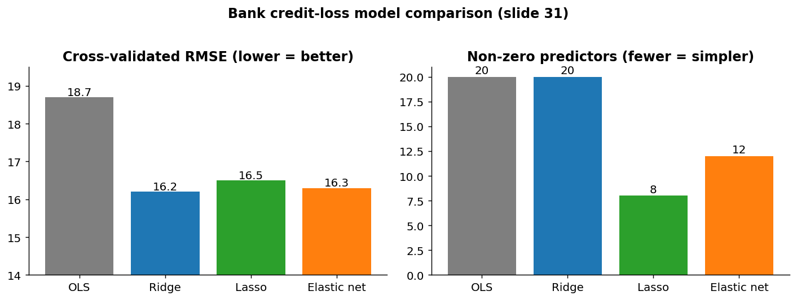

**Quantified reading (worked):**

* All three regularized models beat OLS: RMSE falls from 18.7 to 16.2 (ridge) = **13.4% better**, to 16.3 (elastic net) = 12.8%, to 16.5 (lasso) = 11.8%.
* Ridge is best on RMSE, but lasso is only **0.3 worse (about 1.9%)** while using **8 of 20 predictors (60% fewer)**.
* Elastic net sits in between: 16.3 with 12 predictors.

**Decision factors beyond RMSE** (from the slide): deployment cost, stability, interpretability, and data availability. For instance, a bank might choose the **lasso** if each additional variable requires an expensive data purchase or a regulator-facing explanation; it might pick **ridge** if its data feeds already exist and accuracy is paramount.

---

## 16. The Regularized Model Development Workflow

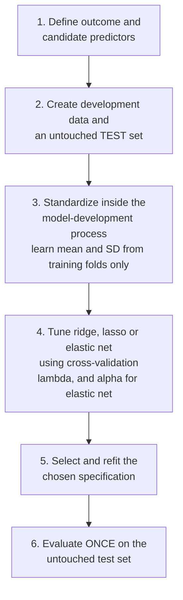

**Key takeaways**

* **Ridge** uses an **L2** penalty and generally **retains all predictors**.
* **Lasso** uses an **L1** penalty and can set coefficients **exactly to zero**.
* **Elastic net** **combines** ridge and lasso behaviour.
* Regularization can improve generalization **even when training fit worsens**.
* The final model should balance **predictive reliability** with **business requirements**.

---

## 17. Python Equivalent

The course uses R/Python. This is the scikit-learn version of the three `glmnet` fits. The `Pipeline` re-learns the scaling inside every CV fold (leakage-safe).

```python
import numpy as np
from sklearn.pipeline import make_pipeline
from sklearn.preprocessing import StandardScaler
from sklearn.linear_model import RidgeCV, LassoCV, ElasticNetCV
from sklearn.model_selection import KFold

cv = KFold(n_splits=10, shuffle=True, random_state=123)   # same folds for every model

ridge = make_pipeline(StandardScaler(),
                      RidgeCV(alphas=np.logspace(-2, 4, 100), cv=cv))
lasso = make_pipeline(StandardScaler(),
                      LassoCV(cv=cv, max_iter=100000))
enet  = make_pipeline(StandardScaler(),
                      ElasticNetCV(l1_ratio=[0.25, 0.5, 0.75], cv=cv, max_iter=100000))

for name, model in [("ridge", ridge), ("lasso", lasso), ("enet", enet)]:
    model.fit(X_train, y_train)
    print(name, model[-1].alpha_ if hasattr(model[-1], "alpha_") else None)

# Coefficients that lasso kept
coefs = lasso[-1].coef_
print("non-zero predictors:", np.sum(coefs != 0))
```

**Vocabulary translation**

| R `glmnet` | Python scikit-learn |
|---|---|
| `lambda` (penalty strength) | `alpha` |
| `alpha` (mixing, 0 = ridge, 1 = lasso) | `l1_ratio` |

(The ridge λ in glmnet and `alpha` in scikit-learn are on slightly different numerical scales, so the numbers will not match one-to-one.)

---

## 18. Cheat Sheet

| Concept | One-liner |
|---|---|
| OLS | Minimizes RSS only; unstable with many/correlated predictors |
| Regularization | RSS **+ penalty** on coefficient size; trades bias for lower variance |
| Ridge | L2 penalty $\lambda\sum\beta^2$; shrinks, keeps all predictors |
| Lasso | L1 penalty $\lambda\sum\lvert\beta\rvert$; shrinks **and** zeros some |
| Elastic net | Mix of L1 and L2; α = mixture, λ = strength |
| λ = 0 | Same as OLS |
| λ → very large | All coefficients → 0 (intercept-only model) |
| α = 0 / α = 1 | Ridge / Lasso |
| Intercept | Not penalized |
| Standardize | Yes, before ridge/lasso (glmnet does it by default) |
| Why lasso gives zeros | Diamond constraint has corners on the axes |
| Ridge with correlated predictors | Shares credit among them |
| Lasso with correlated predictors | Picks one (may change by sample) |
| $\hat\beta_j=0$ | Not the same as "unimportant" or "no causal effect" |
| `lambda.min` | Lowest CV error |
| `lambda.1se` | Largest λ within 1 SE of the minimum: simpler, stronger regularization |
| Final step | Refit, then evaluate **once** on the untouched test set |

**Top mistakes to avoid**
1. Forgetting to standardize predictors (or standardizing before splitting).
2. Reading lasso zeros as "no business relevance" or as causal conclusions.
3. Choosing λ using the test set.
4. Comparing ridge, lasso and elastic net on different CV folds.
5. Declaring a "winner" when CV differences are smaller than their standard errors.
6. Letting the λ grid end right at the best value without checking beyond it.

---

## 19. Practice Questions with Answers

**Q1.** State the ridge objective and say what happens when λ = 0 and when λ → ∞.
**A.** Ridge minimizes $RSS+\lambda\sum_{j}\beta_j^2$. At λ = 0 it is OLS. As λ → ∞ the penalty dominates and all slope coefficients → 0 (never exactly zero for finite λ), leaving the intercept-only model.

**Q2.** Compute the ridge objective (λ = 5) for β = (3, −1) with RSS = 20, and the lasso objective for the same β.
**A.** Ridge: 20 + 5(9 + 1) = **70**. Lasso: 20 + 5(3 + 1) = **40**.

**Q3.** OLS gives (6.0, −4.5, 3.0) and ridge gives (4.2, −3.15, 2.1). What fraction of each coefficient is retained, and what does this pattern suggest?
**A.** 4.2/6.0 = 0.70, 3.15/4.5 = 0.70, 2.1/3.0 = 0.70. All shrunk by about 30%, uniform shrinkage with no zeros: a ridge-type result.

**Q4.** Why is it wrong to run ridge on income (₹) and age (years) without standardizing?
**A.** The coefficient size depends on units: income per rupee is tiny, so its penalty is almost free, while age is penalized heavily. Shrinkage then reflects measurement units, not usefulness. Standardizing puts predictors on a common scale. (Do it within training folds to avoid leakage.)

**Q5.** Why can lasso set coefficients to exactly zero but ridge cannot?
**A.** The L1 constraint region (diamond) has corners on the axes, where the RSS contours often first touch it, making one coefficient zero. The L2 region (circle) is smooth, so the touching point rarely lies on an axis.

**Q6.** For orthonormal predictors and λ = 4 (ISLR form), find the ridge and lasso estimates when the OLS estimate is 5 and when it is 1.5.
**A.** Ridge: 5/(1+4) = **1.0** and 1.5/5 = **0.3**. Lasso: threshold λ/2 = 2, so 5 → 5 − 2 = **3.0** and 1.5 → max(1.5 − 2, 0) = **0**.

**Q7.** Three predictors (app sessions, app minutes, page views) are almost perfectly correlated. Compare the behaviour of OLS, ridge and lasso.
**A.** OLS: unstable, possibly opposite-signed large coefficients that change from sample to sample. Ridge: shrinks all three and spreads the effect among them. Lasso: tends to keep one and zero out the others, and the retained one may change with the sample. Elastic net would tend to keep or drop them together.

**Q8.** Lasso sets the coefficient of "complaints" to zero. A manager concludes "complaints don't affect churn". Respond.
**A.** Not justified. A zero coefficient only says that, *given the other retained variables*, complaints added little predictive value. It may be correlated with a retained variable, and lasso does not establish causal importance. Selection may also differ in another sample.

**Q9.** Explain `lambda.min` and `lambda.1se`. When would you choose each?
**A.** `lambda.min` = λ with the lowest CV error (best predictive estimate). `lambda.1se` = the largest λ whose CV error is within one standard error of the minimum (stronger regularization, simpler model, statistically similar performance). Choose `lambda.min` when accuracy is paramount, and `lambda.1se` when simplicity, stability or interpretability matter.

**Q10.** In elastic net with the grid α ∈ {0, 0.25, 0.5, 0.75, 1}, how many CV runs (calls to `cv.glmnet`) are needed, and what are they selecting?
**A.** Five calls, one per α. Each uses CV to select the best λ for that α (over a whole λ sequence); then the (α, λ) pair with the best CV performance is chosen.

**Q11.** Using the bank table (OLS 18.7/20, ridge 16.2/20, lasso 16.5/8, elastic net 16.3/12), recommend a model for a bank that must justify its predictors to a regulator and pays per data feed.
**A.** Lasso: only 0.3 RMSE worse than ridge (≈ 1.9%) but 60% fewer predictors, so cheaper and easier to explain. If the regulator is comfortable with larger models and data is free, ridge gives the best estimated accuracy; elastic net is a compromise. Confirm with the same CV folds and check the differences against standard errors.

**Q12.** Compute the elastic net penalty (slide's formula) for β = (2, −1, 0) with λ = 2 and α = 0.5.
**A.** $\lambda[\alpha\sum|\beta_j|+(1-\alpha)\sum\beta_j^2] = 2[0.5(3)+0.5(5)] = 2[1.5+2.5]=$ **8**. (In glmnet's convention, with the extra ½ on the ridge part: 2[1.5 + 0.25 × 5] = 5.5.)

**Q13.** Training error of a regularized model is higher than that of OLS. Does that mean it's worse?
**A.** No. Training error always favours the unpenalized fit. What matters is validation/test error: regularization often gives higher training error but lower out-of-sample error.

---

## 20. Glossary

| Term | Meaning |
|---|---|
| **Regularization / shrinkage** | Penalizing coefficient size to improve generalization |
| **Penalty term** | The extra cost added to RSS for large coefficients |
| **L2 penalty** | Sum of squared coefficients (ridge) |
| **L1 penalty** | Sum of absolute coefficients (lasso) |
| **λ (lambda)** | Penalty strength (tuning parameter) |
| **α (alpha)** | Elastic-net mixing parameter: 0 = ridge, 1 = lasso |
| **Multicollinearity** | Predictors strongly correlated with each other |
| **Sparse model** | A model in which many coefficients are exactly zero |
| **Dense model** | A model using all (or nearly all) predictors |
| **Soft-thresholding** | Lasso's operation: subtract a constant and floor at zero |
| **Coefficient path** | Plot of coefficients as λ varies |
| **Standardization** | Rescaling each predictor to mean 0, SD 1 |
| **`lambda.min`** | λ with the lowest CV error |
| **`lambda.1se`** | Largest λ within one standard error of the best CV error |
| **Overfitting** | Low training error but much higher validation/test error |
| **Underfitting** | High training and high validation/test error |
| **Generalization** | Performance on new, unseen observations |

---

## 21. Things to Watch for in the Slides and R Output

These are observations for your own understanding. They may be worth raising in class.

1. **Ridge `lambda.min` sits on the edge of the λ grid.** The slide reports `lambda.min` = 25.53. In my Python re-creation of glmnet's default sequence, 25.53 is exactly the *smallest* λ in the grid, which means the search stopped before the CV curve turned up. Extending the grid to smaller λ (e.g., `lambda = 10^seq(5, -2, length = 100)`) would show whether a smaller λ is better. In my re-run the best λ on an extended grid was ≈ 4, with CV error only ~2% lower, so the conclusion hardly changes, but the habit of checking matters.
2. **Elastic net loop uses different folds for each α.** `set.seed(123)` is called once *before* the loop, so each `cv.glmnet` call draws new random folds. Differences between α values therefore mix real differences with fold luck. Better: create `foldid <- sample(rep(1:10, length.out = nrow(x)))` once and pass `foldid = foldid` to every call.
3. **`lambda.min` is itself noisy.** The lasso fit earlier in the slides (`cv_lasso`) and the α = 1 row in the elastic-net table (λ = 0.727) are both lasso with 10-fold CV but give visibly different λ values, because they used different random folds. The CV curve is flat near its minimum, so the exact λ chosen is not very stable.
4. **Elastic-net penalty scaling.** The slide's formula puts $(1-\alpha)\sum\beta_j^2$; glmnet actually uses $(1-\alpha)\tfrac12\sum\beta_j^2$ (and RSS/2n), as the slide hints with "different packages may use slightly different scaling conventions".
5. **Coefficient-path axis label.** The slide's x-axis is labelled **−Log(λ)**, so **right = weaker penalty** (λ smaller). That matches the plots (coefficients ≈ 0 on the far left).
6. **Figures in these notes.** Figures 01, 02 and 13 use the slide's numbers. Figures 08, 09 and 10 are **re-created in Python from the actual Hitters data** using glmnet's conventions (so shapes match the slides, but exact values differ slightly because the random folds differ). Figure 11 overlays the slide's table with an identical-folds re-run. Figures 03–07 and 12 are simulations or conceptual illustrations built for these notes (numbers quoted in the text come from those simulations).

---

*Notes prepared from the Course Outline (AY 2026-27) and the "AMLBT Lectures 3–5" slides (draft dated 2026-09-27). Slide wording may still change since the deck is marked "Draft".*
