# Sessions 6–10 — Tree-Based Methods: Decision Trees, Pruning, Bagging, Random Forests, Boosting & Gradient Boosting

**Course:** Advanced Machine Learning in Business Transformation (BDA/IDA, Term II, AY 2026-27)
**Faculty:** Dr. S. Sanyal  |  **Mode:** Offline/Online  |  **CLO covered:** CLO 3 — *Analyze tree-based machine learning methods, including decision trees and ensemble approaches, for solving classification and prediction problems in business contexts* (Bloom Level 4: Analyze)
**Suggested reading:** ISLR Ch. 8 (decision trees, bagging, random forests, boosting). *Gradient boosting with general loss functions goes a little beyond ISLR; Hastie–Tibshirani–Friedman, "Elements of Statistical Learning", Ch. 10, is the usual deeper reference.*
**Builds on:** [Sessions 1–2 — Model selection](../session-01-02-model-selection/notes.md) (bias–variance, CV, leakage) and [Sessions 3–5 — Regularization](../session-03-05-regularization/notes.md) (penalties, tuning by CV). Trees reuse all of these ideas: pruning is a penalty, ensembles are variance control, and every tuning parameter is chosen by CV or OOB error.

---

## Table of Contents

1. [The Big Picture](#1-the-big-picture)
2. [Why Trees Are Useful in Business](#2-why-trees-are-useful-in-business)
3. [A Tree as a Set of Decision Rules](#3-a-tree-as-a-set-of-decision-rules)
4. [Regression Trees](#4-regression-trees)
5. [Classification Trees](#5-classification-trees)
6. [Overfitting, Complexity and Pruning](#6-overfitting-complexity-and-pruning)
7. [Trees in R: Hitters and Carseats](#7-trees-in-r-hitters-and-carseats)
8. [Strengths and Weaknesses of a Single Tree](#8-strengths-and-weaknesses-of-a-single-tree)
9. [Why Average Many Trees? Bagging](#9-why-average-many-trees-bagging)
10. [Random Forests](#10-random-forests)
11. [Why Averaging Reduces Variance (the Maths)](#11-why-averaging-reduces-variance-the-maths)
12. [Boosting](#12-boosting)
13. [Gradient Boosting](#13-gradient-boosting)
14. [Boosting in R (gbm)](#14-boosting-in-r-gbm)
15. [Comparing and Choosing Tree-Based Methods](#15-comparing-and-choosing-tree-based-methods)
16. [Business Cases](#16-business-cases)
17. [The Model-Development Workflow](#17-the-model-development-workflow)
18. [Python Equivalents](#18-python-equivalents)
19. [Cheat Sheet](#19-cheat-sheet)
20. [Practice Questions with Answers](#20-practice-questions-with-answers)
21. [Glossary](#21-glossary)
22. [Things to Watch for in the Slides and R Output](#22-things-to-watch-for-in-the-slides-and-r-output)

---

## 1. The Big Picture

**Tree-based methods predict an outcome by repeatedly splitting the predictor space into smaller regions.** Each region gets one prediction. Used for:

* regression (numeric outcome) and classification (categorical outcome),
* customer and market segmentation,
* managerial decision support.

> **Trees convert predictor values into a sequence of decision rules.**

**Analogy: the game of "20 Questions".** To guess an object you ask a chain of yes/no questions, each chosen to narrow the possibilities as much as possible. A tree is a 20-Questions strategy learned from data: *"Tenure under 12 months? Yes → Complaints at least 3? Yes → likely to churn."*

**The family in this chapter**

| Method | One-line idea |
|---|---|
| **Decision tree** | One tree of yes/no rules |
| **Pruned tree** | A single tree trimmed to a sensible size |
| **Bagging** | Average many trees fitted to bootstrap samples |
| **Random forest** | Bagging, but each split sees only a random subset of predictors |
| **Boosting** | Build small trees one after another, each correcting the last |
| **Gradient boosting** | Boosting generalised to any loss function |

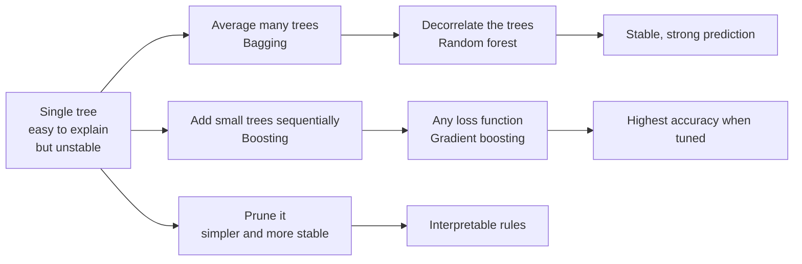

**Bias–variance map (ties back to Sessions 1–2)**

| Model | Typical problem | How it is addressed |
|---|---|---|
| Deep single tree | Low bias, **high variance** (overfits) | Prune it (penalty), or average many trees |
| Bagging | Variance falls through averaging | Trees stay deep |
| Random forest | Same, plus lower correlation between trees | Random predictor subset per split |
| Boosting | Starts with high bias (shallow trees), reduces it **gradually** | Learning rate, depth and number of trees tuned by CV |

---

## 2. Why Trees Are Useful in Business

* Trees capture **nonlinear relationships** without you specifying a functional form in advance.
* They **naturally capture interactions** (e.g., complaints matter *only for short-tenure customers*).
* A single tree is **easy to communicate** to managers: it reads like a policy flowchart.
* **Terminal nodes can be interpreted as business segments.**

**Examples:** customer churn, credit risk, sales prediction, response to marketing campaigns, store performance, service prioritisation.

> **A tree can support both prediction and interpretable decision rules.**

**Contrast with linear regression:** a linear model says "each extra complaint adds the same amount of churn risk to everyone". A tree can say "complaints barely matter for loyal customers but are decisive for new ones", with no interaction term written by you.

---

## 3. A Tree as a Set of Decision Rules

**Churn example.** Predictors: Tenure, Complaints, MonthlySpend. A tree might use the rule `Tenure < 12`, followed (on one branch) by `Complaints ≥ 3`.

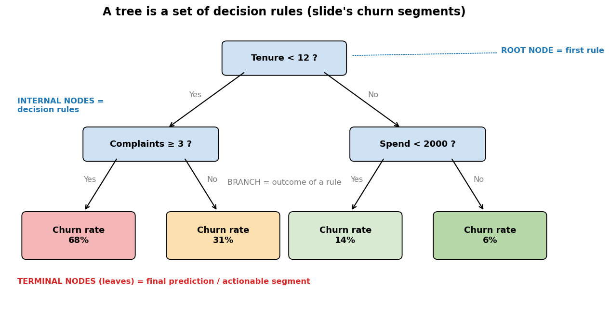

Each observation follows **one path from the root node to a terminal node**.

| Term | Meaning |
|---|---|
| **Root node** | The first rule (top of the tree) |
| **Internal node** | A decision rule |
| **Branch** | Outcome of the rule (yes/no) |
| **Terminal node (leaf)** | Final prediction or segment |

**Segments from the slide's churn tree**

| Segment | Estimated churn rate |
|---|---|
| Tenure < 12, Complaints ≥ 3 | **68%** |
| Tenure < 12, Complaints < 3 | 31% |
| Tenure ≥ 12, Spend < 2000 | 14% |
| Tenure ≥ 12, Spend ≥ 2000 | **6%** |

* Each leaf is an **actionable customer segment**; managers can attach a different retention action to each.
* A tree gives **both prediction and segmentation**.

### 3.1 The same model seen as rectangles

A tree is secretly a **partition of the predictor space into rectangles** $R_1, R_2, \dots, R_J$, with one constant prediction in each:

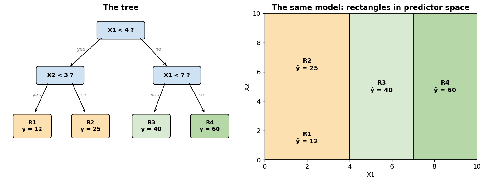

**Analogy:** cutting a map into rectangular sales territories with straight horizontal/vertical cuts, then quoting one average sales figure per territory.

### 3.2 Regression trees vs classification trees

| | Regression tree | Classification tree |
|---|---|---|
| Outcome | Quantitative | Categorical |
| Example | Monthly sales | Customer churn |
| Terminal-node prediction | **Mean response** in the node | **Class** or class probability |
| Split criterion | Reduce **RSS / MSE** | Improve **class purity** |
| Typical use | Demand prediction | Risk classification |

> **The tree structure is similar; the prediction rule differs by outcome type.**

---

## 4. Regression Trees

### 4.1 How a regression tree predicts

The tree divides predictor space into terminal regions $R_1,\dots,R_J$. For an observation falling in $R_j$, the prediction is the **average outcome of the training observations in that region**:

$$\hat y_{R_j}=\frac{1}{N_j}\sum_{i:\,x_i\in R_j} y_i$$

**Example:** a terminal node holds 20 similar stores whose average weekly sales are 430 units. A new store that lands in this node is predicted to sell **430 units**.

### 4.2 Recursive binary splitting

Trees are built by **recursive binary splitting**. At each node:

1. consider **all available predictors**,
2. consider **all allowable split points** (or category groupings for factors),
3. choose the split that gives the **largest improvement in fit**: $X_j < s$ versus $X_j \ge s$.

* The chosen split divides the current region into **two child regions**, and the process repeats inside each child.
* A predictor can be used **more than once**, at different levels. *It is not removed after use.*
* The procedure is **greedy**: it picks the best split *at the current node*, not the best overall tree (which would require searching all possible future trees).

**Analogy:** hiring in rounds. At each step you pick the single best question to ask right now, without planning the whole interview. This is fast but can miss a combination of questions that would have worked better together.

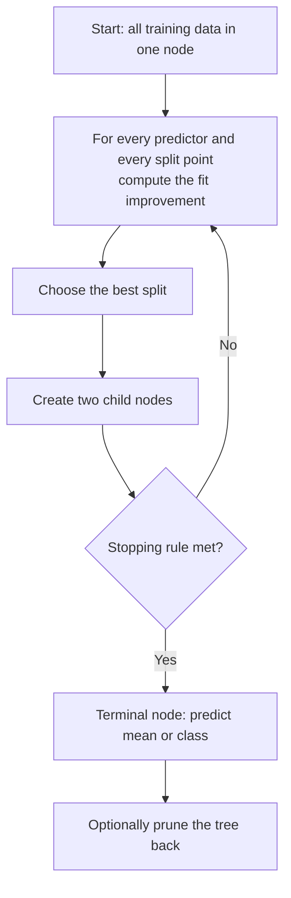

### 4.3 When does growth stop?

A node becomes terminal when no further allowable split is made. Common stopping controls:

| Control | Meaning | R `tree` argument |
|---|---|---|
| **Minimum node size** | A node needs enough observations to be considered for splitting | `minsize` |
| **Minimum child size** | A split must leave enough observations in **each** child | `mincut` |
| **Minimum improvement** | A split must reduce fit error or impurity enough | `mindev` |

> **Grow the tree → stop according to growth rules → prune if needed.**
> Stopping rules set how large the *initial* tree can get; pruning later removes splits that don't improve expected out-of-sample performance enough.

### 4.4 Choosing a split: minimise RSS

For a candidate split creating regions $R_1$ and $R_2$, choose the one minimising

$$\sum_{i:\,x_i\in R_1}(y_i-\hat y_{R_1})^2+\sum_{i:\,x_i\in R_2}(y_i-\hat y_{R_2})^2$$

* A good split creates groups whose outcomes are **relatively homogeneous**.
* The predictor need not be linearly related to the response.
* Later splits can use different predictors in different parts of the tree.

> **Trees adapt locally rather than fitting one global equation.**

### 4.5 Worked example: Sales vs Advertising

| Advertising | 1 | 2 | 3 | 4 | 5 |
|---|---|---|---|---|---|
| Sales | 2 | 3 | 4 | 10 | 12 |

Candidate split points are the midpoints: 1.5, 2.5, 3.5, 4.5. For each, predict each side by its mean and add the two RSS values.

**Detailed calculation for X < 3.5:**

* R₁ = {2, 3, 4}, mean 3 → RSS₁ = (2−3)² + (3−3)² + (4−3)² = **2**
* R₂ = {10, 12}, mean 11 → RSS₂ = (10−11)² + (12−11)² = **2**
* Total = 2 + 2 = **4**

**All four splits (slide):**

| Split | Left mean | Right mean | Total RSS |
|---|---|---|---|
| X < 1.5 | 2.00 | 7.25 | 58.75 |
| X < 2.5 | 2.50 | 8.67 | 35.17 |
| **X < 3.5** | **3.00** | **11.00** | **4.00** ← smallest |
| X < 4.5 | 4.75 | 12.00 | 38.75 |

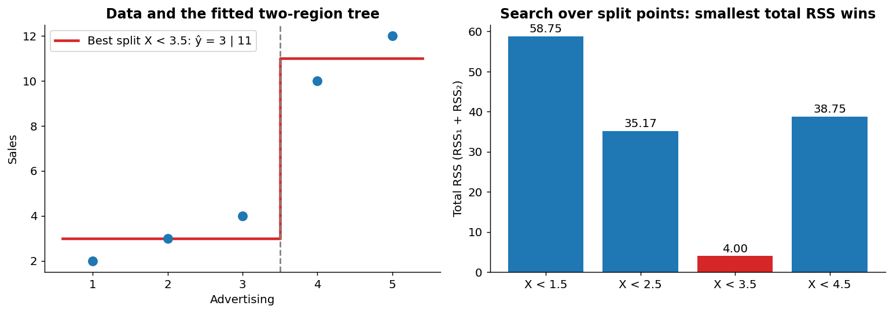

**Check one more by hand (X < 1.5):** left = {2} (mean 2, RSS 0); right = {3, 4, 10, 12}, mean 7.25, RSS = 4.25² + 3.25² + 2.75² + 4.75² = 18.06 + 10.56 + 7.56 + 22.56 = **58.75** ✓.

Result: **X < 3.5 ⇒ ŷ = 3; X ≥ 3.5 ⇒ ŷ = 11.** The same search is then repeated inside each resulting region.

```r
library(tree)
sales_data <- data.frame(Advertising = c(1, 2, 3, 4, 5), Sales = c(2, 3, 4, 10, 12))
# Allow the root node to split, but stop after the first split
ctrl <- tree.control(nobs = nrow(sales_data), mincut = 1, minsize = 5, mindev = 0)
sales_tree <- tree(Sales ~ Advertising, data = sales_data, control = ctrl)
plot(sales_tree); text(sales_tree, pretty = 0)
```

The control settings are deliberate: with only 5 rows, `tree`'s defaults (`minsize = 10`, `mincut = 5`) would refuse to split at all. Here `minsize = 5` lets the root split and `mincut = 1` allows tiny children, and each child (size < 5) then cannot split again. The result is the one-split tree 3 | 11, exactly the hand calculation.

---

## 5. Classification Trees

### 5.1 Predictions in a classification tree

A terminal node holds observations from different classes. The estimated probability of class *k* in node *m* is

$$\hat p_{mk}=\frac{\text{number of observations of class }k\text{ in node }m}{\text{number of observations in node }m}$$

* A simple rule assigns the **most common class** in the node.
* The probabilities can also be used with a **business-specific threshold** (see Sessions 1–2: choose thresholds by cost, not by default 0.5).

**Example:** 80 customers in a node, 52 churned → estimated churn probability = 52/80 = **0.65**.

### 5.2 Measuring node purity

A useful split makes nodes more **concentrated in one class**. Two common impurity measures:

$$\text{Gini}_m=\sum_{k=1}^{K}\hat p_{mk}(1-\hat p_{mk}) \qquad\qquad \text{Entropy}_m=-\sum_{k=1}^{K}\hat p_{mk}\log(\hat p_{mk})$$

*(m = node, k = class, p̂ₘₖ = proportion of node m in class k, K = number of classes.)*
An equivalent form of Gini is $1-\sum_k \hat p_{mk}^2$.

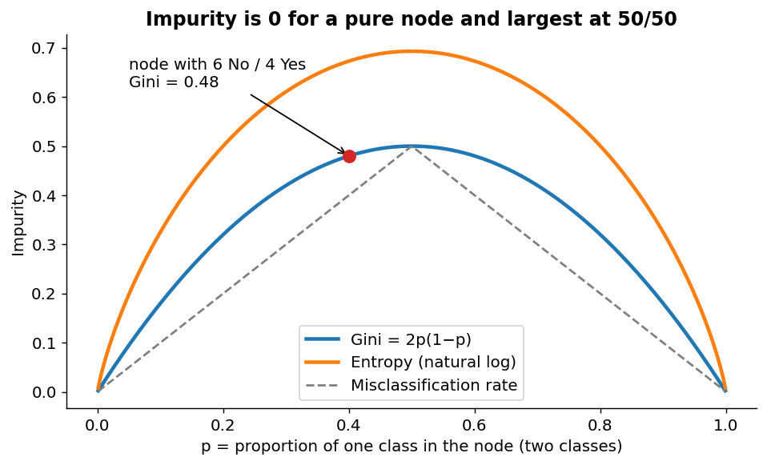

* Impurity is **small** when one class dominates (0 for a perfectly pure node).
* Impurity is **largest** when classes are evenly mixed (50/50).
* Gini and entropy look different but give very similar splits in practice.

**Worked examples**

| Node | p̂ | Gini | Entropy (natural log) |
|---|---|---|---|
| 10 customers: 6 No, 4 Yes | 0.6, 0.4 | 0.6(0.4) + 0.4(0.6) = **0.48** | −(0.6 ln 0.6 + 0.4 ln 0.4) ≈ 0.673 |
| 80 customers: 52 churned | 0.65, 0.35 | 2(0.65)(0.35) = **0.455** | ≈ 0.647 |
| Pure node (all "Yes") | 1, 0 | **0** | 0 |
| 50/50 node | 0.5, 0.5 | **0.5** (two-class max) | ≈ 0.693 |

> Trees choose splits that **reduce the weighted impurity of the resulting child nodes**.

**Analogy:** sorting laundry into two baskets. A good split puts mostly whites in one basket and mostly colours in the other. Impurity measures how mixed each basket still is.

### 5.3 Worked example: choosing a split on Complaints

| Complaints | 0 | 1 | 1 | 2 | 2 | 3 | 3 | 4 | 4 | 5 |
|---|---|---|---|---|---|---|---|---|---|---|
| Churn | No | No | Yes | No | No | Yes | Yes | No | Yes | No |

* Parent node: 4 Yes, 6 No → Gini = 1 − 0.6² − 0.4² = **0.48**.
* Candidate split points: 0.5, 1.5, 2.5, 3.5, 4.5. For each, compute the **weighted** Gini of the two children.

| Split | Left (No, Yes) | Right (No, Yes) | Gini L | Gini R | Weighted Gini |
|---|---|---|---|---|---|
| X < 0.5 | (1, 0) | (5, 4) | 0.000 | 0.494 | 0.444 |
| X < 1.5 | (2, 1) | (4, 3) | 0.444 | 0.490 | 0.476 |
| **X < 2.5** | **(4, 1)** | **(2, 3)** | **0.320** | **0.480** | **0.400** |
| X < 3.5 | (4, 3) | (2, 1) | 0.490 | 0.444 | 0.476 |
| X < 4.5 | (5, 4) | (1, 0) | 0.494 | 0.000 | 0.444 |

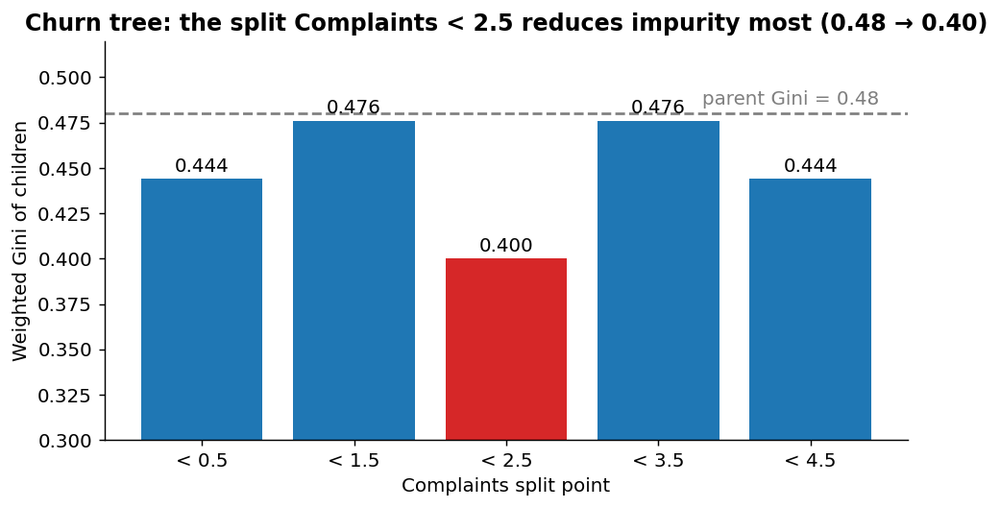

**Detailed calculation for X < 2.5:**

* Left Gini = 1 − (4/5)² − (1/5)² = **0.32**; right Gini = 1 − (2/5)² − (3/5)² = **0.48**
* Weighted Gini = (5/10)(0.32) + (5/10)(0.48) = **0.40**
* Impurity reduction = 0.48 − 0.40 = **0.08**, the largest among the candidates.

**Result:** Complaints < 2.5 ⇒ Churn = No; Complaints ≥ 2.5 ⇒ Churn = Yes.

```r
library(tree)
churn_data <- data.frame(
  Complaints = c(0, 1, 1, 2, 2, 3, 3, 4, 4, 5),
  Churn = factor(c("No","No","Yes","No","No","Yes","Yes","No","Yes","No")))
ctrl <- tree.control(nobs = nrow(churn_data), mincut = 1, minsize = 6, mindev = 0)
churn_tree <- tree(Churn ~ Complaints, data = churn_data, control = ctrl)
plot(churn_tree); text(churn_tree, pretty = 0)
summary(churn_tree)
```

**Reading the slide's `summary()` output**

| Output | Meaning (with the numbers) |
|---|---|
| Number of terminal nodes: **2** | One split → two leaves |
| Misclassification error rate: **0.3 = 3/10** | Left leaf (complaints 0–2: 4 No, 1 Yes) predicts No, so 1 error. Right leaf (3–5: 3 Yes, 2 No) predicts Yes, so 2 errors. Total 3 of 10 |
| Residual mean deviance: **1.467 = 11.73/8** | Deviance = −2 Σ nₘₖ ln p̂ₘₖ. Left: 5.00, right: 6.73, total **11.73**. Divided by (n − leaves) = 10 − 2 = **8** |

(Here `minsize = 6` lets the root (10 obs) split but prevents the two 5-observation children from splitting again.)

### 5.4 Which predictor is split first? (two-predictor example)

| Customer | X1 | X2 | Churn |
|---|---|---|---|
| 1 | 1 | 4 | No |
| 2 | 2 | 1 | Yes |
| 3 | 3 | 5 | No |
| 4 | 4 | 2 | Yes |
| 5 | 5 | 3 | No |

Parent: 3 No, 2 Yes → Gini = 1 − (3/5)² − (2/5)² = **0.48**. The tree tests every split of **both** predictors:

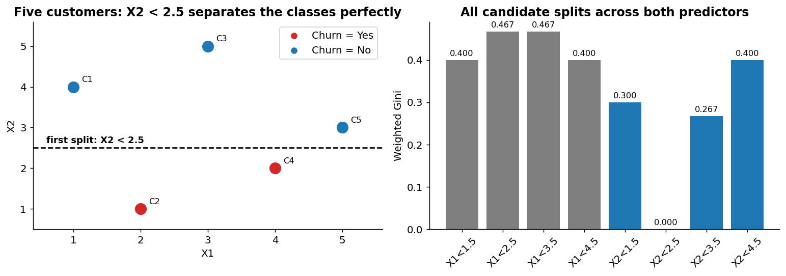

* For **X2 < 2.5**: left = 2 Yes, 0 No; right = 0 Yes, 3 No. **Both children are perfectly pure**, so the weighted Gini is **0**.
* **First split: X2 < 2.5.** Notice no split on X1 can do better than 0.400: X1 has no neat relationship with churn here, while X2 separates the classes completely.

This is how a tree does **automatic variable selection**: the most informative predictor wins the top spot.

### 5.5 Segmentation from classification trees

Leaves give **data-driven segments**, e.g., *High-value customer → low tenure → many complaints* may define a high-risk retention segment. Advantages: segments are **mutually exclusive**, rules are **operational**, and each customer is assigned to **one leaf**.

⚠️ **Caution:** segments are optimised for the **prediction target** (churn), not necessarily stable market segments for other business purposes (e.g., brand positioning).

---

## 6. Overfitting, Complexity and Pruning

### 6.1 Why large trees overfit

* Continuing to split **always improves training fit** (a tree can eventually give every observation its own leaf).
* Very deep trees create **tiny terminal nodes** that capture sample-specific noise, and such rules may not reproduce in new data.

$$\text{Tree size}\uparrow \;\Rightarrow\; \text{Training error}\downarrow \quad\text{but validation error may eventually increase}$$

**Real-data demonstration** (Hitters salary data; average over 30 random 70/30 splits):

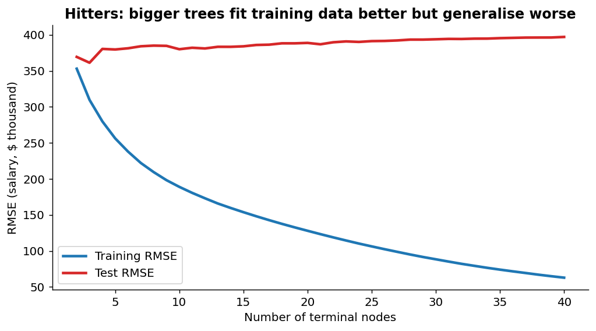

* **Training RMSE** falls steadily as the tree grows, from about 353 (2 leaves) to about 63 (40 leaves).
* **Test RMSE** is lowest for a *very small* tree (≈ 361 at 3 leaves) and then **climbs** to about 397 at 40 leaves.

> **A very large tree can have low training error but poor generalization.** (The same U-shape as Session 1–2.)

### 6.2 What counts as tree complexity?

* number of terminal nodes, tree depth,
* minimum observations required for a split,
* minimum observations allowed in a terminal node.

More complexity gives more detailed rules, smaller segments, lower training error and **potentially higher variance**. A practical tree balances **fit with stability**.

### 6.3 Cost-complexity pruning

Instead of stopping growth early (you might stop just before a really good split appears):

1. **grow a large tree**, then
2. **prune it back.**

Pruning balances training fit against tree size:

$$\text{Tree Cost}=RSS(T)+\alpha\,|T|$$

* $RSS(T)$ = lack of fit, $|T|$ = number of terminal nodes, $\alpha$ = penalty per leaf.
* **α ↑ ⇒ smaller tree.**

**This is the same idea as ridge/lasso (Sessions 3–5):** "fit + penalty × complexity", with α playing the role of λ. At α = 0 you keep the full tree; as α grows, the weakest branches are cut off one at a time, producing a *nested sequence of trees*.

**Worked example:** Tree A has RSS = 100 with |T| = 10 leaves; Tree B has RSS = 130 with |T| = 5.

| α | Cost of A (100 + 10α) | Cost of B (130 + 5α) | Winner |
|---|---|---|---|
| 5 | 150 | 155 | A (bigger) |
| 6 | 160 | 160 | tie |
| 10 | 200 | 180 | **B (smaller)** |

As the price per leaf rises past α = 6, the smaller tree becomes the better trade.

### 6.4 Choosing the tree size by cross-validation

* Different values of the pruning parameter give trees of different sizes.
* **Cross-validation** estimates the prediction error of each candidate.
* Pick the size with good out-of-sample performance.

$$\text{Pruning parameter}\;\to\;\text{tree complexity}\;\to\;\text{CV performance}$$

* A **slightly smaller tree may be preferred when its CV performance is close** to the larger tree's (the "one-standard-error" idea from Sessions 3–5).
* Pruning improves **interpretability** as well as complexity control.

**Slide example (Carseats classification tree; values read from the slide's plot):**

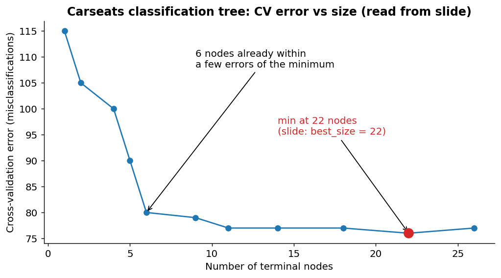

* CV error drops sharply up to about 6 terminal nodes, then is nearly flat; the minimum is at **22 nodes** (`best_size = 22`).
* A 6-node tree is already within a few misclassifications of the best; whether to prefer it depends on how much you value simplicity.

**Real-data version on Hitters** (cost-complexity pruning with 5-fold CV on a 70% training sample):

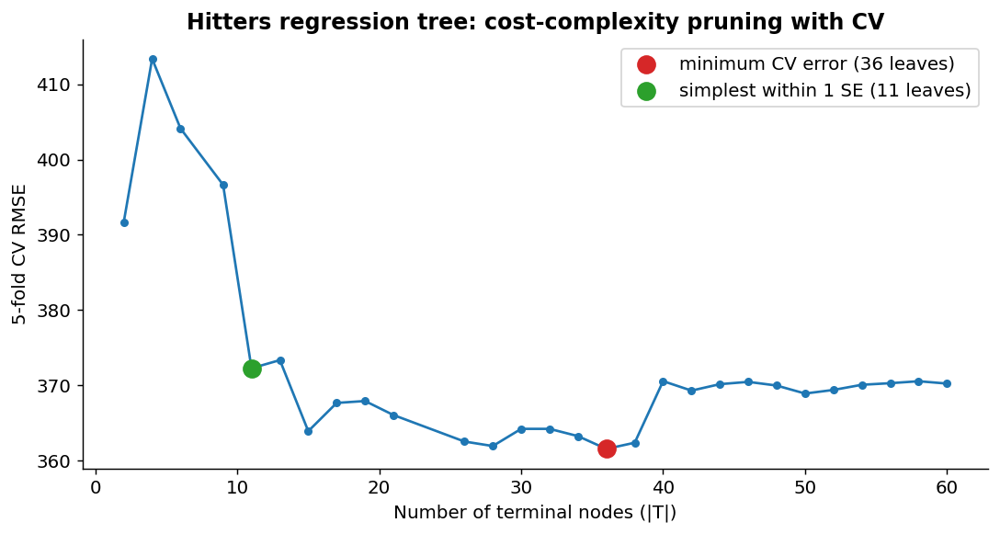

* Unpruned tree: 165 leaves (training error 0); test MSE ≈ 117,400. The CV-minimum tree (36 leaves) gives test MSE ≈ 114,700.
* The CV curve is **very flat** between about 11 and 40 leaves, so the **simplest tree within one standard error has only 11 leaves**, far easier to explain with similar accuracy.

### 6.5 Interpreting a pruned tree: six questions

1. Which predictor appears at the **root**?
2. What is the **first split point**?
3. Which variables appear **deeper**?
4. What **prediction** is made in each terminal node?
5. **How many observations** fall in each node?
6. Are the segments **large enough** to be operationally useful?

> **The tree describes a prediction rule, not a causal mechanism.**

---

## 7. Trees in R: Hitters and Carseats

### 7.1 Regression tree on Hitters

```r
library(ISLR2); library(tree)
data(Hitters); Hitters <- na.omit(Hitters)

set.seed(123)
train <- sample(1:nrow(Hitters), size = floor(0.7*nrow(Hitters)))   # 184 of 263 players
tree_hitters <- tree(Salary ~ ., data = Hitters, subset = train)
summary(tree_hitters)
plot(tree_hitters); text(tree_hitters, pretty = 0)
```

**Reading the slide's summary**

| Output | Interpretation |
|---|---|
| Variables actually used: CRBI, CAtBat, AtBat, Walks, CRuns, Hits | **6 of the 19 predictors** were ever chosen for a split; the rest were never the best split at any node (automatic variable selection) |
| Number of terminal nodes: **10** | 10 final player groups = 10 − 1 = **9 splits** (binary tree) |
| Each terminal node predicts | the **mean Salary** of the training players in that node |
| Residual mean deviance: **61,870 = 10,770,000 / 174** | RSS divided by residual degrees of freedom (184 training players − 10 leaves = 174). Smaller = better **training** fit |
| Residuals: Min −622, Max **1583**, Mean 0 | Residual = actual − predicted; positive = underpredicted. A residual of 1583 means at least one player earns far more than the tree predicts |

**The tree on the slide:**

```
CRBI < 321.5
├─ yes → CAtBat < 1260
│        ├─ yes → AtBat < 158  → 544.5 / 158.8
│        └─ no  → 461.1
└─ no  → Walks < 61 → ... (further splits on AtBat, Walks, CRuns, Hits) ... leaves 802 to 2017
```

### 7.2 Making a prediction: Alvin Davis

| CRBI | CAtBat | AtBat | Walks | CRuns | Hits |
|---|---|---|---|---|---|
| 266 | 1624 | 479 | 76 | 224 | 130 |

1. Root: CRBI = 266 < 321.5 → go **left**.
2. Next: CAtBat = 1624 is not < 1260 → go **right**.
3. This is a terminal node: **Salary = 461.1** (thousand dollars, i.e. $461,100).

> **Only the predictors encountered on the root-to-leaf path affect a given prediction.** Although six variables appear *somewhere* in the tree, Alvin's prediction used just two of them.

(For comparison, the boosted model on slide 67 predicts 536.35 for the same player.)

### 7.3 Classification tree on Carseats

```r
library(ISLR2); library(tree); data(Carseats)
Carseats$High <- factor(ifelse(Carseats$Sales > 8, "Yes", "No"))
set.seed(123)
train <- sample(1:nrow(Carseats), size = floor(0.7*nrow(Carseats)))      # 280 of 400
tree_carseats <- tree(High ~ . - Sales, data = Carseats, subset = train)   # exclude Sales itself!
plot(tree_carseats); text(tree_carseats, pretty = 0); summary(tree_carseats)
```

* The outcome `High` is created *from* `Sales`, so `Sales` must be excluded (`- Sales`): otherwise the tree would "predict" High from the variable it is defined by. **This is data leakage** (Sessions 1–2).
* The first split is on **ShelveLoc** (shelf-location quality: Bad/Medium vs Good), then Price, Advertising, etc. For a *categorical* predictor the split is a **grouping of categories** ("ShelveLoc: Bad, Medium").
* The unpruned tree is large and hard to read. Leaves are groups with different probabilities of high sales.

### 7.4 Pruning with cross-validation

```r
set.seed(123)
cv_carseats <- cv.tree(tree_carseats, FUN = prune.misclass)     # CV using misclassification error
plot(cv_carseats$size, cv_carseats$dev, type = "b",
     xlab = "Number of terminal nodes", ylab = "Cross-validation error")
best_size <- cv_carseats$size[which.min(cv_carseats$dev)]       # slide: 22
pruned_tree <- prune.misclass(tree_carseats, best = best_size)
plot(pruned_tree); text(pruned_tree, pretty = 0)
```

| Piece | Meaning |
|---|---|
| `FUN = prune.misclass` | Prune by **misclassification** (not deviance) |
| `cv_carseats$size` | Candidate tree sizes |
| `cv_carseats$dev` | Cross-validated **number of misclassifications** (out of the 280 training observations) |
| `which.min(dev)` | Size with the lowest CV error (22 in the slide) |
| `prune.misclass(..., best = k)` | Trim the tree back to *k* terminal nodes |

---

## 8. Strengths and Weaknesses of a Single Tree

| Strengths | Weaknesses |
|---|---|
| Easy to explain and visualise | Can have **lower predictive accuracy** than ensembles |
| Captures nonlinearities | Can be **unstable** across training samples |
| Captures interactions automatically | **Greedy** splitting may miss better global structures |
| Produces natural segments | **Deep trees overfit** |
| Little distributional structure required | Small sample changes can alter the tree substantially |

> **Ensemble methods address the instability of individual trees.**

**Analogy:** one expert who gives clear reasons (a single tree) versus a committee that quietly votes (an ensemble). The expert is easier to question; the committee is usually more reliable.

---

## 9. Why Average Many Trees? Bagging

**Idea.** Suppose individual trees are noisy predictors. If their prediction errors are **not perfectly correlated**, averaging reduces variance. For regression:

$$\hat f_{avg}(x)=\frac1B\sum_{b=1}^{B}\hat f^{(b)}(x)$$

**Analogy: "wisdom of the crowd".** At a fair, the average of 500 people's guesses of an ox's weight is usually closer than most individuals' guesses, because their idiosyncratic errors cancel. But if everyone copies the same loud neighbour, averaging helps much less. (This is exactly the correlation issue random forests address.)

> **Many unstable trees can combine into a stable predictor.**

### 9.1 The bagging procedure

**Bagging = bootstrap aggregation.**

1. Draw **B bootstrap samples** from the training data (sample *n* rows **with replacement**).
2. **Fit a tree** to each bootstrap sample.
3. **Combine** the predictions.

* **Regression:** $\hat f_{bag}(x)=\frac1B\sum_b \hat f^{(b)}(x)$ (average).
* **Classification:** each tree **votes** for a class, or the predicted **class probabilities are averaged**.

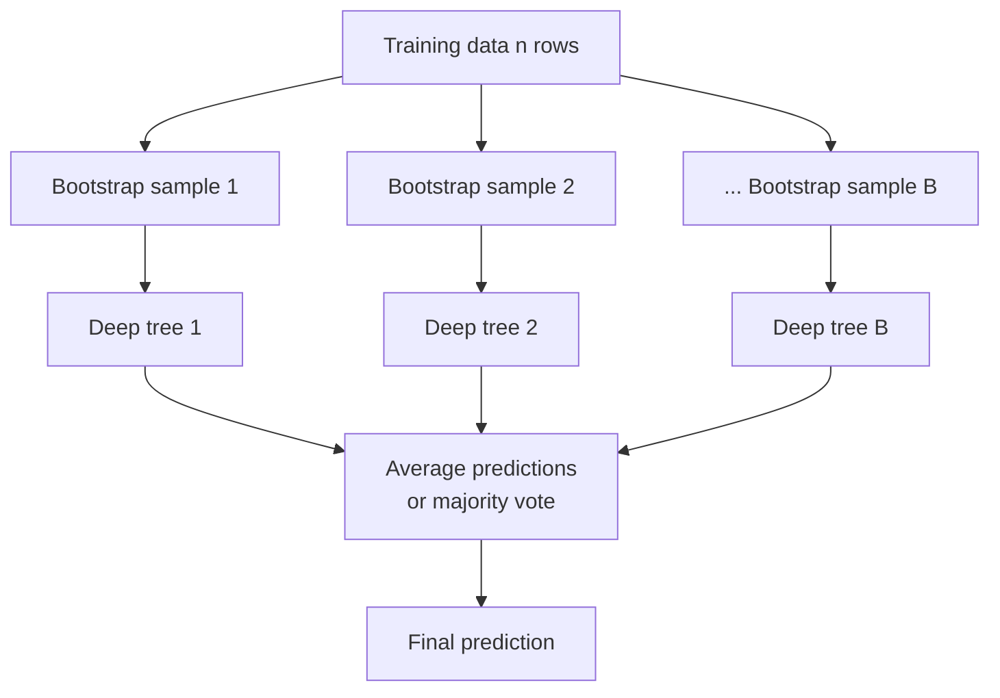

### 9.2 Why bagging reduces variance

* A single deep tree can change a lot if the training sample changes.
* Bootstrap samples deliberately create **different versions** of the training data, so the trees differ.
* **Averaging smooths out sample-specific fluctuations.**
* Bagging usually grows **large trees without pruning each heavily**: each tree is low-bias/high-variance, and the averaging controls the variance.

**Simulation:** 25 different training samples from the same sine-wave-plus-noise process. Left: one deep tree per sample. Right: a 50-tree bagged ensemble per sample.

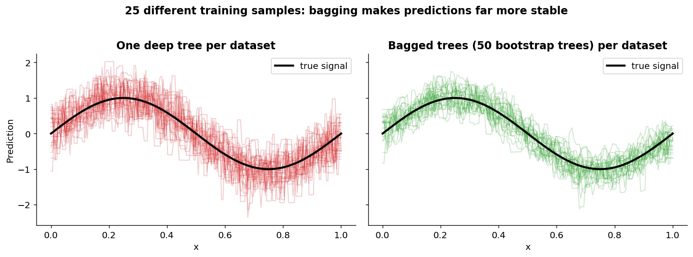

* Single trees (left) scatter widely around the true curve.
* Bagged predictions (right) hug the truth much more consistently. The average prediction variance across the 25 samples fell from **0.153 to 0.075** (about half).

### 9.3 Out-of-bag (OOB) observations

Each bootstrap sample contains only about **63.2%** of the distinct training observations. So roughly **36.8%** are **left out** of any given tree: these are that tree's **out-of-bag (OOB)** observations.

$$P(\text{an observation is NOT drawn}) = \Big(1-\tfrac1n\Big)^n \;\to\; e^{-1}\approx 0.368$$

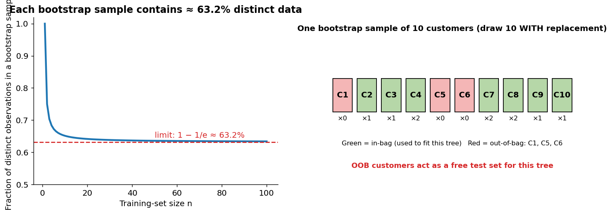

**OOB error estimate:**

1. For each observation, predict it using **only the trees for which it was OOB**.
2. Compare those predictions with the actual outcomes.
3. Aggregate over all observations.

> **OOB error provides an internal estimate of test performance.**

* OOB observations weren't used to fit the corresponding trees, so the predictions **mimic predictions on unseen data**.
* **No separate validation set is required.**
* Uses: assess bagging performance, compare random-forest settings, monitor whether enough trees have been grown.
* ⚠️ OOB error is **specific to bootstrap-based ensembles** (bagging, random forests), not to boosting or single trees.

**Analogy:** each tree takes a "closed-book exam" on the students it never studied from. Averaging those exam scores tells you how well the whole class of trees will do on unseen cases.

### 9.4 Bagging in R

```r
library(randomForest); library(ISLR2)
data(Hitters); Hitters <- na.omit(Hitters)
x <- model.matrix(Salary ~ ., Hitters)[, -1]
p <- ncol(x)                                   # 19 predictors
set.seed(123)
bag_fit <- randomForest(Salary ~ ., data = Hitters, mtry = p, ntree = 500, importance = TRUE)
bag_fit
importance(bag_fit)
```

* **Setting `mtry = p`** makes **all** predictors available at every split, which **is bagging**.

**Reading the slide's output**

| Output | Meaning |
|---|---|
| Type: regression; **500 trees** | Final prediction = average over 500 regression trees |
| Variables tried at each split: **19** | All predictors considered at every split, hence bagging |
| **Mean of squared residuals: 80,352.62** | The **OOB mean squared prediction error** (smaller = better); RMSE ≈ √80,353 ≈ **283** (i.e. about $283,000) |
| **% Var explained: 60.37** | OOB predictions explain about **60%** of the variation in Salary |
| **%IncMSE** | How much the **OOB prediction error increases when a predictor is randomly permuted**. *Larger ⇒ greater predictive importance* |
| **IncNodePurity** | Total reduction in RSS from splits on that predictor, summed over all trees. *Larger ⇒ greater contribution to useful splits* |

* **Negative %IncMSE** (League −1.22, Division −0.81) means permuting the variable did not hurt prediction, i.e. little incremental predictive value in this fitted model.
* **Top by %IncMSE:** CHits (18.4), CAtBat (13.8), CRBI (13.5), AtBat (10.6). **Top by IncNodePurity:** CHits (10.4 M), CRBI (8.5 M), Walks (5.0 M), RBI (3.9 M).
* The two measures **don't agree perfectly** (e.g. AtBat ranks 4th on %IncMSE but is middling on purity), and strongly correlated career statistics (CHits, CAtBat, CRuns, CRBI...) share importance. Use importance as a guide, not a verdict.

---

## 10. Random Forests

> **Random forest = bagging + random predictor selection at each split.**

At each split:

* **bagging** considers **all** predictors;
* a **random forest** considers only a **random subset of m < p predictors**.

### 10.1 Why random predictor selection helps

Suppose one predictor is **very strong** (e.g., CHits in Hitters).

| With bagging | With random forests |
|---|---|
| That predictor is chosen near the **top of almost every tree** | The strong predictor is **sometimes unavailable** at a split |
| Trees become **similar** | Other predictors get chances to split |
| Their errors are **highly correlated** | Trees become **less similar** |

> **Less correlation among trees ⇒ greater benefit from averaging.**

**Analogy:** a hiring panel. If every interviewer looks at the same CV section, they reach the same conclusion and adding more interviewers adds nothing. If each interviewer sees a random subset of the CV, their judgments differ, and the combined verdict is better.

### 10.2 Important tuning parameters

| Parameter | Meaning | Effect |
|---|---|---|
| `ntree` | Number of trees | More trees mainly **improve stability**; unlike a single deep tree, they **do not usually cause overfitting** |
| `mtry` | Predictors considered at each split | **Smaller mtry** increases randomness between trees; **excessively small mtry** can weaken individual trees |
| Minimum node size | How small terminal nodes may get | Controls tree depth/flexibility |

*Common defaults (R `randomForest`):* regression **mtry ≈ p/3**, classification **mtry ≈ √p**. In Hitters p/3 ≈ 6.3, hence the slide's `mtry = 6`.

**OOB error or cross-validation** can guide tuning.

### 10.3 Random forest in R

```r
set.seed(123)
rf_fit <- randomForest(Salary ~ ., data = Hitters, mtry = 6, ntree = 500, importance = TRUE)
rf_fit
plot(rf_fit)          # OOB error as trees are added
varImpPlot(rf_fit)    # variable importance
```

**Slide output:** OOB mean squared residuals **78,239.16** and **61.41%** variance explained, a small improvement over bagging (80,352.62 and 60.37%).

**Reading the OOB-error plot (slide 48):**

* The OOB error **falls sharply over the first 100–200 trees, then is nearly flat**: the forest has largely **stabilised**.
* A flat curve means additional trees give **diminishing returns**.
* Unlike boosting (where CV picks the best number of trees at a minimum), you don't choose `ntree` by finding an exact minimum: if the curve is flat well before 500, 500 trees is a reasonable choice.

**Re-created on the real Hitters data (Python)**, same pattern:

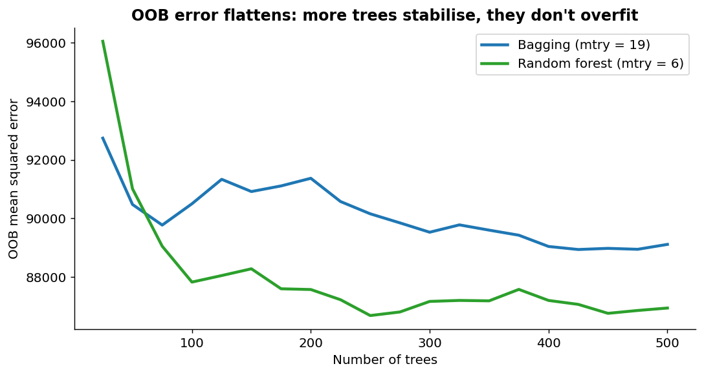

**Tuning `mtry` with OOB error (re-created):**

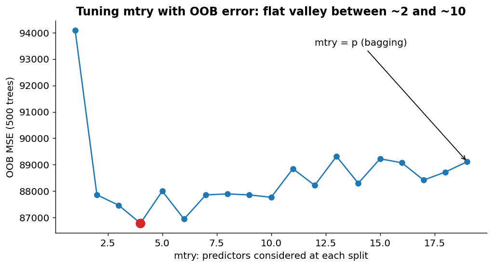

* mtry = 1 is clearly too restrictive (weak individual trees); the curve is a **flat valley from about 2 to 10**; mtry = p (bagging) is slightly worse.
* This is why the slide says "compare candidate values of mtry using OOB error or cross-validation", but also why you shouldn't agonise: the valley is wide.

### 10.4 Variable importance

Random forests can rank predictors by contribution to predictive performance:

* **decrease in prediction accuracy when a variable is disrupted** (permutation importance, `%IncMSE`),
* **total reduction in node impurity** attributed to splits on that variable (`IncNodePurity`).

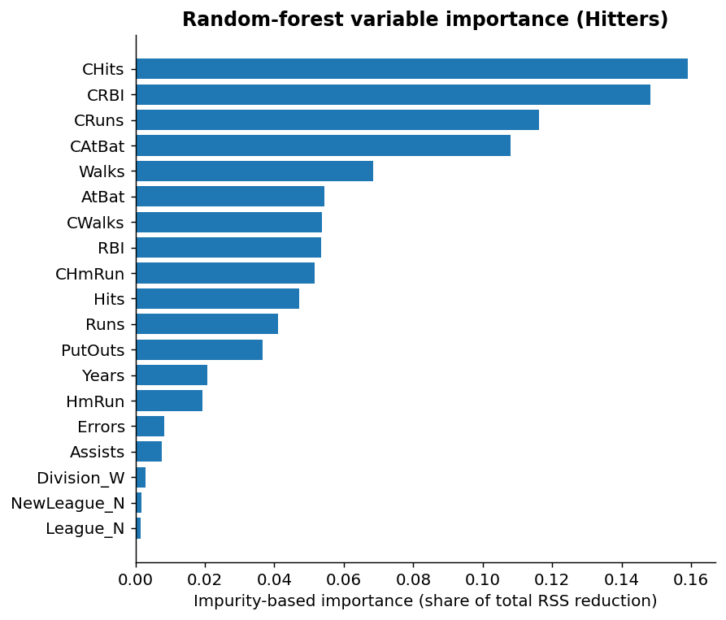
*(Impurity-based importance from a Python re-creation; like IncNodePurity, it highlights CHits, CRBI, CRuns, CAtBat.)*

⚠️ **Use importance cautiously:**

> **High variable importance means predictive usefulness, not causal importance.**

* **Correlated predictors can share or redistribute importance.**
* Importance should **support** interpretation, not replace business reasoning.

### 10.5 Bagging vs random forests

| | Bagging | Random forest |
|---|---|---|
| Bootstrap samples | Yes | Yes |
| Trees grown | Many | Many |
| Predictors available at each split | **All** | **Random subset** |
| Goal | Reduce tree **variance** | Reduce variance **and tree correlation** |
| Final prediction | Average / vote | Average / vote |
| Interpretability | Lower than one tree | Lower than one tree |

---

## 11. Why Averaging Reduces Variance (the Maths)

Let $X_b$ be the prediction from tree *b*, and $\bar X=\frac1B\sum_{b=1}^B X_b$. Then

$$\mathrm{Var}(\bar X)=\frac1{B^2}\Big[\sum_{b=1}^{B}\mathrm{Var}(X_b)+2\sum_{b<c}\mathrm{Cov}(X_b,X_c)\Big]$$

* Averaging reduces variance, **more so when the trees have low covariance/correlation**.
* If every tree has variance $\sigma^2$ and every pair has correlation $\rho$:

$$\boxed{\mathrm{Var}(\bar X)=\rho\sigma^2+\frac{1-\rho}{B}\sigma^2}\qquad\text{and as }B\to\infty:\quad \mathrm{Var}(\bar X)\to\rho\sigma^2$$

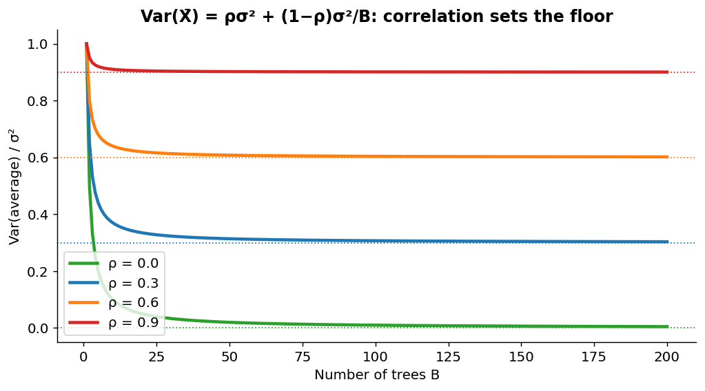

**Reading the chart (σ² = 1):**

* With **ρ = 0** (independent trees) variance shrinks like 1/B towards 0.
* With **ρ = 0.9** (very similar trees) it never gets below 0.9: **adding trees can't fix correlation**.
* Each curve flattens at its own floor ρσ²: **more trees help, but highly correlated trees limit the gain.**

**Worked example (σ² = 100, so a single tree has SD = 10; B = 100 trees):**

| Correlation ρ | Var of average = ρσ² + (1−ρ)σ²/B | SD of average |
|---|---|---|
| 0.9 | 90 + 0.1 (100)/100 = **90.1** | 9.5 |
| 0.5 | 50 + 0.5 (100)/100 = **50.5** | 7.1 |
| 0.1 | 10 + 0.9 (100)/100 = **10.9** | 3.3 |

Going from ρ = 0.9 to ρ = 0.1 (the random-forest effect) cuts the SD from 9.5 to 3.3 with the same number of trees.

> * **Bagging** reduces variance by averaging trees grown on bootstrap samples.
> * **Random forests** further reduce **correlation** among trees by restricting candidate predictors at each split.
> * **Boosting** builds trees **sequentially**, each correcting the errors of the current ensemble; its main mechanism is **not** variance reduction through averaging.

---

## 12. Boosting

Boosting also combines many trees, but **builds them sequentially**.

* Bagging and random forests build trees **independently** (in parallel).
* Boosting builds each new tree using **information from the current ensemble**.
* New trees focus on **patterns not yet captured well**.
* Typical boosted trees are **shallow**, not fully grown.

> **Boosting learns gradually by adding one small tree at a time.**

**Analogy: a golfer's practice.** Each practice round (tree) targets the mistakes of the previous rounds (the residuals), improving a little each time. Bagging, by contrast, is like asking 500 different golfers to play once and averaging their scores.

| | Bagging / Random forest | Boosting |
|---|---|---|
| Tree construction | Independent / parallel | **Sequential** |
| Main idea | Average many noisy trees | Add trees to correct current errors |
| Typical tree size | Often **deep** | Usually **shallow** |
| Key controls | `mtry`, number of trees | **learning rate, depth, number of trees** |
| Main benefit | Variance reduction | Flexible bias–variance improvement |

### 12.1 The algorithm for regression

Start with an initial prediction, usually the mean: $\hat f_0(x)=\bar y$. At step *b* = 1, …, B:

1. Compute the **current residuals**: $r_i=y_i-\hat f_{b-1}(x_i)$.
2. Fit a **small regression tree** with the residuals as the response and the original predictors as inputs: $r \sim X_1+\dots+X_p$.
3. Let this tree predict the **residual correction** $\hat f^{(b)}(x)$.
4. **Update:**

$$\hat f_b(x)=\hat f_{b-1}(x)+\lambda\,\hat f^{(b)}(x)\qquad\text{new prediction = current prediction + fraction of the predicted correction}$$

Trees are "added" by **adding their predictions**, not by joining their structures.

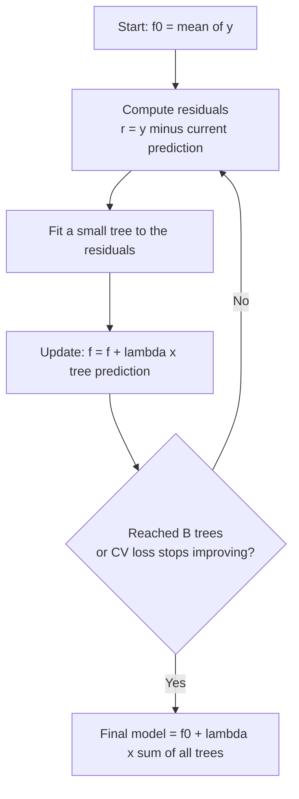

### 12.2 Toy example (Sales vs Advertising)

| X (Advertising) | 1 | 2 | 3 | 4 |
|---|---|---|---|---|
| Y (Sales) | 2 | 4 | 8 | 10 |

**Step 0:** $\hat f_0=\bar y=(2+4+8+10)/4=6$ for everyone. Residuals: **(−4, −2, 2, 4)**.

**Step 1:** fit a one-split tree to the residuals: it picks **X < 2.5** ⇒ r̂ = −3 (mean of −4, −2); X ≥ 2.5 ⇒ r̂ = +3 (mean of 2, 4). With **λ = 0.5**:

* X < 2.5: 6 + 0.5(−3) = **4.5**
* X ≥ 2.5: 6 + 0.5(3) = **7.5**

**Step 2:** new residuals = 2 − 4.5, 4 − 4.5, 8 − 7.5, 10 − 7.5 = **(−2.5, −0.5, 0.5, 2.5)**. The best one-split tree again uses X < 2.5: r̂ = **−1.5** and **+1.5**. Update with λ = 0.5:

* X < 2.5: 4.5 + 0.5(−1.5) = **3.75**
* X ≥ 2.5: 7.5 + 0.5(1.5) = **8.25**

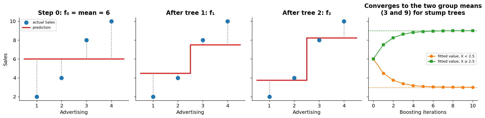

**What to notice**

* Predictions **creep gradually** toward the data (6 → 4.5 → 3.75 on the left; 6 → 7.5 → 8.25 on the right).
* Each step closes **half** of the remaining gap (that's λ = 0.5): the gap to the left-group mean 3 goes 3 → 1.5 → 0.75 → …
* With one-split trees ("stumps") the fitted values converge to the **two group means (3 and 9)**, and the model can never separate X = 1 from X = 2 or X = 3 from X = 4. To capture finer structure you need deeper trees, i.e. more interaction depth (next sections) or more splits.

### 12.3 The learning rate λ

$$\hat f_b(x)=\hat f_{b-1}(x)+\lambda\hat f^{(b)}(x)$$

λ is the **learning rate** or **shrinkage parameter**.

| Small λ | Large λ |
|---|---|
| Each tree contributes only a **small step** | Each tree has **greater influence** |
| Usually requires **more trees** | Learning is **faster** but **less stable** |

> **Small learning rate + more trees is a common strategy.**

**Analogy:** walking down a hillside in fog. Small steps take longer but you're unlikely to overshoot the valley; big strides get you there fast but may overshoot (overfit).

### 12.4 Tree depth in boosting

Tree depth controls the complexity of each **weak learner**.

* **Depth 1:** a **decision stump**, one split at a time (an *additive* model with no interactions).
* **Greater depth:** captures more complex **interactions** (depth *d* allows interactions among up to *d* variables).
* **Very deep** boosted trees can become unnecessarily flexible.

**Tuning parameters:** number of trees, learning rate, tree depth. They should be **selected jointly** using validation or cross-validation (a smaller learning rate typically needs more trees).

### 12.5 Weak learners

* A **weak learner** is a model with limited predictive ability on its own (in tree boosting: a small or shallow tree).
* Boosting combines many of them sequentially:

$$\hat f_B(x)=\hat f_0(x)+\lambda\hat f^{(1)}(x)+\lambda\hat f^{(2)}(x)+\dots+\lambda\hat f^{(B)}(x)$$

> **Many weak trees + sequential corrections ⇒ strong predictive model.**
> A weak learner is not necessarily a *bad* learner; it is **deliberately kept simple** so the model improves gradually instead of relying on one complex tree.

### 12.6 When can boosting overfit?

Boosting is powerful but **requires tuning**. Overfitting is more likely when:

* **too many trees** are added,
* individual trees are **too deep**,
* the **learning rate is too large**,
* the **sample size is limited** relative to model flexibility.

> **More boosting iterations are not automatically better.** (Contrast: more trees in a random forest are safe.) Monitor validation performance as boosting proceeds.

---

## 13. Gradient Boosting

**Gradient boosting** generalises "fit the residuals" to **any differentiable loss function** $L(y_i,\hat f(x_i))$.

At iteration *b*:

1. For each observation, work out how its prediction should change to reduce the loss. These desired corrections are the **negative gradient** (also called **pseudo-residuals**):

$$r_{ib}=-\left.\frac{\partial L(y_i,f(x_i))}{\partial f(x_i)}\right|_{f=\hat f_{b-1}}$$

2. Fit a **small regression tree** $\hat f^{(b)}(x)$ using the original predictors to predict these corrections $r_{ib}$.
3. **Add a fraction** of the tree's prediction: $\hat f_b(x)=\hat f_{b-1}(x)+\lambda\hat f^{(b)}(x)$.

**Special case: squared error.** If $L=(y-\hat y)^2/2$, the negative gradient is simply the **residual** $y_i-\hat y_i$, so gradient boosting reduces to fitting successive trees to residuals (Section 12).

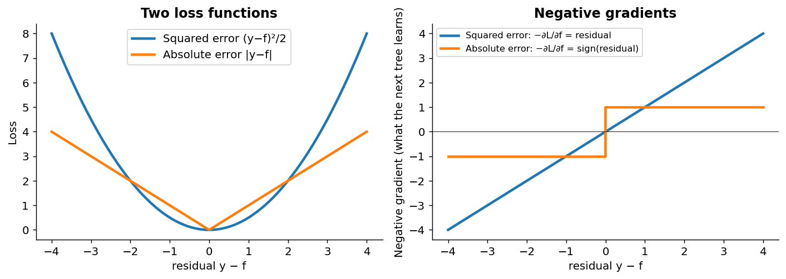

| Loss | Negative gradient (what the next tree learns) |
|---|---|
| Squared error | the **ordinary residual** (size and direction of the error) |
| Absolute error | the **direction of the error only** (+1 if y > f, −1 if y < f) |
| Logistic loss (classification) | loss-based corrections ("pseudo-residuals"), **not** the class labels themselves |

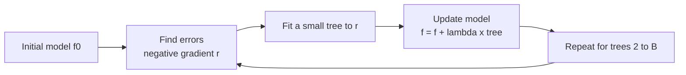

> **Gradient boosting = repeatedly fit a small tree in the direction that reduces the current loss.**
> The new tree **does not replace** earlier trees; its prediction is **added** to the current model, giving $\hat f_B(x)=\hat f_0(x)+\lambda\sum_{b=1}^B \hat f^{(b)}(x)$.

### 13.1 Toy example with absolute-error loss

Same data: X = 1, 2, 3, 4; Y = 2, 4, 8, 10. Loss $L(y,f)=|y-f|$. A suitable initial prediction is the **median**: $\hat f_0=6$.

**Step 1: negative gradients.** For absolute error, $-\partial L/\partial f=+1$ if $y>f$ and $-1$ if $y<f$:

| X | Y | f̂₀ | Negative gradient |
|---|---|---|---|
| 1 | 2 | 6 | −1 |
| 2 | 4 | 6 | −1 |
| 3 | 8 | 6 | +1 |
| 4 | 10 | 6 | +1 |

A small tree fitted to these signs finds **X < 2.5 ⇒ −1; X ≥ 2.5 ⇒ +1**: two regions where predictions should move in opposite directions.

**Step 2: how far to move?** The residuals are (−4, −2, 2, 4). For absolute-error loss the correction in each region is the **median residual**:

* X < 2.5: median(−4, −2) = **−3**; X ≥ 2.5: median(2, 4) = **+3**.

With **λ = 0.5**: X < 2.5 → 6 + 0.5(−3) = **4.5**; X ≥ 2.5 → 6 + 0.5(3) = **7.5**.

(Same numbers as the squared-error toy example, because the data are symmetric in each region, but the *mechanism* differs: the tree learns **directions**, and the **median** sets the step size.) *The loss function determines what correction the next tree learns.*

### 13.2 Gradient boosting vs gradient descent

Both move in the direction that reduces the loss.

| Aspect | Gradient descent | Gradient boosting |
|---|---|---|
| What is updated? | **Model parameters** (e.g., coefficients) | The **prediction function itself** |
| Direction of update | Negative gradient w.r.t. **parameters** | Negative gradient w.r.t. **current predictions** |
| Typical update | $\theta_b=\theta_{b-1}-\eta\nabla L$ | $\hat f_b=\hat f_{b-1}+\lambda\hat f^{(b)}$ |
| Role of the gradient | Says how parameters should change | Creates **pseudo-residuals** for the next tree |
| Building block | Parameter vector | **Small decision tree** |

* A boosting step can't move freely in every possible direction of function space, so it fits a **small tree that approximates the negative gradient**.
* The learning rate (η or λ) controls the step size.

> **Gradient boosting can be viewed as gradient descent in function space.**

### 13.3 Classification with boosting

* The model builds a **score or probability** rather than a continuous prediction.
* Successive trees improve the chosen **classification loss** (e.g. logistic loss).
* Predicted probabilities are then converted to classes using an **appropriate threshold**.
* Applications: churn, fraud, default, campaign response, lead conversion.
* The evaluation metric should **match the business objective**: ROC-AUC, sensitivity or expected cost (Sessions 1–2).

---

## 14. Boosting in R (gbm)

```r
library(gbm); library(ISLR2)
data(Hitters); Hitters <- na.omit(Hitters)
set.seed(123)
boost_fit <- gbm(Salary ~ ., data = Hitters,
                 distribution = "gaussian",      # squared-error loss
                 n.trees = 5000,                 # maximum number of trees
                 interaction.depth = 2,          # small trees
                 shrinkage = 0.01,               # learning rate lambda
                 n.minobsinnode = 10,            # minimum observations per terminal node
                 cv.folds = 5, verbose = FALSE)
best_trees <- gbm.perf(boost_fit, method = "cv")   # slide: 1047
summary(boost_fit, n.trees = best_trees)
```

| Argument | Meaning |
|---|---|
| `distribution = "gaussian"` | Squared-error loss (use `"bernoulli"` for binary classification) |
| `n.trees = 5000` | Upper limit; the best number is picked by CV afterwards |
| `interaction.depth = 2` | Small trees (each tree has `interaction.depth + 1` leaves in gbm) |
| `shrinkage = 0.01` | Learning rate λ (small, so many trees are needed) |
| `n.minobsinnode = 10` | Minimum observations in a terminal node |
| `cv.folds = 5` | 5-fold CV to estimate out-of-sample loss at every iteration |
| `gbm.perf(..., method = "cv")` | Finds the number of trees at the **minimum CV loss** |

### 14.1 Reading the performance plot

In `gbm.perf()` (slide 66): the **black curve** is training loss, the **green curve** CV loss, and the **blue dashed line** marks the minimum of the CV curve.

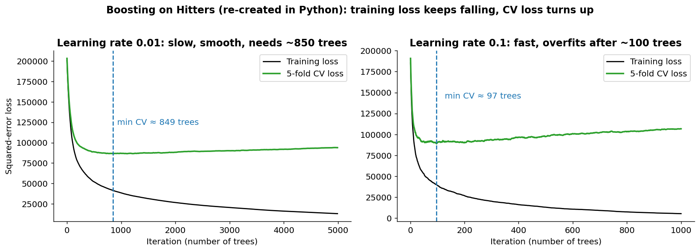
*(Re-created in Python from the real Hitters data. The shape matches the slide, though numbers differ slightly.)*

* **Training loss keeps decreasing** as trees are added (the model can always fit the training data better).
* **CV loss falls, bottoms out, then slowly rises**: later trees fit noise.
* **Selected number of trees = number at the minimum of the green CV-loss curve** (1047 on the slide; ≈ 850 in my re-creation).
* **Left panel vs right panel:** with learning rate 0.01 the curve is smooth and the optimum is late; with learning rate 0.1 it is reached after only ≈ 100 trees and overfitting then sets in quickly. This is the "small learning rate + more trees" trade-off in action.

### 14.2 Prediction for one player

```r
new_player <- Hitters["Alvin Davis", , drop = FALSE]
pred_salary <- predict(boost_fit, newdata = new_player, n.trees = best_trees)
```

**Output:** selected trees 1047; predicted salary for Alvin Davis **536.35** (thousand dollars). The single regression tree gave 461.11 for the same player; the boosted prediction draws on 1047 small trees rather than one path.

### 14.3 Relative influence

`summary(boost_fit)` reports **rel.inf**:

* It measures how much each predictor contributes to **improving the boosted model across all trees**.
* Each time a variable is used for a split, the **improvement in loss is recorded and accumulated**.
* The values are scaled to sum to about **100**. E.g., if CRBI = 13.25, it accounts for about **13.25%** of the model's total measured splitting influence.

**How it is useful:** rank predictors by reliance, prioritise key variables for further study, identify variables needing **data-quality and monitoring attention**, and flag low-influence variables as removal candidates *subject to validation*.

⚠️ **Relative influence does not show the direction of the effect and does not establish causality.**

---

## 15. Comparing and Choosing Tree-Based Methods

| Method | Interpretability | Prediction stability | Typical role |
|---|---|---|---|
| Single tree | **High** | Low–Medium | Rules / segmentation |
| Pruned tree | **High** | Medium | Simpler decision support |
| Bagging | Low | High | Variance reduction |
| Random forest | Low | High | Strong general prediction |
| Boosting | Low | High *when tuned* | High predictive accuracy |

**The slide's decision sequence**

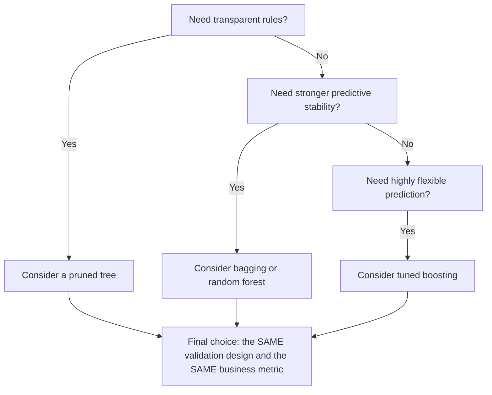

> **Final selection should be based on the same validation design and business metric.**

### 15.1 A head-to-head on real data

All models below were evaluated on the **same 5-fold CV folds** (repeated twice) on the Hitters data (re-created in Python, with the lasso included to link back to Sessions 3–5):

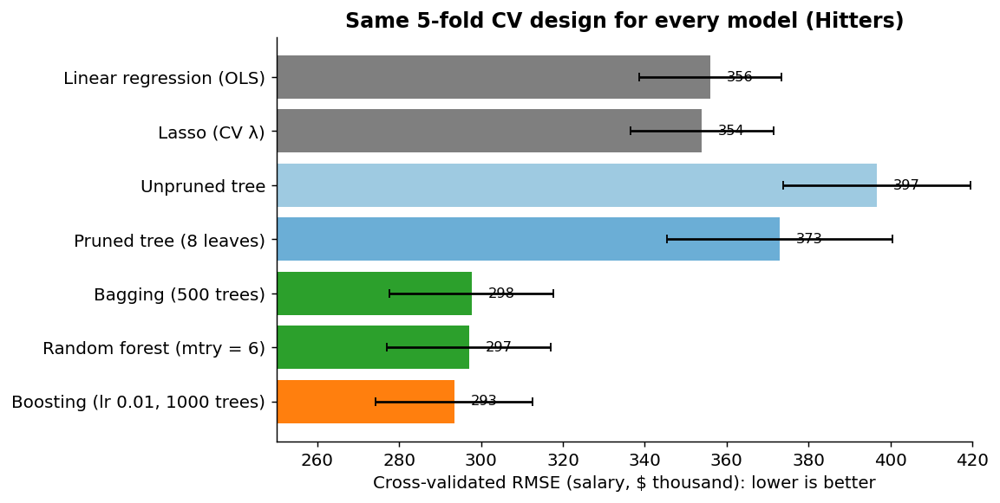

| Model | CV RMSE (salary, $ thousand) |
|---|---|
| Linear regression (OLS) | ≈ 356 |
| Lasso | ≈ 354 |
| Unpruned tree | ≈ 397 |
| Pruned tree (8 leaves) | ≈ 373 |
| Bagging | ≈ 298 |
| Random forest (mtry = 6) | ≈ 297 |
| Boosting (lr 0.01, 1000 trees) | ≈ 293 |

**How to read it**

* A **single tree is worse than a linear model here** (≈ 373–397 vs ≈ 355): instability costs accuracy. Pruning helps a bit (397 → 373).
* **All three ensembles beat the linear models by roughly 16–18%** (e.g. 297 vs 356) and beat the unpruned tree by about 25%. The gap to the linear models is roughly two standard errors (a paired comparison on identical folds would be sharper), and it is much larger than the gaps among the ensembles.
* The **differences among bagging, random forest and boosting are tiny** (≈ 293–298) relative to the standard errors (≈ 20). Don't crown a winner: choose using interpretability, speed, tuning effort and deployment needs. (Same lesson as the elastic-net comparison in Sessions 3–5.)

---

## 16. Business Cases

### 16.1 Demand prediction (retailer)

Predict **store-level demand** from previous sales, price, promotions, footfall, holidays, store size and local demographics.

* A **single tree** gives useful rules but can be **unstable**.
* A **random forest** can capture **nonlinear demand patterns**, model **interactions** (e.g., promotion × holiday), **average across many trees** and improve **predictive stability**.
* Use case: **Prediction → inventory planning → replenishment decision.**

### 16.2 Churn prediction (telecom)

Predictors: tenure, monthly bill, service calls, complaints, contract type, data usage, payment behaviour. Possible models:

| Model | Role |
|---|---|
| Single tree | **Transparent rules** for retention teams |
| Random forest | **Stable prediction** |
| Boosted trees | **High predictive performance** |

The preferred model depends on **validation performance, interpretability requirements, the cost of false negatives** (a missed churner), and **deployment constraints**.

### 16.3 Segmentation and decision support

* Leaves give **data-driven segments** (mutually exclusive, operational, one leaf per customer), but remember they are optimised for the **prediction target**, not for every segmentation purpose.
* Predictions **inform** decisions; they do not **determine** them:

| Application | Prediction | Decision |
|---|---|---|
| Churn | Churn probability | Retention intervention |
| Credit risk | Default probability | Review / pricing / limit |
| Demand | Expected sales | Inventory allocation |
| Marketing | Response probability | Campaign targeting |
| Service | Escalation risk | Priority routing |

> **The prediction informs the decision; it does not determine the decision by itself.**

---

## 17. The Model-Development Workflow

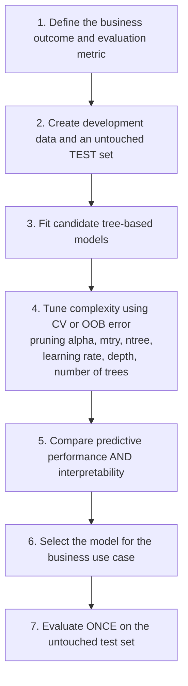

**Key takeaways**

* Decision trees **partition the predictor space using recursive binary rules**.
* Regression trees predict **terminal-node means**; classification trees predict **classes or probabilities**.
* **Pruning** controls the complexity of a single tree.
* **Bagging** averages bootstrap trees to **reduce variance**.
* **Random forests** further **reduce tree correlation** via random predictor subsets at each split.
* **Boosting** builds trees **sequentially** to improve the current model.
* **Gradient boosting** generalises this to **arbitrary differentiable loss functions**.
* Single trees emphasise **interpretability**; ensembles usually emphasise **predictive performance**.
* Business use should combine **validation evidence** with **interpretability, cost and deployment requirements**.

---

## 18. Python Equivalents

```python
from sklearn.tree import DecisionTreeRegressor, DecisionTreeClassifier
from sklearn.ensemble import (RandomForestRegressor, GradientBoostingRegressor,
                              HistGradientBoostingClassifier)
from sklearn.model_selection import KFold, cross_val_score

# 1) Single tree with cost-complexity pruning
tree = DecisionTreeRegressor(random_state=0)
path = tree.cost_complexity_pruning_path(X_train, y_train)     # candidate alphas
# choose ccp_alpha by cross-validation, then:
pruned = DecisionTreeRegressor(ccp_alpha=best_alpha, random_state=0).fit(X_train, y_train)

# 2) Bagging = random forest with max_features=1.0 ; Random forest = smaller max_features
bag = RandomForestRegressor(n_estimators=500, max_features=1.0, oob_score=True, random_state=0)
rf  = RandomForestRegressor(n_estimators=500, max_features=1/3, oob_score=True, random_state=0)
rf.fit(X_train, y_train)
print("OOB R^2:", rf.oob_score_)                 # OOB-based estimate; no validation set needed
print(rf.feature_importances_)                   # impurity-based importance

# 3) Gradient boosting: learning rate, number of trees and tree size are the key knobs
gb = GradientBoostingRegressor(n_estimators=5000, learning_rate=0.01,
                               max_leaf_nodes=3, min_samples_leaf=10, subsample=0.5)
gb.fit(X_train, y_train)
# staged_predict lets you compute validation loss after every tree to find the best number of trees
val_loss = [((y_val - p) ** 2).mean() for p in gb.staged_predict(X_val)]
best_n = int(np.argmin(val_loss)) + 1

# 4) Classification boosting with early stopping on a validation fraction
clf = HistGradientBoostingClassifier(learning_rate=0.05, max_iter=2000,
                                     early_stopping=True, validation_fraction=0.2)
```

**Vocabulary translation (R → Python)**

| R | scikit-learn |
|---|---|
| `tree` `minsize`, `mincut`, `mindev` | `min_samples_split`, `min_samples_leaf`, `min_impurity_decrease` |
| `prune.misclass`, `cv.tree` | `ccp_alpha` + cross-validation |
| `randomForest(mtry = ...)` | `max_features` |
| `ntree` | `n_estimators` |
| `gbm(shrinkage = ...)` | `learning_rate` |
| `gbm(interaction.depth = d)` | `max_depth` or `max_leaf_nodes` (≈ d + 1 leaves) |
| `gbm(bag.fraction)` | `subsample` |
| `gbm.perf(method = "cv")` | `staged_predict` + CV |

---

## 19. Cheat Sheet

| Concept | One-liner |
|---|---|
| Tree | Recursive binary splits → rectangles → one prediction each |
| Regression leaf | Mean of the training outcomes in the leaf |
| Classification leaf | Majority class (or class proportions) |
| Split rule (regression) | Minimise RSS₁ + RSS₂ |
| Split rule (classification) | Minimise weighted Gini (or entropy) of children |
| Gini | Σ p(1−p); 0 = pure, 0.5 = worst for 2 classes |
| Greedy | Best split *now*, not best tree overall |
| Stopping controls | minsize, mincut, mindev |
| Cost-complexity pruning | Minimise RSS(T) + α\|T\|; larger α → smaller tree |
| Choose tree size | Cross-validation (consider the smaller tree within 1 SE) |
| Single-tree weakness | Unstable, can overfit, lower accuracy |
| Bagging | Average trees on bootstrap samples → lower variance |
| OOB | ~36.8% left out of each bootstrap; free test-error estimate |
| Random forest | Bagging + random subset of m < p predictors per split |
| mtry defaults | Regression ≈ p/3; classification ≈ √p |
| More trees in RF | Stabilise; don't overfit |
| Var of average | ρσ² + (1−ρ)σ²/B |
| Boosting | Sequential small trees fitted to current errors |
| Update | f ← f + λ × tree |
| Boosting knobs | Number of trees, learning rate, tree depth (tune jointly) |
| Gradient boosting | Trees fit the negative gradient of any loss |
| Squared-error gradient | Plain residual |
| Absolute-error gradient | Sign of the residual |
| Importance | Predictive usefulness, **not** causal |
| More boosting trees | Can overfit; choose by CV |

**Top mistakes to avoid**

1. Reading a large, unpruned tree as "the truth": it is unstable and overfit.
2. Judging a tree by training deviance instead of validation/test error.
3. Reading variable importance or lasso/tree selection as causal.
4. Including the outcome (or a transform of it) as a predictor (e.g., `Sales` when predicting `High`).
5. Forgetting that OOB error exists only for bootstrap ensembles.
6. Running boosting for "as many trees as possible" without CV.
7. Choosing a model by one metric on one split instead of the same CV design for all.

---

## 20. Practice Questions with Answers

**Q1.** A node has 30 "Yes" and 70 "No". Compute its Gini impurity and the predicted class probability for "Yes".
**A.** p̂(Yes) = 0.30. Gini = 2(0.3)(0.7) = **0.42**.

**Q2.** That node (30 Yes, 70 No) is split into Left = (20 Yes, 10 No) and Right = (10 Yes, 60 No). Compute the weighted Gini and the impurity reduction.
**A.** Gini_L = 2(2/3)(1/3) = 0.444; Gini_R = 2(1/7)(6/7) = 0.245. Weighted = 0.30(0.444) + 0.70(0.245) = **0.305**. Reduction = 0.42 − 0.305 = **0.115**.

**Q3.** X = 1, 2, 3, 4 and Y = 1, 3, 7, 9. Find the best first split for a regression tree and its predictions.
**A.** X < 1.5: left {1} RSS 0; right {3, 7, 9}, mean 6.33, RSS 18.67 → 18.67. X < 2.5: {1, 3} mean 2, RSS 2; {7, 9} mean 8, RSS 2 → **4**. X < 3.5: {1, 3, 7} mean 3.67, RSS 18.67; {9} RSS 0 → 18.67. **Best: X < 2.5**, predictions **2** and **8**.

**Q4.** Using the same data (Y = 1, 3, 7, 9) perform one boosting step with a one-split tree and λ = 0.1.
**A.** f̂₀ = mean = 5, residuals (−4, −2, 2, 4). The tree picks X < 2.5 with r̂ = −3 and +3. f̂₁ = 5 + 0.1(−3) = **4.7** for X < 2.5 and 5 + 0.1(3) = **5.3** for X ≥ 2.5. (A small λ moves slowly, so many trees are needed.)

**Q5.** Trees have variance σ² = 16 each. Compute the variance of the average of B = 100 trees when ρ = 0.25 and when ρ = 0.75. What does it tell you about random forests?
**A.** ρ = 0.25: 0.25(16) + 0.75(16)/100 = 4 + 0.12 = **4.12** (SD ≈ 2.03). ρ = 0.75: 12 + 0.04 = **12.04** (SD ≈ 3.47). The floor ρσ² dominates, so reducing the **correlation** between trees (random predictor subsets) matters more than adding trees.

**Q6.** For n = 1000, what fraction of distinct observations is in a bootstrap sample? If a forest has 500 trees, in roughly how many trees is a given observation OOB?
**A.** 1 − (1 − 1/1000)¹⁰⁰⁰ ≈ **0.632** (63.2%) in-bag. OOB probability ≈ 0.368, so about 0.368 × 500 ≈ **184 trees**.

**Q7.** Tree A has RSS 100 and 10 leaves; Tree B has RSS 130 and 5 leaves. For which α does cost-complexity pruning prefer B?
**A.** Cost A = 100 + 10α; cost B = 130 + 5α. Equal at α = 6. For **α > 6**, B is preferred.

**Q8.** Why can a random forest with 5000 trees not overfit the way a single deep tree does, while a boosted model with 5000 trees can?
**A.** Forest trees are independent; adding more only averages away more noise (the variance converges to ρσ²). Boosting trees are sequential and each fits the remaining errors, so enough of them will start fitting noise: CV loss rises after its minimum.

**Q9.** The OOB plot of a random forest is flat after 150 trees. With ntree = 500, what do you conclude? Would you search for the "minimum" of this curve to choose ntree?
**A.** The forest has stabilised; 500 is adequate (just more computation than needed). You don't choose `ntree` at a minimum of the OOB curve: extra trees give diminishing, not negative, returns. (For boosting, you **do** choose the number of trees at the CV minimum.)

**Q10.** In `gbm`, what do `shrinkage`, `interaction.depth` and `n.trees` control, and how should they be chosen?
**A.** `shrinkage` = learning rate λ; `interaction.depth` = size of each small tree (interaction order); `n.trees` = how many trees. They interact (smaller shrinkage needs more trees), so tune them jointly by CV; use `gbm.perf(method = "cv")` to find the best number of trees for given other settings.

**Q11.** For squared-error vs absolute-error loss, what does the next tree in gradient boosting learn?
**A.** Squared error: the ordinary residual y − f̂. Absolute error: the sign of the residual (+1/−1), with each leaf's step size set by the median residual.

**Q12.** A manager sees that a random forest ranks "Division" last in importance and wants to drop it from the data feed. Comment.
**A.** Low importance means low *predictive* usefulness in this fitted model, not that it has no business relevance, and correlated variables can absorb its importance. Check by refitting without it and comparing CV/OOB error; weigh data cost and business meaning.

**Q13.** A bank must give regulators clear reasons for each credit decision, but also wants accuracy. Which tree-based approach would you start with and why?
**A.** Start with a pruned tree (transparent rules), compare with random forest/boosting on the same CV design, and quantify the accuracy sacrificed by simplicity. If the ensemble is much better, consider using it for scoring with explanation tools, or keep the tree for decisions needing direct rule-based justification.

**Q14.** True or false: "A tree with 40 leaves has a lower test error than a tree with 8 leaves because its training error is lower."
**A.** False. Training error always falls as the tree grows; test error typically has a U-shape (see the Hitters chart in Section 6.1).

---

## 21. Glossary

| Term | Meaning |
|---|---|
| **Root / internal / terminal node** | First rule / decision rule / final prediction (leaf) |
| **Recursive binary splitting** | Repeatedly splitting a region into two by a rule Xⱼ < s |
| **Greedy** | Choosing the best step at the current node only |
| **Gini / entropy** | Node-impurity measures for classification |
| **Residual mean deviance** | Deviance (or RSS) divided by (n − number of leaves) |
| **Cost-complexity pruning** | Trimming a big tree by minimising RSS(T) + α\|T\| |
| **Bootstrap sample** | A random sample of size n drawn with replacement |
| **Bagging** | Bootstrap aggregation: average trees from bootstrap samples |
| **Out-of-bag (OOB)** | Observations left out of a given bootstrap sample (~36.8%) |
| **OOB error** | Prediction error computed only from trees that didn't see the observation |
| **Random forest** | Bagging plus a random subset of predictors at each split |
| **mtry** | Number of predictors considered at each split |
| **%IncMSE** | Increase in OOB error when a predictor is randomly permuted |
| **IncNodePurity** | Total RSS reduction from splits on a predictor |
| **Boosting** | Sequentially adding small trees to correct current errors |
| **Learning rate / shrinkage (λ)** | Fraction of each new tree's prediction that is added |
| **Weak learner** | A deliberately simple model (small tree) |
| **Stump** | A tree with one split |
| **Pseudo-residual** | Negative gradient of the loss; what each boosting tree is fitted to |
| **Relative influence** | Share of total loss improvement attributed to a predictor (sums to ≈ 100) |
| **Ensemble** | A combination of many models into one prediction |

---

## 22. Things to Watch for in the Slides and R Output

Observations for your own understanding; some may be worth raising in class.

1. **`tree`'s default classification criterion is *deviance*, not Gini.** The slides teach Gini, and Gini and entropy/deviance usually pick very similar splits, but `tree()` uses deviance by default (`split = "gini"` is available). The `rpart` package defaults to Gini. The deviance in the churn `summary()` (11.73) is the entropy-style number.
2. **Tiny-data examples need hand-set controls.** `tree()` defaults (`minsize = 10`, `mincut = 5`, `mindev = 0.01`) would refuse to split 5 or 10 rows. The slides' `tree.control(...)` settings are chosen so the tree makes exactly one split, matching the hand calculation.
3. **The Hitters regression tree is judged only on training fit.** A 70/30 split is created but the slide's `summary()` reports *training* deviance (61,870), which is not an estimate of out-of-sample accuracy. To evaluate: `predict(tree_hitters, Hitters[-train, ])` and compute test MSE. (In my re-creation, the test error of a big tree is clearly worse than its training error, and the pruned tree is similar or better.)
4. **`cv.tree` details.** With `prune.misclass`, `dev` is the cross-validated *number* of misclassifications (out of the 280 training rows), and `cv.tree` lists sizes from large to small, so `which.min()` returns the *first* minimum, i.e. the **largest** tree among ties. The CV curve on slide 30 is almost flat from 6 to 26 nodes, so a much smaller tree is nearly as good; choosing a smaller one (the "within one standard error" idea) is often better for interpretability.
5. **OOB error depends on settings I couldn't match exactly.** My Python re-creation gave OOB MSE ≈ 89,100 (bagging) and ≈ 86,900 (random forest) vs the slide's 80,353 and 78,239, different tree-growing defaults and random draws. The *pattern* (RF slightly better than bagging; flat OOB curve) matches.
6. **The two importance measures need not agree** (see Section 9.4): permutation-based %IncMSE and impurity-based IncNodePurity rank variables differently, and correlated career-statistics share importance.
7. **`gbm` is stochastic by default** (`bag.fraction = 0.5` subsamples the data at each tree), so set the seed; the "best number of trees" (1047) varies with the seed and CV folds. My re-creation found ≈ 850 trees with a similar-shaped curve.
8. **Gradient-boosting toy example (slides 62–63).** The tree is fitted to the *signs* (−1/+1), but the leaf values actually added are the **median residuals** (−3, +3), the leaf-wise "line search" step for absolute-error loss.
9. **Slide 51 assumes identical variance and equal pairwise correlation across trees.** Real trees are not exactly like that, but the formula captures the logic (the correlation floor).
10. **About the figures.** Figures 01–06, 10–12, 16, 17 are conceptual illustrations or simulations built for these notes (numbers in them come from the slides' examples or from simulation). Figure 08 is read off the slide's plot (approximate). Figures 07, 09, 13, 14, 15, 18, 19 are **re-created in Python on the real Hitters data**, so shapes match the slides but exact values differ.

---

*Notes prepared from the Course Outline (AY 2026-27) and the "AMLBT Lectures 6–10" slides (draft dated 2026-10-08). Slide wording may still change since the deck is marked "Draft".*
