# Sessions 11 & 12 — Association Analysis: Frequent Itemsets, Apriori, Rule Metrics and Market-Basket Insights

**Course:** Advanced Machine Learning in Business Transformation (BDA/IDA, Term II, AY 2026-27)
**Faculty:** Dr. S. Sanyal  |  **Mode:** Offline  |  **CLO covered:** CLO 4 — *Analyze support vector machines and association analysis techniques for business applications involving classification, pattern discovery, and rule-based insights* (Bloom Level 4: Analyze). *(Sessions 13–14 cover the SVM half of this CLO.)*
**Suggested reading:** *Introduction to Data Mining* (Tan, Steinbach, Karpatne, Kumar), Ch. 5, "Association Analysis: Basic Concepts and Algorithms" (free chapter on the authors' site, listed in the course outline).
**Builds on:** [Sessions 6–10 — Tree-based methods](../session-06-10-tree-based-methods/notes.md) (trees also produce "if-then" rules, but *supervised*; association rules are the *unsupervised* counterpart) and [Sessions 1–2 — Model selection](../session-01-02-model-selection/notes.md) (thresholds must be justified; small samples are noisy).

---

## Table of Contents

1. [The Big Picture](#1-the-big-picture)
2. [Key Concepts and Definitions](#2-key-concepts-and-definitions)
3. [The Metrics in Depth: Support, Confidence, Lift, Conviction](#3-the-metrics-in-depth-support-confidence-lift-conviction)
4. [The Four Steps of Association Analysis](#4-the-four-steps-of-association-analysis)
5. [Thresholds in Association Rule Mining](#5-thresholds-in-association-rule-mining)
6. [The Apriori Algorithm](#6-the-apriori-algorithm)
7. [Worked Example 1: Apriori Step by Step](#7-worked-example-1-apriori-step-by-step)
8. [Rule Generation from Frequent Itemsets](#8-rule-generation-from-frequent-itemsets)
9. [Worked Example 2: Milk, Bread and Butter in R](#9-worked-example-2-milk-bread-and-butter-in-r)
10. [Real Data: the Groceries Dataset](#10-real-data-the-groceries-dataset)
11. [Choosing Thresholds in Practice](#11-choosing-thresholds-in-practice)
12. [Lift vs Conviction](#12-lift-vs-conviction)
13. [Pitfalls and Limitations](#13-pitfalls-and-limitations)
14. [From Rules to Business Action](#14-from-rules-to-business-action)
15. [Python Equivalent](#15-python-equivalent)
16. [Cheat Sheet](#16-cheat-sheet)
17. [Practice Questions with Answers](#17-practice-questions-with-answers)
18. [Glossary](#18-glossary)
19. [Things to Watch for in the Slides and R Output](#19-things-to-watch-for-in-the-slides-and-r-output)

---

## 1. The Big Picture

> **Association analysis is an *unsupervised* method for discovering patterns of items that occur together in transactional data.**

* **Unsupervised** means there is **no outcome variable** to predict (contrast with regression, trees and SVM): we simply search the data for combinations that appear together unusually often.
* Its flagship use is **market-basket analysis**: which combinations of products frequently occur in the same shopping basket?

**Analogy: the supermarket cashier's memory.** A cashier who has scanned millions of baskets starts to notice that people who buy *nappies and baby wipes* often also buy *baby food*. Association analysis is that cashier's intuition made systematic, with numbers attached to how often, how reliably and how surprisingly the pattern occurs.

### 1.1 Business applications (from the slides)

| Application | What association analysis offers | Business use |
|---|---|---|
| **Market-basket analysis** | Products frequently bought together | Cross-selling strategies |
| **Recommendation systems** | Items suggested from past purchasing behaviour | "Customers who bought X also bought Y" |
| **Fraud detection** | Spot unusual patterns in transactions | Flag deviations from typical co-occurrence patterns |
| **Inventory management** | Purchase associations | Optimise product placement and stock |

*A small thought on fraud:* association rules themselves describe **frequent** patterns; "unusual" behaviour is found by comparing transactions against those patterns (e.g., a basket violating a very reliable rule). Rare-pattern detection usually needs additional methods.

### 1.2 Where it fits in the course

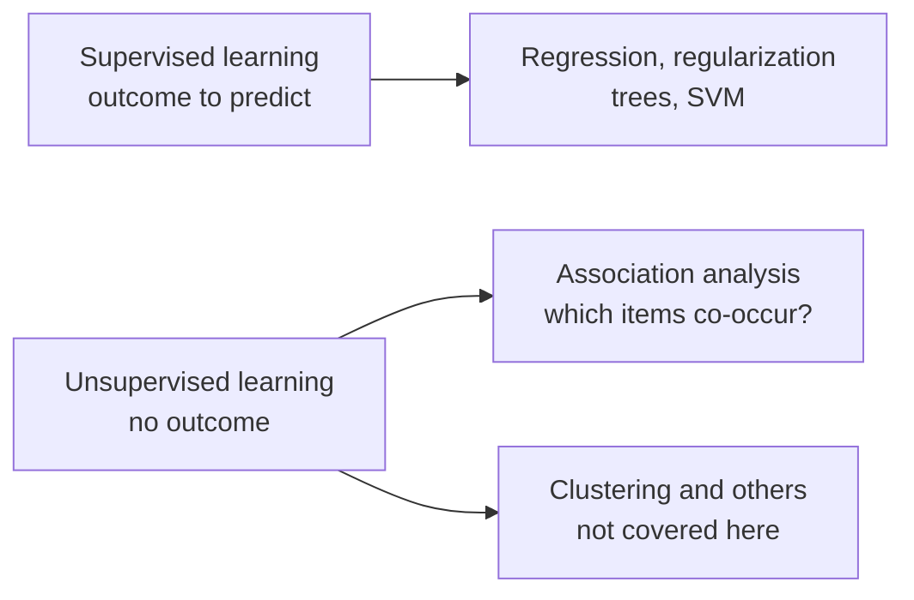

---

## 2. Key Concepts and Definitions

Throughout, **N** = total number of transactions (baskets).

| Concept | Meaning | Formula |
|---|---|---|
| **Itemset** | A collection of one or more items | e.g. {bread, butter}, {milk, eggs, cheese} |
| **Support** | Proportion of transactions containing the itemset | $\text{Support}(X)=\dfrac{\#\text{ transactions containing }X}{N}$ |
| **Confidence** | How often items in Y appear in transactions that contain X | $\text{Confidence}(X\to Y)=\dfrac{\text{Support}(X\cup Y)}{\text{Support}(X)}$ |
| **Coverage** | How often X (the antecedent) occurs | $\text{Coverage}(X\to Y)=\text{Support}(X)$ |
| **Lift** | Strength of the rule relative to what independence would give | $\text{Lift}(X\to Y)=\dfrac{\text{Confidence}(X\to Y)}{\text{Support}(Y)}$ |
| **Conviction** | Compares the frequency of *missing* Y given X with the baseline frequency of missing Y | $\text{Conviction}(X\to Y)=\dfrac{1-\text{Support}(Y)}{1-\text{Confidence}(X\to Y)}$ |
| **Association rule** | A rule X → Y between two **disjoint** itemsets | LHS (antecedent, the "if") → RHS (consequent, the "then") |
| **Count** | Absolute number of transactions where the rule holds | Support × N |

* **Lift > 1** means X and Y co-occur **more often than expected under independence** (positive association).
* Rule structure: **LHS (the "if" part, the conditions) → RHS (the "then" part, the items associated with the LHS)**.

### 2.1 From baskets to a transaction matrix

**Data preparation** converts raw data into a *transactional format*: one row per basket, listing the items purchased. It is equivalent to a 0/1 matrix with one column per item.

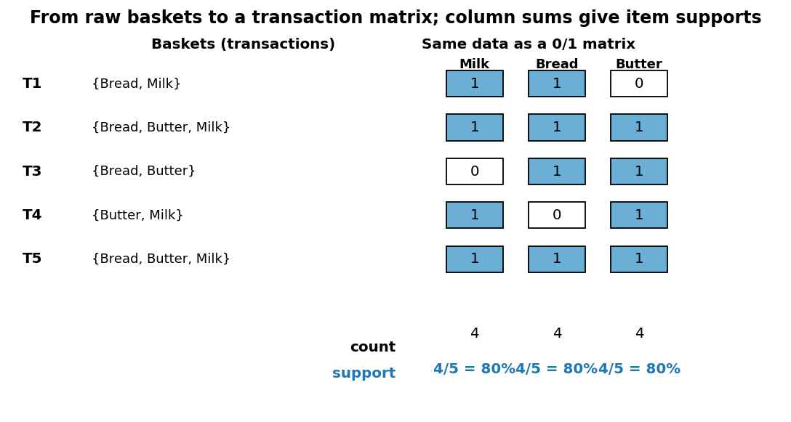

Column sums divided by N give each item's support. Here Milk 4/5 = 0.8, Bread 4/5 = 0.8, Butter 4/5 = 0.8 (this is "toy dataset 2" from the slides).

> A real retail dataset is **sparse**: the Groceries data below has about 2.6% of cells equal to 1 (the average basket has ~4.4 items out of ~170 products).

---

## 3. The Metrics in Depth: Support, Confidence, Lift, Conviction

### 3.1 Support: "how often?"

Support measures **how frequent** an itemset (or a rule's X ∪ Y) is. It tells you whether a pattern is **relevant at scale** or just a handful of baskets.

* A pattern with support 0.001 in a store with a million baskets is still 1,000 baskets; the same 0.001 in a 5,000-basket dataset is just 5 baskets (anecdote).

### 3.2 Confidence: "how reliably?"

$$\text{Confidence}(X\to Y)=P(Y\mid X)=\frac{\text{Support}(X\cup Y)}{\text{Support}(X)}$$

Among baskets containing X, the share that also contain Y. It measures the **reliability** of the rule.

**Weakness:** confidence ignores how popular Y already is. If 80% of *all* baskets contain bread, then "milk → bread" with confidence 80% tells us nothing. This is where lift comes in.

### 3.3 Lift: "compared with chance"

Under **independence**, $P(X\cap Y)=P(X)P(Y)$, so the **expected** support of X ∪ Y is Support(X) × Support(Y). Lift is the ratio of observed to expected co-occurrence:

$$\text{Lift}(X\to Y)=\frac{\text{Support}(X\cup Y)}{\text{Support}(X)\,\text{Support}(Y)}=\frac{\text{Confidence}(X\to Y)}{\text{Support}(Y)}$$

| Lift | Meaning |
|---|---|
| **> 1** | **Positive association**: X and Y co-occur more often than expected |
| **= 1** | Co-occurrence matches independence |
| **< 1** | **Negative association**: X and Y co-occur less often than expected |

*Example:* Lift(Milk → Bread) = 1.5 would mean the observed co-occurrence is 1.5 times the level expected under independence.

**Picture (toy dataset 2: Milk and Bread):**

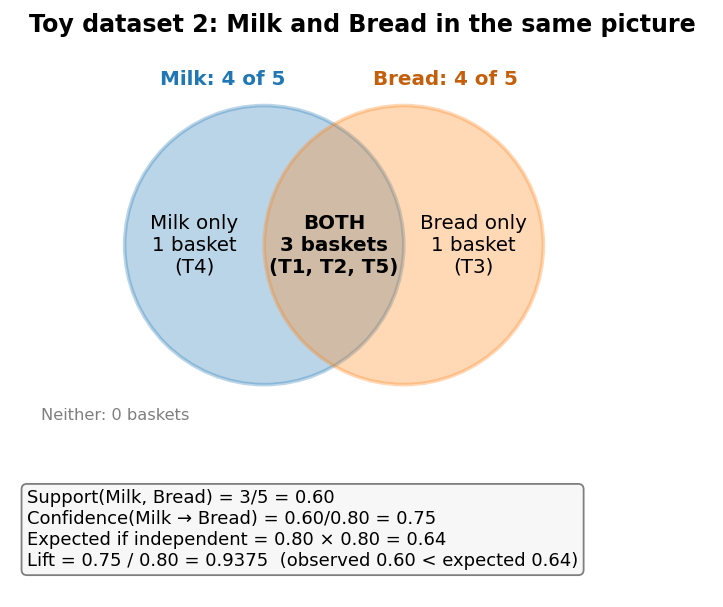

* Observed support of both = 3/5 = **0.60**; expected under independence = 0.8 × 0.8 = **0.64**.
* Lift = 0.60/0.64 = 0.9375: the items co-occur *slightly less* than chance would predict.

> **Lift is symmetric:** Lift(X → Y) = Lift(Y → X) (the numerator and denominator involve the same three supports). **Confidence is not symmetric.**

**Worked asymmetry example.** Suppose Support(X) = 0.2, Support(Y) = 0.5 and Support(X ∪ Y) = 0.1. Then Confidence(X → Y) = 0.1/0.2 = **0.5**, but Confidence(Y → X) = 0.1/0.5 = **0.2**. Lift both ways = 0.1/(0.2 × 0.5) = **1.0**: independence.

### 3.4 Conviction: "how badly does the rule fail?"

$$\text{Conviction}(X\to Y)=\frac{1-\text{Support}(Y)}{1-\text{Confidence}(X\to Y)}=\frac{P(\neg Y)}{P(\neg Y\mid X)}$$

It compares the **baseline rate of missing Y** with the **rate of missing Y among baskets containing X**.

| Conviction | Meaning |
|---|---|
| **= 1** | The conditional rate of missing Y equals its baseline rate (X tells you nothing) |
| **> 1** | Y is missed *less often* when X is present than the baseline; the larger, the stronger the implication |
| **< 1** | The opposite: Y is missed *more* often when X is present |
| **= ∞** | Confidence = 1: the rule is never violated |

*Example from the slides:* conviction = 1.25 ⇒ P(¬Y | X) = P(¬Y)/1.25, so the probability of missing Y is **20% lower** than its baseline (1 − 1/1.25 = 0.20).

**Conviction is directional** (X → Y and Y → X generally differ) whereas **lift is symmetric**.

**How the metrics respond to confidence** (illustration with P(Y) = 0.4):

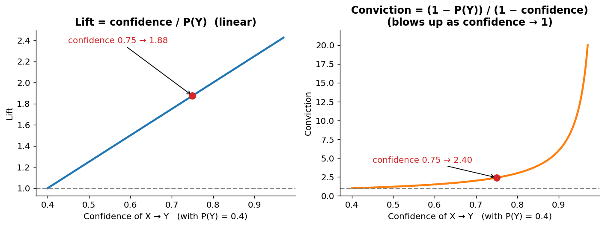

* **Lift** grows *linearly* with confidence (confidence ÷ 0.4). A rule with confidence 0.75 has lift 1.875.
* **Conviction** *explodes* as confidence approaches 1 (since the denominator 1 − confidence → 0). The same rule has conviction (1 − 0.4)/(1 − 0.75) = 2.4. This sensitivity to near-perfect rules is why it is used to assess **robustness of implication**.

### 3.5 Quick reference: what each metric answers

| Metric | Question | Direction | Range |
|---|---|---|---|
| Support | How often does the itemset occur? | n/a | 0 to 1 |
| Confidence | When X occurs, how often does Y? | X → Y only | 0 to 1 |
| Coverage | How often does the antecedent occur? | n/a | 0 to 1 |
| Lift | Is the co-occurrence above or below chance? | Symmetric | 0 to ∞ (1 = independence) |
| Conviction | How strongly does X imply Y (how rarely is the rule violated)? | X → Y only | 0 to ∞ (1 = no implication) |

---

## 4. The Four Steps of Association Analysis

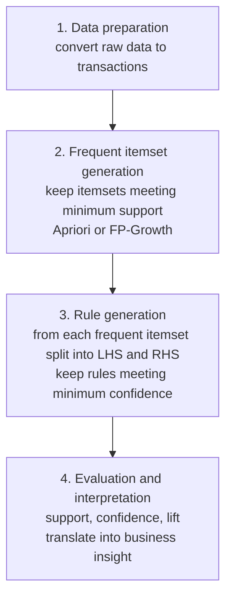

| Step | What happens | Notes |
|---|---|---|
| **1. Data preparation** | Convert raw data into a transactional format, e.g. the list of items bought in each transaction | Define what a "transaction" is (a basket, a customer-day, a customer-month?) and the item level (SKU or category) |
| **2. Frequent itemset generation** | Identify itemsets meeting the **minimum support** threshold | **Apriori**: generates candidate itemsets and prunes infrequent ones using the Apriori property. **FP-Growth**: builds a compact FP-tree and mines patterns *without* candidate generation |
| **3. Rule generation** | From frequent itemsets, generate rules that satisfy the **minimum confidence** (and optionally a **lift**) threshold | Done *after* itemsets are found |
| **4. Evaluation and interpretation** | Use support, confidence and lift to evaluate rules; interpret in business context | Insight comes from the business reading, not from the numbers alone |

**About FP-Growth (extra, beyond the slides' detail).** Instead of repeatedly scanning the data for candidates, FP-Growth compresses all transactions into a prefix-tree (FP-tree) in which shared beginnings of baskets are stored once, then mines the tree recursively. It finds the **same frequent itemsets as Apriori**, usually faster on large datasets.

---

## 5. Thresholds in Association Rule Mining

Three different filters act at three different stages:

| Stage | Threshold | Purpose | Example (from slides) |
|---|---|---|---|
| **Frequent-itemset generation** | **Minimum support** | Keep itemsets that occur **often enough to be relevant** | At 50%, only itemsets appearing in **at least half** the transactions are considered frequent |
| **Rule generation** | **Minimum confidence** | Retain rules with sufficiently high **observed reliability** | At 70%, the consequent must occur in **at least 70%** of baskets containing the antecedent |
| **Evaluation (post-rule)** | **Lift** | Identify co-occurrences that **depart from independence** | Lift > 1 indicates a positive association |

**How the thresholds divide the work in Apriori** (slide 7):

* **Support** ensures the **relevance of the itemsets**.
* **Confidence** **filters rules after** frequent itemsets are found.
* **Lift** helps **evaluate the resulting rules** relative to independence.

---

## 6. The Apriori Algorithm

Apriori is the classic algorithm for finding frequent itemsets in transactional data; association rules are then generated from them.

### 6.1 The Apriori property (downward closure)

> **If an itemset is frequent, then all of its subsets must also be frequent.**

Equivalently (the form used for pruning): **if an itemset is infrequent, every superset of it is infrequent too.**

**Why this is true.** Adding an item to an itemset can only **keep or reduce** its support: any basket containing {Milk, Bread, Butter} certainly contains {Milk, Bread}. So support(superset) ≤ support(subset): *support never increases as itemsets grow.*

**Analogy.** If fewer than 3 people in a class own a sports car, then fewer than 3 people can own *both a sports car and a yacht*. There is no point checking the pair once the single item has failed.

### 6.2 Why prune? Efficiency

With *d* items there are 2^d − 1 possible itemsets. Retail catalogues have thousands of items, so we cannot count them all. By eliminating candidates that have an infrequent subset **before counting their support**, Apriori **dramatically reduces the search space**.

### 6.3 The algorithm

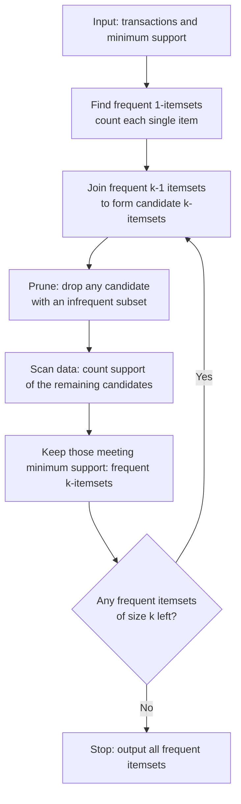

1. **Input:** the transactional dataset and a user-defined **minimum support**.
2. **Start** with single items (1-itemsets).
3. **Iteratively generate** larger itemsets (k-itemsets) by **combining previously found frequent (k − 1)-itemsets**.
4. **Prune** using the Apriori property: *if a k-itemset has any infrequent subset, drop it without computing its support.*
5. **Repeat** until no more frequent itemsets can be generated.

*How the join works (extra):* two frequent (k − 1)-itemsets are merged when they share their first k − 2 items (items kept in a fixed order). Example: from frequent 2-itemsets {AB, AC, BC, BD}, AB + AC give candidate ABC; BC + BD give candidate BCD. ABC survives pruning (AB, AC, BC are all frequent); BCD is pruned because its subset CD is not in the list.

---

## 7. Worked Example 1: Apriori Step by Step

**Toy dataset 1** (5 transactions); **minimum support = 60%** (itemset must appear in at least 3 of 5 transactions).

| Transaction | Items |
|---|---|
| T1 | {Milk, Bread, Butter} |
| T2 | {Milk, Bread} |
| T3 | {Bread, Butter} |
| T4 | {Milk, Butter} |
| T5 | {Bread, Butter} |

**Step 1: candidate 1-itemsets**

| Item | Transactions | Support |
|---|---|---|
| Milk | T1, T2, T4 | 3/5 = **60%** ✔ |
| Bread | T1, T2, T3, T5 | 4/5 = **80%** ✔ |
| Butter | T1, T3, T4, T5 | 4/5 = **80%** ✔ |

All 1-itemsets are frequent.

**Step 2: candidate 2-itemsets** (combine the frequent items)

| Itemset | Transactions | Support | Frequent? |
|---|---|---|---|
| {Milk, Bread} | T1, T2 | 2/5 = 40% | ✘ |
| {Milk, Butter} | T1, T4 | 2/5 = 40% | ✘ |
| {Bread, Butter} | T1, T3, T5 | 3/5 = 60% | ✔ |

Frequent 2-itemsets: **{Bread, Butter}** only.

**Step 3: can a 3-itemset be generated?** The only possible 3-itemset is {Milk, Bread, Butter}. Its 2-item subsets are {Milk, Bread} (40%), {Milk, Butter} (40%) and {Bread, Butter} (60%). Since {Milk, Bread} is infrequent, the 3-itemset **cannot be frequent and is not even a candidate**.

**Step 4: apply the Apriori property.** *(Note: it is sufficient to check the immediate (k − 1)-item subsets: if all those are frequent, then smaller subsets automatically are.)* Standard Apriori **stops here** because only one frequent 2-itemset remains, so no 3-itemset can be formed by joining.

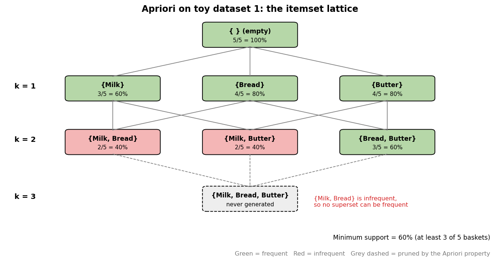

**Result:** frequent itemsets = {Milk}, {Bread}, {Butter}, {Bread, Butter}.

**Saved work:** we never counted {Milk, Bread, Butter}. In a big dataset this kind of saving happens at *every* level (see the Groceries search-space chart in Section 10.4).

---

## 8. Rule Generation from Frequent Itemsets

This step follows frequent-itemset mining (and is also done by `arules::apriori()`).

1. Take each frequent itemset **I** with |I| > 1.
2. **Split I into all possible combinations** of antecedent (LHS) and consequent (RHS).
3. For each rule LHS → RHS, calculate **confidence** = Support(I) / Support(LHS) (and optionally lift).
4. **Keep rules meeting the minimum confidence.**

**Worked example** from toy dataset 1: the frequent itemset {Bread, Butter} (support 3/5 = 0.6) yields two candidate rules. With a minimum confidence of 70%:

| Rule | Confidence | Lift | Keep? |
|---|---|---|---|
| Bread → Butter | 0.6/0.8 = **0.75** | 0.75/0.8 = 0.9375 | ✔ (passes 70%) |
| Butter → Bread | 0.6/0.8 = **0.75** | 0.75/0.8 = 0.9375 | ✔ (passes 70%) |

Both pass the confidence filter, yet **lift is below 1**: customers who buy bread are slightly *less* likely than average to buy butter. A rule can look reliable and still carry no real association, which is why the evaluation step uses lift too.

**Why not compute support again?** Because of the Apriori property, every subset of a frequent itemset (including the LHS) is also frequent, so its support has already been recorded.

**How many rules could there be?** For *d* items, the number of possible rules (non-empty LHS and RHS, any sizes) is

$$R=3^d-2^{d+1}+1\qquad (d=3: 12\text{ rules};\; d=6: 602\text{ rules};\; d=10: 57{,}002\text{ rules})$$

*(from Tan et al., extra)*. That is why thresholds are needed.

---

## 9. Worked Example 2: Milk, Bread and Butter in R

**Toy dataset 2** (5 transactions; objective: analyse the relationship between Milk and Bread):

| Transaction | Items |
|---|---|
| T1 | {Milk, Bread} |
| T2 | {Milk, Bread, Butter} |
| T3 | {Bread, Butter} |
| T4 | {Milk, Butter} |
| T5 | {Milk, Bread, Butter} |

### 9.1 Computing the metrics by hand

| Metric | Calculation | Value |
|---|---|---|
| Support({Milk}) | 4/5 | **0.8** |
| Support({Bread}) | 4/5 | **0.8** |
| Support({Milk, Bread}) | 3/5 (T1, T2, T5) | **0.6** |
| Confidence(Milk → Bread) | 0.6 / 0.8 | **0.75** |
| Confidence(Bread → Milk) | 0.6 / 0.8 | **0.75** |
| Lift(Milk → Bread) | 0.75 / 0.8 | **0.9375** |
| Lift(Bread → Milk) | 0.75 / 0.8 | **0.9375** |
| Conviction(Milk → Bread) *(extra)* | (1 − 0.8)/(1 − 0.75) = 0.2/0.25 | **0.8** |

**Interpretation:** Milk and Bread appear together in 60% of baskets; given Milk, Bread is bought 75% of the time (and vice versa). But lift 0.9375 < 1: they appear together *slightly less often than expected under independence*. (With only five transactions these values illustrate the calculations rather than establish stable purchasing patterns.)

### 9.2 The R code

```r
library(arules)
transactions <- as(list(
  c("Milk", "Bread"),
  c("Milk", "Bread", "Butter"),
  c("Bread", "Butter"),
  c("Milk", "Butter"),
  c("Milk", "Bread", "Butter")
), "transactions")
inspect(transactions)

# Generate association rules (very low thresholds so that everything is shown)
invisible(capture.output({
  rules <- apriori(transactions, parameter = list(supp = 0.01, conf = 0.01, target = "rules"))
}))
inspect(rules)

# Rules whose LHS contains Milk and whose RHS is Bread
milk_to_bread <- subset(rules, lhs %in% "Milk" & rhs %in% "Bread")
inspect(milk_to_bread)
bread_to_milk <- subset(rules, lhs %in% "Bread" & rhs %in% "Milk")
inspect(bread_to_milk)
```

| Piece | Meaning |
|---|---|
| `as(list(...), "transactions")` | Converts a list of baskets into arules' sparse transaction format |
| `apriori(..., target = "rules")` | Runs Apriori and generates rules |
| `supp`, `conf` | Minimum support and minimum confidence |
| `invisible(capture.output(...))` | Hides apriori's console log in the slides |
| `subset(rules, lhs %in% "Milk" & rhs %in% "Bread")` | Filters rules. `%in%` means the LHS **contains** Milk (it may contain other items too) |

### 9.3 The output: all 12 rules

| # | LHS | RHS | Support | Confidence | Coverage | Lift | Count |
|---|---|---|---|---|---|---|---|
| 1 | {} | {Bread} | 0.8 | 0.800 | 1.0 | 1.000 | 4 |
| 2 | {} | {Milk} | 0.8 | 0.800 | 1.0 | 1.000 | 4 |
| 3 | {} | {Butter} | 0.8 | 0.800 | 1.0 | 1.000 | 4 |
| 4 | {Bread} | {Milk} | 0.6 | 0.750 | 0.8 | 0.9375 | 3 |
| 5 | {Milk} | {Bread} | 0.6 | 0.750 | 0.8 | 0.9375 | 3 |
| 6 | {Bread} | {Butter} | 0.6 | 0.750 | 0.8 | 0.9375 | 3 |
| 7 | {Butter} | {Bread} | 0.6 | 0.750 | 0.8 | 0.9375 | 3 |
| 8 | {Milk} | {Butter} | 0.6 | 0.750 | 0.8 | 0.9375 | 3 |
| 9 | {Butter} | {Milk} | 0.6 | 0.750 | 0.8 | 0.9375 | 3 |
| 10 | {Bread, Milk} | {Butter} | 0.4 | 0.667 | 0.6 | 0.8333 | 2 |
| 11 | {Bread, Butter} | {Milk} | 0.4 | 0.667 | 0.6 | 0.8333 | 2 |
| 12 | {Butter, Milk} | {Bread} | 0.4 | 0.667 | 0.6 | 0.8333 | 2 |

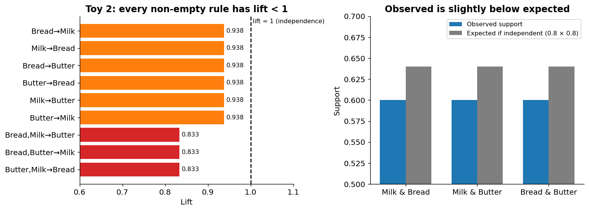

### 9.4 How to read it (slides 18–20)

**Column meanings:** *support* = share of baskets containing LHS ∪ RHS; *confidence* = P(RHS | LHS); *coverage* = support of the LHS; *lift* = relative to independence; *count* = number of baskets.

**Rules with an empty LHS ({} → RHS).** E.g., {} → {Bread}: support 0.8 (80% of baskets contain Bread), confidence 0.8 (equal to Bread's support, because an empty antecedent holds in every basket), lift **1** (the empty antecedent provides no extra information). These "baseline" rows are useful as a reference: **a rule is interesting only if its confidence beats the baseline confidence of its RHS.** (To drop them, add `minlen = 2` to the `parameter` list.)

**Single-item LHS.** {Bread} → {Butter}: support 0.6, confidence 0.75 (75% of Bread baskets contain Butter), lift 0.9375 (slightly below the independence benchmark of 1).

**Multi-item LHS.** {Bread, Butter} → {Milk}: support 0.4 (40% of baskets contain all three items), confidence 2/3 ≈ 0.667, lift 5/6 ≈ 0.833 (a **larger departure below independence**). Conviction for this rule *(extra)* = (1 − 0.8)/(1 − 0.667) = 0.6.

**Insights from the slides**

* **Positive associations:** *none.* No rule with a non-empty LHS has lift above 1.
* **Below independence:** {Butter} → {Milk} and {Bread} → {Butter} (lift 0.9375); {Bread, Butter} → {Milk} (0.8333).
* **General pattern:** Milk, Bread and Butter each have support 0.8; every *pair* has support 0.6; the triple has support 0.4. These five transactions are illustrative: the small sample does **not** establish a broader purchasing pattern.

**One more run (slide 21):** the same rules appear with `supp = 0.4, conf = 0.5`, because every rule above already has support ≥ 0.4 and confidence ≥ 0.667. Raising the thresholds to those values removes nothing here.

---

## 10. Real Data: the Groceries Dataset

The `Groceries` dataset (in R's `arules` package) holds **one month of real point-of-sale data from a grocery store**: 9,835 transactions of food and household items, with a product hierarchy attached (items belong to a `level2` category such as "sausage" which sits in `level1` "meat and sausage").

```r
library(arules)
data("Groceries")
summary(Groceries)
inspect(Groceries[1:10])
invisible(capture.output({
  rules <- apriori(Groceries, parameter = list(supp = 0.01, conf = 0.5))
}))
inspect(sort(rules, by = "lift"))
```

### 10.1 Reading `summary(Groceries)`

| Output | Meaning |
|---|---|
| **9,835 rows** (transactions) × **169 columns** (items) | N = 9,835 baskets; 169 product labels |
| **Density 0.0261** | About 2.6% of the 0/1 matrix is filled: very **sparse** |
| Most frequent items: **whole milk 2,513**, other vegetables 1,903, rolls/buns 1,809, soda 1,715, yogurt 1,372 | Whole milk is in 2,513/9,835 = **25.5%** of baskets |
| Basket-size distribution: 2,159 baskets have **1** item, 1,643 have 2, 1,299 have 3, … up to **32** items | **Mean 4.41**, median 3, max 32 |
| Extended item information: labels, level2, level1 | Items can be **aggregated** to broader categories |

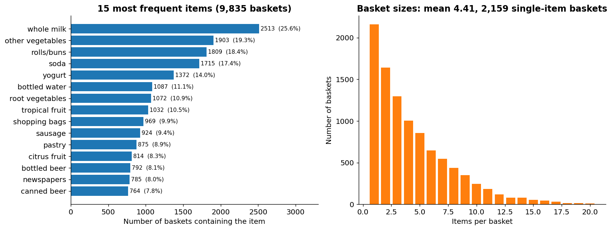

*(Charts computed directly from the Groceries transactions.)* Notice: a fifth of baskets contain just one item, and a few staples dominate. Frequent staples will shape the rules (see below).

**Slide 24, ten sample baskets.** E.g., basket 3 = {whole milk}; basket 7 = {rolls/buns}; basket 9 = {pot plants}; basket 1 = {citrus fruit, semi-finished bread, margarine, ready soups}; basket 8 = {other vegetables, UHT-milk, rolls/buns, bottled beer, liquor (appetizer)}. Real baskets are messy.

### 10.2 The 15 rules at support ≥ 1%, confidence ≥ 50% (sorted by lift)

I re-ran Apriori on the Groceries transactions and reproduced the slide's 15 rules exactly (same support, confidence, coverage, lift and count). Conviction is added for reference.

| # | LHS → RHS | Support | Confidence | Coverage | **Lift** | Count | Conviction |
|---|---|---|---|---|---|---|---|
| 1 | {citrus fruit, root vegetables} → {other vegetables} | 0.01037 | 0.586 | 0.01769 | **3.03** | 102 | 1.95 |
| 2 | {tropical fruit, root vegetables} → {other vegetables} | 0.01230 | 0.585 | 0.02105 | **3.02** | 121 | 1.94 |
| 3 | {root vegetables, rolls/buns} → {other vegetables} | 0.01220 | 0.502 | 0.02430 | 2.59 | 120 | 1.62 |
| 4 | {root vegetables, yogurt} → {other vegetables} | 0.01291 | 0.500 | 0.02583 | 2.58 | 127 | 1.61 |
| 5 | {curd, yogurt} → {whole milk} | 0.01007 | 0.582 | 0.01729 | 2.28 | 99 | 1.78 |
| 6 | {other vegetables, butter} → {whole milk} | 0.01149 | 0.574 | 0.02003 | 2.24 | 113 | 1.75 |
| 7 | {tropical fruit, root vegetables} → {whole milk} | 0.01200 | 0.570 | 0.02105 | 2.23 | 118 | 1.73 |
| 8 | {root vegetables, yogurt} → {whole milk} | 0.01454 | 0.563 | 0.02583 | 2.20 | 143 | 1.70 |
| 9 | {other vegetables, domestic eggs} → {whole milk} | 0.01230 | 0.553 | 0.02227 | 2.16 | 121 | 1.66 |
| 10 | {yogurt, whipped/sour cream} → {whole milk} | 0.01088 | 0.525 | 0.02074 | 2.05 | 107 | 1.57 |
| 11 | {root vegetables, rolls/buns} → {whole milk} | 0.01271 | 0.523 | 0.02430 | 2.05 | 125 | 1.56 |
| 12 | {pip fruit, other vegetables} → {whole milk} | 0.01352 | 0.518 | 0.02613 | 2.03 | 133 | 1.54 |
| 13 | {tropical fruit, yogurt} → {whole milk} | 0.01515 | 0.517 | 0.02928 | 2.02 | 149 | 1.54 |
| 14 | {other vegetables, yogurt} → {whole milk} | **0.02227** | 0.513 | 0.04342 | 2.01 | 219 | 1.53 |
| 15 | {other vegetables, whipped/sour cream} → {whole milk} | 0.01464 | 0.507 | 0.02888 | 1.98 | 144 | 1.51 |

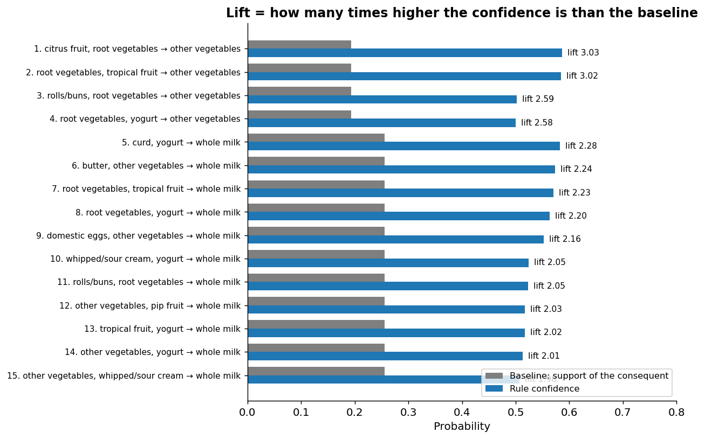

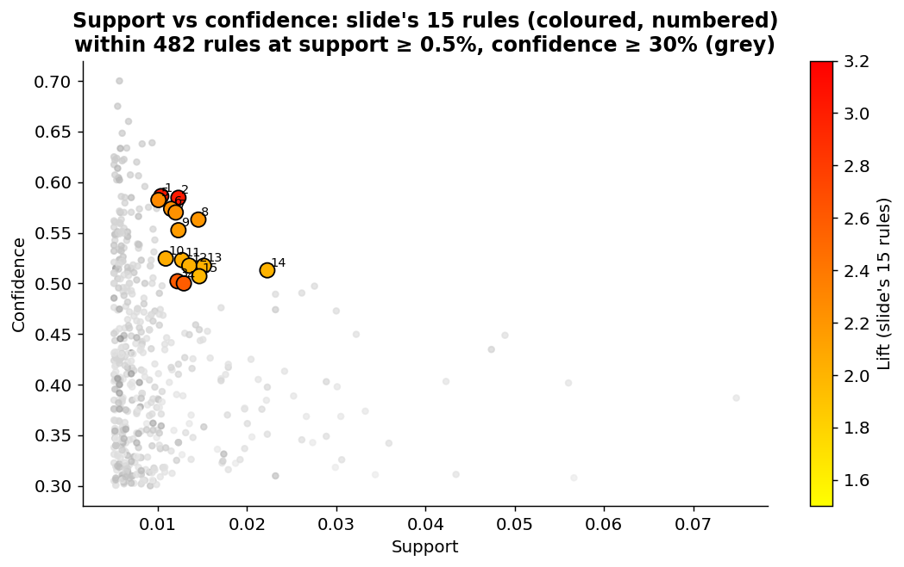

### 10.3 Interpreting the rules (slides 26–27)

**Verifying the lift arithmetic.** Rule 1: Support(other vegetables) = 1903/9835 = 0.1935. Lift = confidence / baseline = 0.5862 / 0.1935 = **3.03**. Rule 14: Support(whole milk) = 2513/9835 = 0.2555, lift = 0.5129/0.2555 = **2.007** ✓.

**Rules with high lift**

* **Rule 1 {citrus fruit, root vegetables} → {other vegetables}** (lift 3.03): baskets containing citrus fruit and root vegetables are about **three times as likely** to contain other vegetables as a basket overall (58.6% vs 19.4%). Reading: shoppers buying vegetables tend to **expand their basket with other vegetable categories**, so vegetable-buyer promotions make sense.
* **Rule 2 {tropical fruit, root vegetables} → {other vegetables}** (lift 3.02): the antecedent includes tropical fruit, which is not directly a vegetable. It suggests a **customer segment that buys a mix of fruit and vegetables**; useful for cross-category promotions (e.g., fruit + vegetable discounts).

**Rules with high confidence**

* **Rule 5 {curd, yogurt} → {whole milk}**: 58.2% of baskets with curd and yogurt also contain whole milk.
* **Rule 6 {other vegetables, butter} → {whole milk}**: 57.4%.
* *(Rules 1 and 2 actually have even higher confidence, 58.6% and 58.5%; the slide's list is ordered by lift, not by confidence, and all 15 rules lie in a narrow 50–59% band.)*

**Rule with high support: Rule 14 {other vegetables, yogurt} → {whole milk}**: support 0.02227 means **2.23% of all transactions (219 baskets) contain all three items {other vegetables, yogurt, whole milk}**. *This is the support of the full 3-item set, not the support of the consequent alone.*

> **Reminder:** support(rule) = support(LHS ∪ RHS). Confusing it with the support of the RHS is a common slip.

### 10.4 What the Apriori run actually did (re-created from the data)

At minimum support 1% (≥ 99 baskets):

| Level k | Possible k-itemsets (171 labels in my copy of the data) | Candidates after joining | After Apriori pruning | **Frequent** |
|---|---|---|---|---|
| 1 | 171 | 171 | 171 | **87** |
| 2 | 14,535 | 3,741 (= C(87,2)) | 3,741 | **213** |
| 3 | 818,805 | 668 | 576 | **32** |
| 4 | 34,389,810 | 9 | 6 | **0** |

→ **332 frequent itemsets in total.** Rules are then generated from the 245 frequent itemsets of size ≥ 2 and filtered at confidence 50%, leaving **15**.

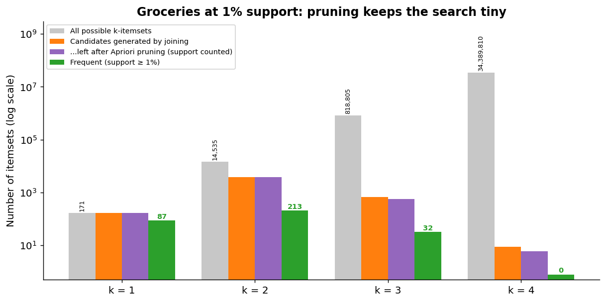

*Reading the chart:* the grey bars (all possible itemsets) grow explosively, while the orange/purple bars (what Apriori actually has to count) stay tiny. At k = 3 the Apriori property removes 92 of 668 candidates (13.8%) **before any counting**. Only 87 of the 171 items are frequent at 1%, so every pair or triple containing an infrequent item is never examined.

### 10.5 Business insights (slide 28)

| Opportunity | How to use the rules |
|---|---|
| **Promotional opportunities** | Group items with strong positive associations for cross-selling, e.g. {tropical fruit, root vegetables, other vegetables} |
| **Store layout** | Place associated items such as {yogurt, whole milk} or {root vegetables, other vegetables} **closer together** so joint purchases are more convenient |
| **Targeted marketing** | Use frequent itemsets such as {other vegetables, yogurt, whole milk} for **bundled discounts** or targeted promotions |

**Two cautions for the Groceries output**

1. **All 15 rules end in "whole milk" (11) or "other vegetables" (4)**: the two most popular items. At 1% support, rules can only be built from items that are already frequent, and the *consequent* of a rule is easiest to predict when it is something half of customers buy. If your goal is to promote less common, higher-margin products, you must **lower the support threshold** (next section) and look at lift.
2. **A rule says shoppers who buy X *also* buy Y; it does not say that moving X next to Y *causes* extra sales.** Test layout changes with experiments.

---

## 11. Choosing Thresholds in Practice

The thresholds are **business and statistical judgments**, not defaults to accept blindly (the same lesson as λ in Sessions 3–5 and K in Sessions 1–2).

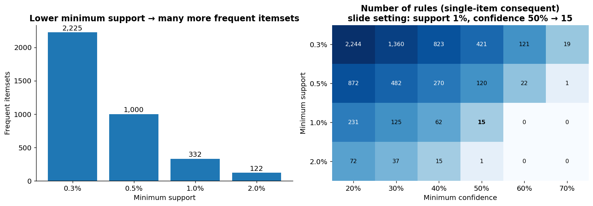

*(Computed on the Groceries data; rules counted with a single-item consequent and non-empty LHS, as `arules` reports them.)*

**What the charts show**

| Min support | Frequent itemsets | Rules at confidence 50% |
|---|---|---|
| 2% | 122 | 1 |
| **1%** (slide) | **332** | **15** |
| 0.5% | 1,000 | 120 |
| 0.3% | 2,225 | 421 |

* **Lower the minimum support from 1% to 0.3% and the rule count at 50% confidence jumps from 15 to 421.** You get more patterns, including rare-but-interesting ones, but also far more to sift through and more spurious ones.
* **Raise the minimum confidence and the count shrinks quickly**: at support 0.3%, confidence 70% leaves only 19 rules.
* At 0.3% support (≥ 30 baskets) the top rules by lift include {citrus fruit, other vegetables, tropical fruit, whole milk} → {root vegetables} with **lift 5.8**, but supported by just **31 baskets**. Higher lift, thinner evidence.

**Trade-off summary**

| Threshold too high | Threshold too low |
|---|---|
| Few rules; only obvious combinations of staple items; **miss niche opportunities** | Thousands of rules; many coincidences supported by a handful of baskets; analyst overload |

**A practical workflow:** start with a moderately low support (so enough baskets back each rule), a modest confidence, then **rank by lift (and check conviction and counts)**, and finally apply business filters (margin, actionability, product category).

---

## 12. Lift vs Conviction

Slide 30 compares the two measures that go beyond support and confidence.

| Aspect | Lift | Conviction |
|---|---|---|
| **What it measures** | Co-occurrence relative to independence | Rule **implication strength** |
| **Formula** | Confidence(X → Y) / Support(Y) | (1 − Support(Y)) / (1 − Confidence(X → Y)) |
| **Question answered** | "How does observed co-occurrence compare with independence?" | "How strongly does the presence of X imply Y (how much does the absence of Y invalidate the rule)?" |
| **Focus** | Strength of association (positive or negative) | Conditional vs baseline **absence** of Y |
| **Direction** | **Symmetric** | **Directional** |
| **Range** | > 1 positive, = 1 none, < 1 negative | < 1, = 1, > 1 (or ∞ when confidence = 1) |
| **Use case** | Evaluate association relative to independence | Evaluate implication strength and **robustness** of the rule |
| **Interpretation** | Lift > 1: positive association | Conviction > 1: **fewer conditional rule violations** than at baseline |

**Worked comparison.** Two hypothetical rules:

| | Confidence | Support(Y) | Lift | Conviction |
|---|---|---|---|---|
| Rule A | 0.90 | 0.90 | 0.90/0.90 = **1.0** | 0.10/0.10 = **1.0** |
| Rule B | 0.40 | 0.05 | 0.40/0.05 = **8.0** | 0.95/0.60 ≈ **1.58** |

Rule A looks reliable (90% confidence) but is **worthless**: 90% of *all* baskets contain Y anyway. Rule B has modest confidence but identifies a customer group 8× more likely to buy Y. Lift and conviction both flag Rule A as uninformative.

*Another common metric (extra):* **leverage** = Support(X ∪ Y) − Support(X)·Support(Y), the *absolute* difference between observed and expected co-occurrence. For Milk → Bread: 0.60 − 0.64 = −0.04.

---

## 13. Pitfalls and Limitations

| Pitfall | Explanation | What to do |
|---|---|---|
| **Small samples** | Five baskets cannot establish a pattern (slide 15, 20). Even thousands of baskets can give rules backed by 30 baskets | Always look at the **count** of baskets behind a rule |
| **Association ≠ causation** | "Buyers of X also buy Y" does not mean X *causes* Y | Test interventions (A/B tests) |
| **Frequent-item bias** | Staples (milk, vegetables) dominate rules at moderate support | Examine lift; lower support; stratify; use category levels |
| **Rare but valuable items** | A high-margin item bought in 0.2% of baskets never appears at 1% support | Lower the threshold for that category or **aggregate to a product hierarchy** (level2/level1 in Groceries) |
| **Too many rules** | Low thresholds produce thousands of rules, many redundant | Rank by lift/conviction, remove redundant rules, apply business filters |
| **High confidence ≠ interesting** | If Y is very popular, confidence is high for any X | Check **lift** and baseline ({} → Y) rows |
| **Thresholds are arbitrary** | Results change a lot with support/confidence | Report the thresholds; do sensitivity analysis (Section 11) |
| **Unsupervised: no accuracy metric** | There is no outcome to test against, so no "validation error" | Validate by **stability** (do the rules persist on a hold-out period?) and by **business experiments** |
| **Data definition issues** | What counts as a transaction/time window/item level changes the rules | Decide with the business team and document |
| **Direction** | A → B and B → A can have different confidence | Interpret each direction separately; lift is symmetric |

---

## 14. From Rules to Business Action

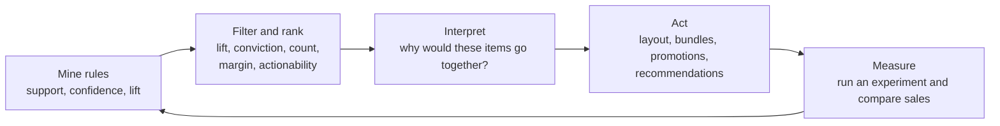

The slides emphasise that **interpretation in the context of the business problem** is what turns rules into actionable insight. A sensible checklist for each candidate rule:

1. Is there **enough evidence** (count, support)?
2. Is the association **above chance** (lift > 1) and robust (conviction)?
3. Does it make **business sense** (substitutes? complements? seasonal?)?
4. Is it **actionable** (can we move shelves, bundle, recommend, change stock)?
5. Is it **new** (not already obvious)?
6. How will we **measure** whether acting on it worked?

---

## 15. Python Equivalent

The course allows R/Python. In Python, `mlxtend` provides Apriori and FP-Growth:

```python
import pandas as pd
from mlxtend.preprocessing import TransactionEncoder
from mlxtend.frequent_patterns import apriori, fpgrowth, association_rules

# transactions = [["Milk","Bread"], ["Milk","Bread","Butter"], ...]
te = TransactionEncoder()
onehot = pd.DataFrame(te.fit(transactions).transform(transactions), columns=te.columns_)

freq = apriori(onehot, min_support=0.01, use_colnames=True)      # frequent itemsets (or fpgrowth(...))
rules = association_rules(freq, metric="confidence", min_threshold=0.5)
rules = rules.sort_values("lift", ascending=False)
print(rules[["antecedents", "consequents", "support", "confidence", "lift", "conviction"]].head(15))
```

| R `arules` | Python `mlxtend` |
|---|---|
| `as(list, "transactions")` | `TransactionEncoder` → 0/1 DataFrame |
| `apriori(supp=, conf=)` | `apriori(min_support=)` then `association_rules(min_threshold=)` |
| `inspect(sort(rules, by="lift"))` | `rules.sort_values("lift")` |
| `coverage` column | `antecedent support` column |
| `lift`, `conviction` | `lift`, `conviction` (plus `leverage`) |

⚠️ `mlxtend` also generates rules with **multi-item consequents**, whereas `arules::apriori` reports rules with a **single item on the right-hand side**, so rule counts will differ between the two.

---

## 16. Cheat Sheet

| Concept | One-liner |
|---|---|
| Association analysis | Unsupervised; finds items that occur together in transactions |
| Itemset | A set of one or more items |
| Support(X) | (# baskets containing X) / N |
| Confidence(X→Y) | Support(X∪Y) / Support(X) = P(Y \| X) |
| Coverage | Support of the LHS |
| Lift | Confidence / Support(Y); > 1 positive, = 1 independent, < 1 negative; **symmetric** |
| Conviction | (1 − Support(Y)) / (1 − Confidence); **directional**; ∞ if confidence = 1 |
| Leverage (extra) | Support(X∪Y) − Support(X)Support(Y) |
| Minimum support | Filters itemsets (relevance) |
| Minimum confidence | Filters rules (reliability) |
| Lift threshold | Optional extra filter |
| Apriori property | Subsets of frequent itemsets are frequent; supersets of infrequent itemsets are infrequent |
| Apriori | Level-wise: frequent k−1 → join → prune → count → frequent k |
| FP-Growth | FP-tree, no candidate generation; same itemsets |
| Rule generation | Split each frequent itemset into LHS → RHS, keep rules above min confidence |
| Rules for d items | 3^d − 2^(d+1) + 1 |
| Empty-LHS rule | Baseline: confidence = Support(RHS), lift = 1 |
| Frequent-item bias | Staples dominate rules at moderate support |
| Association ≠ causation | Always |

**Top mistakes to avoid**
1. Choosing rules by confidence alone (ignoring how popular the RHS is).
2. Treating lift from tiny counts as reliable.
3. Confusing a rule's support with the consequent's support.
4. Calling a rule "causal", or reading X → Y as if Y → X had the same confidence.
5. Using the default thresholds without asking what they exclude.
6. Mining at SKU level when the products you care about are rare (aggregate instead).

---

## 17. Practice Questions with Answers

**Q1.** Using toy dataset 2, compute support, confidence, lift and conviction for {Butter} → {Milk}.
**A.** Butter is in T2, T3, T4, T5 (support 0.8); Milk in T1, T2, T4, T5 (0.8); both in T2, T4, T5 → support **0.6**. Confidence = 0.6/0.8 = **0.75**. Lift = 0.75/0.8 = **0.9375**. Conviction = (1 − 0.8)/(1 − 0.75) = **0.8**.

**Q2.** Six transactions: T1 {A,B,C}, T2 {A,B}, T3 {A,C}, T4 {B,C}, T5 {A,B,C}, T6 {A}. With minimum support 50%, run Apriori and list the frequent itemsets.
**A.** Counts: A = 5, B = 4, C = 4 (all ≥ 3) → frequent. Pairs: AB = 3 (T1,T2,T5), AC = 3 (T1,T3,T5), BC = 3 (T1,T4,T5) → all frequent (≥ 3). Triple ABC (all subsets frequent) = 2 (T1,T5) < 3 → **infrequent**. Frequent itemsets: A, B, C, AB, AC, BC.

**Q3.** From the data in Q2, generate the rules from {A, B}, with minimum confidence 70%, and give their lift.
**A.** Support(AB) = 3/6 = 0.5; Support(A) = 5/6; Support(B) = 4/6. A → B: confidence = 0.5/(5/6) = **0.60** (rejected). B → A: confidence = 0.5/(4/6) = **0.75** (kept). Lift of both = 0.75/(5/6) = **0.90** (< 1: slight negative association, despite 75% confidence).

**Q4.** P(X) = 0.4, P(Y) = 0.5, P(X ∩ Y) = 0.2. Compute confidence, lift and conviction for X → Y. What do you conclude?
**A.** Confidence = 0.2/0.4 = 0.5. Lift = 0.5/0.5 = **1**. Conviction = (1 − 0.5)/(1 − 0.5) = **1**. The items are independent: X tells us nothing about Y.

**Q5.** Why does Apriori's pruning never lose a frequent itemset?
**A.** Support is anti-monotone: adding items can't increase support, since every basket containing the larger itemset also contains every subset. So an itemset with an infrequent subset has support ≤ that subset's support < minimum, and can safely be discarded without counting.

**Q6.** A shop sells 10 products. How many possible itemsets (non-empty) and how many possible rules?
**A.** Itemsets: 2¹⁰ − 1 = **1,023**. Rules: 3¹⁰ − 2¹¹ + 1 = 59,049 − 2,048 + 1 = **57,002**. (Illustrates why thresholds and pruning are needed.)

**Q7.** The Groceries rule {root vegetables, yogurt} → {other vegetables} has support 0.0129, confidence 0.50 and lift 2.58. Interpret all three, and say what Support(other vegetables) is.
**A.** About 1.3% of all baskets (127) contain all three items. Half of the baskets with root vegetables and yogurt contain other vegetables. Lift 2.58 means that is 2.58× the baseline: Support(other vegetables) = 0.50/2.58 ≈ **0.194** (19.4%). Conviction = (1 − 0.194)/(1 − 0.5) ≈ 1.61.

**Q8.** Rule A: confidence 0.9 with Support(Y) = 0.9. Rule B: confidence 0.4 with Support(Y) = 0.05. Which is more interesting?
**A.** Rule B. Lift(A) = 1 (no information; everyone buys Y), Lift(B) = 8. Conviction: A = 1.0, B ≈ 1.58.

**Q9.** Slide 27 lists Rule 14 as a "high-support" rule with support 0.02227. A student says "so 2.2% of customers buy {other vegetables, yogurt}". Correct them.
**A.** 0.02227 is the support of the **three-item set** {other vegetables, yogurt, whole milk}. The antecedent {other vegetables, yogurt} alone has support (coverage) 0.0434, about 4.3% of baskets.

**Q10.** After lowering the minimum support from 1% to 0.3%, the number of rules at 50% confidence rises from 15 to 421. Give two benefits and two risks.
**A.** *Benefits:* rules involving less popular items and niche segments appear; lifts can be much larger. *Risks:* many more spurious rules; each may rest on very few baskets (~30), so high lift may be noise; analyst overload and multiple-testing-like problems.

**Q11.** An item has support 0.2% and high margin. How can you still study its associations?
**A.** Lower the minimum support (accepting a weaker evidence base), restrict analysis to baskets in the relevant category, or **aggregate** items to a higher level of the product hierarchy (e.g., use `level2`/`level1` labels in Groceries) so that the aggregated item reaches the support threshold.

**Q12.** True or false: (a) Lift(X → Y) = Lift(Y → X). (b) Confidence(X → Y) = Confidence(Y → X). (c) Conviction(X → Y) = Conviction(Y → X).
**A.** (a) **True** (symmetric). (b) **False** in general; equal only when Support(X) = Support(Y). (c) **False** in general: conviction is directional.

**Q13.** A bank proposes using association rules to detect fraud by flagging unusual transactions. Comment.
**A.** Association rules summarise *frequent* co-occurrences, so they could be used to flag baskets that violate very reliable rules (high conviction), but they don't directly identify rare behaviours, and thresholds on support would hide rare fraud patterns. They are better as a complement to supervised or anomaly-detection methods.

**Q14.** In the toy dataset 2 output, {Bread, Butter} → {Milk} has confidence 0.667 and lift 0.833. Explain both numbers in words and compute its conviction.
**A.** Of the 3 baskets with Bread and Butter (T2, T3, T5), 2 contain Milk: 2/3 = 0.667. Milk is in 80% of all baskets, so this is below the baseline: 0.667/0.8 = 0.833, a negative association. Conviction = (1 − 0.8)/(1 − 0.667) = **0.6** (< 1).

---

## 18. Glossary

| Term | Meaning |
|---|---|
| **Transaction / basket** | One purchase record: the set of items bought together |
| **Itemset** | A collection of one or more items |
| **k-itemset** | An itemset with k items |
| **Frequent itemset** | An itemset whose support meets the minimum support |
| **Support** | Proportion of transactions containing an itemset (or both sides of a rule) |
| **Confidence** | P(RHS \| LHS): reliability of a rule |
| **Coverage** | Support of the antecedent (LHS) |
| **Lift** | Observed co-occurrence relative to independence |
| **Conviction** | Baseline rate of missing Y divided by the rate of missing Y given X |
| **Leverage** | Observed minus expected co-occurrence |
| **Antecedent / LHS** | The "if" part of a rule |
| **Consequent / RHS** | The "then" part of a rule |
| **Apriori property / downward closure** | Subsets of frequent itemsets are frequent; supersets of infrequent itemsets are infrequent |
| **Candidate itemset** | An itemset generated by joining that must still be tested |
| **Pruning** | Discarding candidates that have an infrequent subset |
| **FP-Growth** | Frequent-pattern mining using a compact FP-tree, no candidate generation |
| **Market-basket analysis** | Finding products frequently bought together |
| **Sparse data** | A 0/1 matrix where most cells are 0 |
| **Unsupervised learning** | Learning patterns without an outcome variable |

---

## 19. Things to Watch for in the Slides and R Output

Observations for your own understanding; some may be worth raising in class.

1. **The empty-LHS rows.** The toy-dataset output includes rules such as {} → {Bread} with lift exactly 1. They are baselines created because `arules::apriori` allows an empty antecedent by default (`minlen = 1`). Add `minlen = 2` to the `parameter` list to remove them.
2. **Why there are exactly 12 rules.** The 12 rules in slide 17 are 3 empty-LHS rules + 6 single-item-LHS rules + 3 two-item-LHS rules. This is *not* the same set as the 12 possible rules from the 3^d − 2^(d+1) + 1 formula: `arules::apriori` reports rules with a **single item** in the consequent, so rules like {Milk} → {Bread, Butter} do not appear. (The matching count of 12 is a coincidence.)
3. **Slide 21's title says `supp = 0.4` and `conf = 0.5`** but the output equals slide 17's (`supp = 0.01`, `conf = 0.01`). That is not a mistake in the output: all 12 rules already have support ≥ 0.4 and confidence ≥ 0.667, so nothing is removed.
4. **`subset(rules, lhs %in% "Milk" & ...)` matches rules whose LHS *contains* Milk.** That's why the output also includes {Butter, Milk} → {Bread}. Add `& size(lhs) == 1` to keep only single-item LHS.
5. **"Rules with High Confidence" (slide 27).** The slide highlights rules 5 and 6, but rules 1 and 2 have slightly higher confidence (58.6%, 58.5% vs 58.2%, 57.4%). The list is sorted by lift. All 15 rules lie between 50% and 59%, so confidence differences are small.
6. **Same consequents everywhere.** All 15 rules end in whole milk or other vegetables, the two most frequent items; see Section 10.5 for why that happens at 1% support.
7. **Item counts.** The slide says 169 columns, while the copy of the dataset I used for the re-creation has 171 distinct labels (a CSV version of the same 9,835 baskets). The 15 rules reproduce identically, but numbers like "possible itemsets" in Section 10.4 use 171.
8. **Lift for toy data.** Slide 15 rightly warns that with five transactions the values only illustrate the calculation. The same caution applies, more mildly, to rules supported by around 100 baskets.
9. **About the figures.** Figures 01–05 are illustrations built from the slides' toy examples (05 is a generic illustration with P(Y) = 0.4). Figures 06–10 are **computed from the real Groceries transactions** with a Python implementation of Apriori that I checked against the slide's 15 rules. Extras that are not on the slides (conviction for each rule, leverage, rule-count formula, FP-Growth description, join step, threshold sensitivity) are labelled "extra" or placed in clearly separate sections.

---

*Notes prepared from the Course Outline (AY 2026-27) and the "AMLBT Lectures 11–12" slides (draft dated 2026-10-14). Slide wording may still change since the deck is marked "Draft".*
