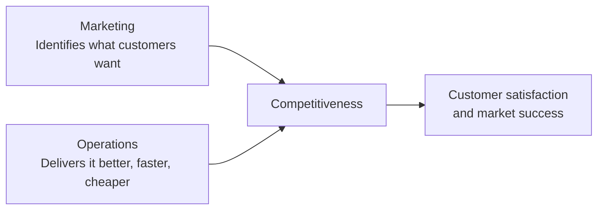
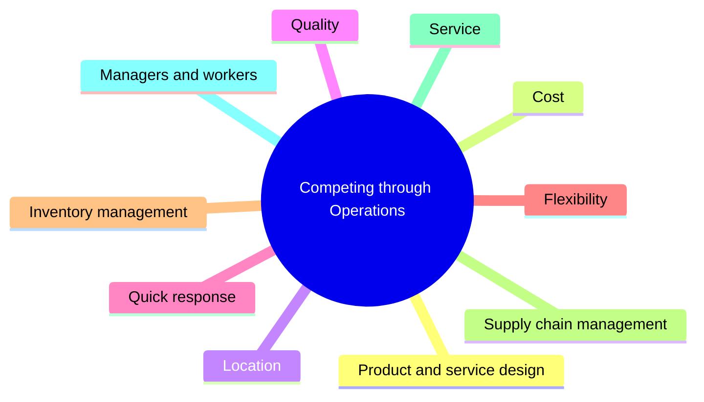
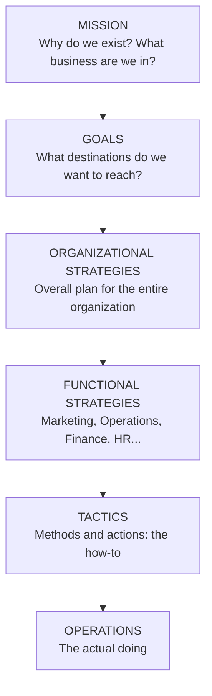
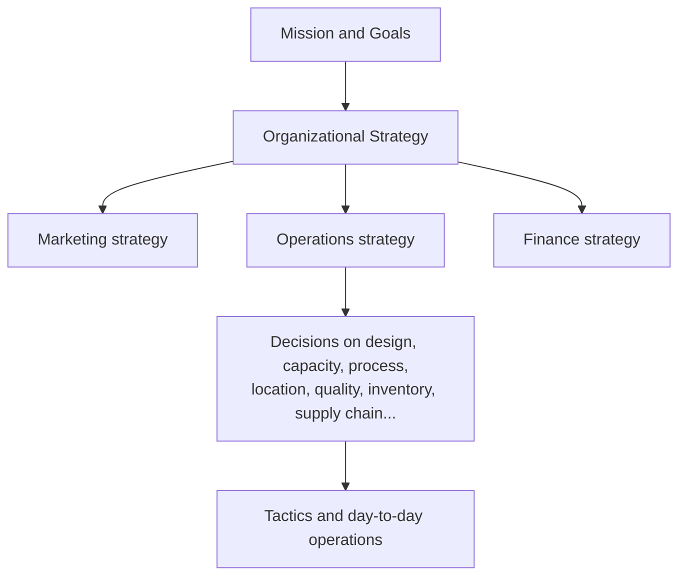
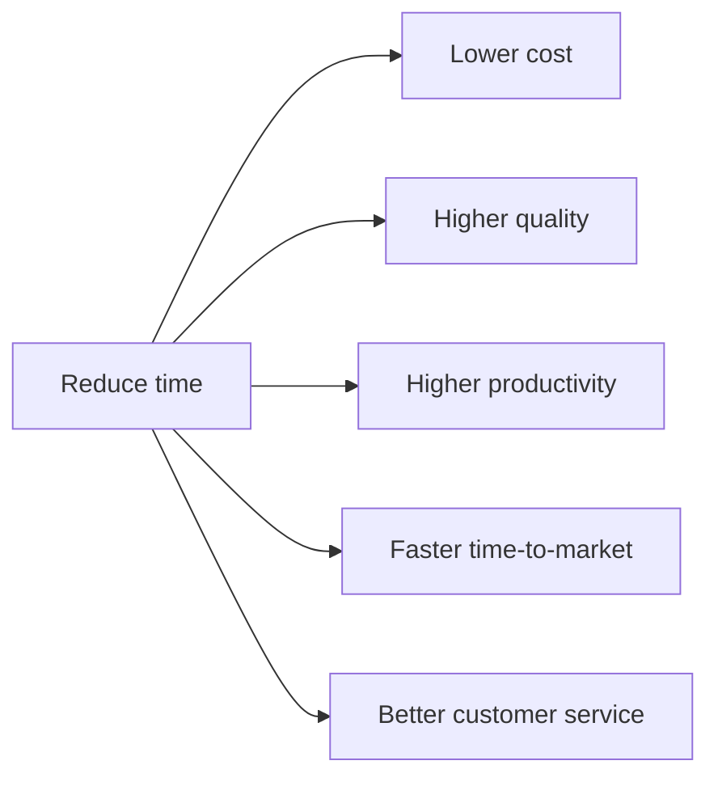
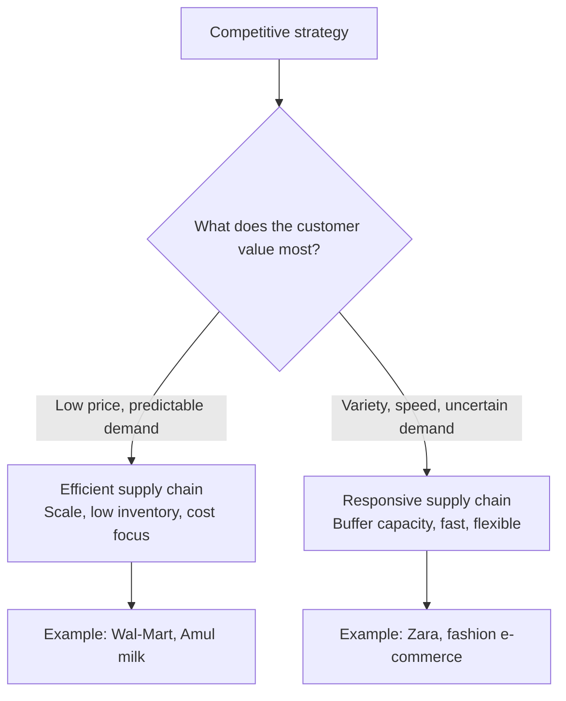
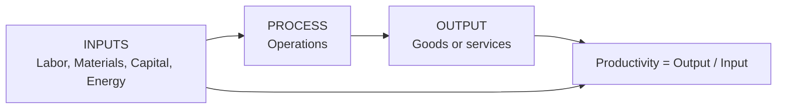
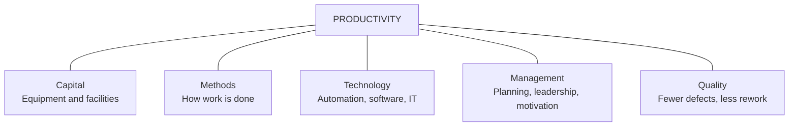
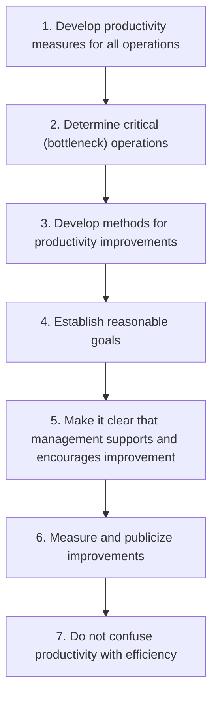

# Operations & Supply Chain Management
## Session 3 Notes: Competitiveness, Strategy & Productivity

**Program:** PGDM-BDA | **Term:** 2 | **Faculty:** Dr. Radha Mohan Gupta
**Syllabus topics:** Competitiveness; Mission, Goals and Strategy; Operations Strategy; Supply Chain Strategy Alignment; Productivity (Problems)
**Reading:** WS-2

> **Note on numbering:** The slide deck is titled "Session 3 & 4", while the syllabus lists this topic as Session 3 only. I have kept the file name as Session 3; rename it if your class ran it over two sessions.
>
> **Note on scope:** Everything from the slides is covered. Where I add material that is *not* on the slides (for example, why organizations fail, and supply chain strategy alignment, which is on the syllabus), it is marked **[Supplementary]** so you know what to treat as extra.

---

## Table of Contents

1. Learning objectives
2. Competitiveness
3. How businesses compete using operations
4. Hierarchical planning: Mission, Goals, Strategy, Tactics
5. Real company examples (Google, Amazon, Patanjali, Amul)
6. Core competencies
7. Operations strategy
8. Strategic OM decision areas
9. Quality-based and time-based strategies
10. Supply chain strategy alignment [Supplementary]
11. Why organizations fail [Supplementary]
12. Productivity
13. Productivity calculations (worked examples)
14. Service sector productivity and process yield
15. Factors affecting productivity and how to improve it
16. Key takeaways
17. **Question bank** (concept Qs, MCQs, True/False, numericals, application/case Qs)
18. Common mistakes and points to verify

---

## 1. Learning Objectives

By the end of this session you should be able to:

- Explain the ways business organizations compete
- Name several reasons organizations fail
- Define **mission, goals, and strategy**, and explain why each matters
- Distinguish **organizational strategy** from **operations strategy**, and explain why linking them is important
- Define **productivity**, and explain why it matters to organizations and to countries
- List the **factors that affect productivity**
- Calculate partial, multifactor, and total productivity, and productivity growth

---

## 2. Competitiveness

**Competitiveness** = how effectively an organization meets the wants and needs of customers *relative to others* that offer similar goods or services.

Two things to notice in this definition:

1. It is **relative**. You are competitive only compared with rivals offering similar things.
2. It is about **customer wants and needs**, not about what the company happens to like producing.

Organizations compete through some combination of their **Marketing** and **Operations** functions:

| Function | Key questions |
|---|---|
| **Marketing** | What do customers want? (identifying consumer wants/needs); pricing and quality; advertising and promotion |
| **Operations** | How can these needs best be satisfied? (designing, producing, and delivering the product or service) |

**Example:** Marketing at a smartphone company finds that customers want a good camera at a mid-range price. Marketing's job ends at *identifying* that need and promoting the product. Operations must *deliver* it: source the sensor, set up assembly, control quality, and ship on time. If either side fails, the company loses to a rival.

### Q&A: Competitiveness

**Q1. Define competitiveness.**
How effectively an organization meets customers' wants and needs relative to other organizations offering similar goods or services.

**Q2. Why is competitiveness described as "relative"?**
Because a firm's position depends on how well rivals perform. A company with good quality is still uncompetitive if rivals offer the same quality at a lower price.

**Q3. Which two functions are primarily responsible for competing in the market?**
Marketing and Operations.

**Q4. What is Marketing's role versus Operations' role in competitiveness?**
Marketing identifies customer wants/needs and influences demand through pricing, quality positioning, advertising and promotion. Operations designs and runs the processes that actually satisfy those needs.

---

## 3. How Businesses Compete Using Operations

The slides list **ten** operational ways to compete:

| # | Way to compete | What it means | Example |
|---|---|---|---|
| 1 | **Product and service design** | Offering features customers value; new or better designs | Apple's iPhone design and ecosystem |
| 2 | **Cost** | Producing at lower cost to price lower or earn higher margin | Wal-Mart, Indian "value" retailers |
| 3 | **Location** | Being convenient or close to customers or inputs | Petrol pumps, supermarkets, mall stores |
| 4 | **Quality** | Consistently meeting or exceeding expectations | Sony TVs, Coca-Cola's consistent taste |
| 5 | **Quick response** | Fast delivery, short lead times, fast complaint resolution | FedEx, Amazon same-day or next-day |
| 6 | **Flexibility** | Handling changes in volume, variety, or customization | Burger King "Have it your way" |
| 7 | **Inventory management** | Right stock at the right place and time; fewer stockouts, less holding cost | Zara's small batches, Amazon fulfilment |
| 8 | **Supply chain management** | Coordinating suppliers, logistics, and partners for cost, speed, reliability | Toyota's supplier network |
| 9 | **Service** | Pre-sale, in-sale, and after-sale support | Disneyland, IBM |
| 10 | **Managers and workers** | Skilled, motivated people and good management | Toyota's culture of continuous improvement |

### Q&A: Ways of competing

**Q5. List any five ways businesses compete using operations.**
Any five of: product/service design, cost, location, quality, quick response, flexibility, inventory management, supply chain management, service, managers and workers.

**Q6. How can *location* be a competitive advantage? Give two examples.**
It makes the product convenient to access or reduces transport/input cost. Examples: supermarkets and mall stores (convenience), a cement plant near limestone (input cost).

**Q7. Give an example of competing on quick response.**
FedEx competes on short processing times and on-time delivery; a restaurant that guarantees service within a fixed time; an e-commerce firm promising next-day delivery.

**Q8. Can a firm compete on all ten at once?**
Rarely. Most dimensions involve trade-offs (for example, flexibility versus low cost). Firms typically choose a few priorities to be excellent at and keep the rest at an acceptable level. This is exactly why a *strategy* is needed (Section 7).

**Q9. How is "managers and workers" a source of competitive advantage?**
Skilled, motivated, and well-managed people improve quality, productivity, and innovation, and rivals find it hard to copy a strong organizational culture.

---

## 4. Hierarchical Planning: Mission, Goals, Strategy, Tactics

Planning in an organization is **hierarchical**: each level gives direction to the level below it, like links in a chain.

### 4.1 Mission

- **Mission**: the reason for an organization's existence.
- **Mission statement**: states the organization's purpose; it should answer **"What business are we in?"**
- Formally: an action-based statement that declares the purpose of an organization and how it serves its customers. It sometimes includes a description of the company, what it does, and its objectives.

**Famous mission statements (from the slides):**

| Company | Mission statement |
|---|---|
| **Amazon** | Serve consumers through online and physical stores, focusing on selection, price, and convenience |
| **Nike** | Bring inspiration and innovation to every athlete in the world |
| **Apple** | Bring the best user experience to customers through innovative hardware, software, and services |
| **Microsoft** | Empower every person and every organization on the planet to achieve more |
| **Tata Group** | Improve the quality of life of the communities we serve globally, through long-term stakeholder value creation based on Leadership with Trust |
| **HDFC Bank** | Be the preferred provider of banking and financial services in India for high-quality customer service and competitive products |

### 4.2 Goals

- The mission is the basis for organizational goals.
- Goals **provide detail and scope** to the mission.
- Goals are the organization's **destinations**.
- Goals serve as the **basis for organizational strategies**.
- Good goals are **specific, measurable, and time-bound** (compare "Reduce packaging waste by 25% this year" with "Be more sustainable").

### 4.3 Strategy

- **Strategy** = a plan for achieving organizational goals; the **roadmap** to the destinations.
- Two levels:
  - **Organizational strategy**: overall strategy for the entire organization; supports the mission and goals.
  - **Functional-level strategy**: strategy for each functional area (marketing, operations, finance, HR); supports the organizational strategy.

### 4.4 Tactics and Operations

- **Tactics** = the methods and actions used to accomplish strategies; the "how-to" part.
- **Operations** = the actual "doing" part of the process.

### 4.5 Vision vs Mission vs Goals vs Strategy (the slide summary)

| Statement | Role | Key question |
|---|---|---|
| **Vision** | Sets the direction and long-term aspiration | Where do we want to be in the long run? |
| **Mission** | Defines purpose and identity | Why do we exist; what business are we in? |
| **Goals** | Specify measurable targets | What exactly do we want to achieve, by when? |
| **Strategy** | Outlines the approach and actions | How will we achieve those goals? |

Together they form a **cohesive strategic framework** guiding the company's decisions and actions.

### Q&A: Mission, goals, strategy

**Q10. What is a mission statement and what question must it answer?**
A statement of the organization's purpose and how it serves customers. It must answer "What business are we in?"

**Q11. Why does an organization need a mission statement?**
It gives a unifying purpose, keeps decisions consistent, guides the setting of goals and strategies, and tells employees, customers, and investors what the organization stands for.

**Q12. How are goals related to the mission?**
The mission is the foundation; goals add detail and scope to it by turning the purpose into specific destinations.

**Q13. How are goals different from strategy?**
Goals are *where* we want to go (destinations); strategy is *how* we will get there (roadmap).

**Q14. Differentiate organizational strategy from functional strategy.**
Organizational strategy covers the whole organization and supports the mission and goals. Functional strategies apply to each functional area (such as operations or marketing) and exist to support the organizational strategy.

**Q15. Differentiate strategy from tactics.**
Strategy is the overall plan; tactics are the specific methods and actions used to carry out that plan.

**Q16. What is the relationship between tactics and operations?**
Tactics are the "how-to"; operations is the actual "doing" of the work.

**Q17. Why is it called "hierarchical" planning?**
Because each level (mission, goals, organizational strategy, functional strategy, tactics) is derived from and must be consistent with the level above it.

**Q18. What happens if a functional strategy is not aligned with the organizational strategy?**
Functions pull in different directions: for example, marketing promises fast customization while operations is set up for low-cost mass production. This leads to customer dissatisfaction, wasted resources, and weaker competitiveness.

**Q19. Which is more long-term: a mission or a tactic?**
The mission. Missions change rarely; tactics change frequently as conditions change.

**Q20. Is "Increase Prime membership by 20% in the next year" a mission, goal, or strategy?**
A goal: it is specific, measurable, and time-bound.

---

## 5. Real Company Examples: Mission → Goals → Strategy

### 5.1 Google

| Level | Statement |
|---|---|
| **Mission** | Organize the world's information and make it universally accessible and useful |
| **Goals** | (a) Increase Google Workspace market share by 10% in the next fiscal year; (b) expand Google Meet's user base by 30% within six months; (c) reduce data-center carbon footprint by 15% |
| **Strategy** | (a) Continuous innovation and research to improve search algorithms and results; (b) invest in marketing and partnerships to promote Workspace against rival productivity suites; (c) collaborate with hardware makers to pre-install Meet on devices |

### 5.2 Amazon

| Level | Statement |
|---|---|
| **Mission** | Serve consumers through online and physical stores, focusing on selection, price, and convenience |
| **Goals** | (a) Grow Prime membership by 20% in the next year; (b) 30% increase in AWS revenue by end of fiscal year; (c) reduce packaging waste by 25% via sustainable packaging |
| **Strategy** | (a) Invest continuously in technology and infrastructure for faster order fulfilment and delivery; (b) diversify offerings through acquisitions, partnerships, and internal development; (c) use customer data and AI-driven insights to personalize recommendations |

### 5.3 Patanjali

| Level | Statement |
|---|---|
| **Mission** | Offer high-quality Ayurvedic products and promote traditional wellness practices to enhance physical, mental, and spiritual health |
| **Goals** | (a) Add 100 new Ayurvedic formulations by end of the fiscal year; (b) raise herbal personal-care market share by 15% within two years; (c) enter at least five new international markets |
| **Strategy** | (a) Collaborate with Ayurvedic experts and research institutions to develop formulations; (b) cost-effective manufacturing and efficient supply chain management for affordable products; (c) aggressive marketing and branding to build trust |

### 5.4 Amul (Why → What → How)

| Mission (Why) | Goals (What) | Strategy (How) |
|---|---|---|
| Manufacture world-class products for all stakeholders | Empower farmers, lead the market, satisfy customers | Cooperative model, affordable pricing, supply chain, broad distribution, emotional branding, sustainability |
| Satisfy nutritional needs globally | Maximize market share and export reach | Continuous product innovation, market expansion, investment in new technology, adapting to consumer preferences |
| Value for money, quality, and technology-led excellence | Customer satisfaction | Cost leadership, quality assurance, feedback-driven improvements, digital initiatives for customer engagement |

> **Easy memory trick:** Mission = **WHY**, Goals = **WHAT**, Strategy = **HOW**, Tactics = **HOW EXACTLY**.

> **Observation:** Notice how operations shows up inside the *strategy* column of each company: Amazon's fulfilment infrastructure, Patanjali's cost-effective manufacturing and supply chain, and Amul's cooperative supply chain and distribution. This is why operations strategy is central to organizational strategy.

> **Caution on dates:** Some goals in the slides carry deadlines such as "by 2025", which has already passed (today is October 2026). Treat them as *illustrations of the format*, not current company targets.

### Q&A: Examples

**Q21. Identify the mission, a goal, and a strategy in Amazon's case.**
Mission: serve consumers via online/physical stores focusing on selection, price, convenience. Goal: grow Prime membership by 20% in a year. Strategy: invest in technology and infrastructure to speed up fulfilment and delivery.

**Q22. Which part of Google's strategy is operations-related?**
Continuous innovation of search algorithms (product/service design), and the hardware collaboration for pre-installation (distribution/supply side). The data-center carbon goal also depends on operations (facilities and energy).

**Q23. In Patanjali's case, how does operations support the strategy?**
Cost-effective manufacturing and efficient supply chain management let Patanjali offer affordable products, which supports its goal of gaining herbal personal-care market share.

**Q24. Why is Amul's cooperative model a strategy and not a mission?**
It is a *how*: the approach used to achieve the goals. The mission is the *why*: producing world-class products for all stakeholders.

**Q25. Write a mission, one goal, and one strategy for a local Goan café.**
*Mission:* Serve fresh, locally sourced food in a welcoming space for residents and tourists. *Goal:* Increase weekday lunch customers by 25% in 12 months. *Strategy:* Offer a quick-service lunch menu with a 10-minute guarantee and tie-ups with nearby offices.

---

## 6. Core Competencies

**Core competencies** = the special attributes or abilities that give an organization a **competitive edge**. To be effective, **core competencies and strategies must be aligned**.

| Company | Core competency | Aligned strategy |
|---|---|---|
| Wal-Mart | Logistics and low-cost supply chain | Everyday low price |
| Apple | Design and integrated hardware-software ecosystem | Differentiation by innovation and user experience |
| Amul | Cooperative farmer network and distribution | Affordable, broad-reach dairy products |
| Toyota | Production system and continuous improvement | High quality at competitive cost |
| FedEx | Global logistics and tracking | Reliable on-time delivery |

**Example of misalignment:** A firm whose core competency is low-cost mass production decides on a strategy of highly customized luxury products. The strategy needs capabilities the firm does not have.

### Q&A

**Q26. Define core competency.**
A special attribute or ability that gives an organization a competitive edge.

**Q27. Why must strategy match core competencies?**
A strategy that depends on abilities the firm lacks cannot be executed well, while strategies built on real strengths are hard for rivals to copy.

**Q28. Give two examples of core competencies.**
Wal-Mart's logistics and supply chain efficiency; Apple's design and ecosystem integration.

---

## 7. Operations Strategy

**Operations strategy** = the approach, **consistent with the organization strategy**, that is used to guide the operations function.

### 7.1 Why linking the two strategies matters

- Operations is where most resources are consumed and where the promise to the customer is actually kept.
- If the organizational strategy promises *fast delivery*, operations must build processes for speed; if it promises *lowest price*, operations must build for cost.
- Misalignment creates broken promises and wasted investment.

### 7.2 Sample operations strategies (from the slides)

| Organizational strategy | Operations strategy emphasis | What it looks like | Examples |
|---|---|---|---|
| **Low price** | Low cost | Efficiency, minimal waste, scale | U.S. first-class postage, Wal-Mart |
| **Responsiveness** | Short processing times, on-time delivery | Speed and reliability | McDonald's restaurants, FedEx |
| **Differentiation: High quality** | High-performance design and/or high-quality processing; consistent quality | Quality systems | Sony TV, Coca-Cola |
| **Differentiation: Innovation** | Newness | Constant new products | 3M, Apple |
| **Differentiation: Variety** | Flexibility (variety) | Many options, customization | Burger King ("Have it your way") |
| **Differentiation: Volume** | Flexibility (volume) | Scale up or down | McDonald's ("Buses Welcome") |
| **Differentiation: Superior customer service** | Service | Exceptional customer experience | Disneyland, IBM |
| **Differentiation: Convenience** | Location | Close and accessible | Supermarkets, mall stores |

> **Note:** On the slide, "Buses Welcome" (McDonald's) illustrates **volume flexibility**, being able to handle a sudden surge such as a tour bus arriving. "Have it your way" (Burger King) illustrates **variety flexibility**.

### Q&A: Operations strategy

**Q29. Define operations strategy.**
The approach, consistent with the organization's strategy, that guides the operations function.

**Q30. Why must organizational strategy and operations strategy be linked?**
Operations delivers on the organization's promise to customers. Without alignment, operations optimizes the wrong things (for example, cost when customers value speed), wasting resources and losing competitiveness.

**Q31. Which operations emphasis fits a "low price" strategy? Name an example.**
Low cost (efficiency and minimal waste). Example: Wal-Mart.

**Q32. How does FedEx's operations strategy reflect its organizational strategy?**
Its organizational strategy is responsiveness. Operations therefore emphasizes short processing times and on-time delivery, with tracking, hub-and-spoke logistics, and a dedicated fleet.

**Q33. Distinguish volume flexibility from variety flexibility with examples.**
Volume flexibility is the ability to handle changes in quantity (McDonald's accommodating buses of tourists). Variety flexibility is the ability to handle many product options (Burger King's customization).

**Q34. Which strategy do Apple and 3M use, and what does operations focus on?**
Differentiation through innovation; operations focuses on newness: rapid new-product development and the ability to launch frequently.

**Q35. What operations emphasis suits Disneyland and IBM?**
Superior customer service: processes and people trained to deliver exceptional customer experience.

**Q36. Why is a supermarket's location a strategic choice, not just a site decision?**
Location creates convenience, which is its form of differentiation; a poor location undermines the strategy no matter how good the store is.

**Q37. Can one company pursue low cost and high differentiation together?**
Hard to do well because the two often conflict (extra features add cost). A few firms manage it with scale or technology, but most choose a primary priority. Trade-offs are central (see Session 1 & 2 notes on trade-offs).

---

## 8. Strategic OM Decision Areas

Operations strategy is carried out through **ten decision areas**:

| Decision area | What the decisions affect |
|---|---|
| Product and service design | Costs, quality, liability, environmental issues |
| Capacity | Cost, structure, flexibility |
| Process selection and layout | Costs, flexibility, skill level needed, capacity |
| Work design | Quality of work life, employee safety, productivity |
| Location | Costs, visibility |
| Quality | Ability to meet or exceed customer expectations |
| Inventory | Costs, shortages |
| Maintenance | Costs, equipment reliability, productivity |
| Scheduling | Flexibility, efficiency |
| Supply chains | Costs, quality, agility, shortages, vendor relations |
| Projects | Costs, new products, services, or operating systems |

*(The slide lists eleven rows; the classical "10 decisions of OM" framework combines some of these. Learn the table as given.)*

**Example linking strategy to decisions:** A "low price" strategy leads to *standardized product design* (fewer variants), *high-volume process selection*, *large-capacity plants*, *low-cost locations*, and *lean inventory*. A "customization" strategy leads to the opposite choices on each.

### Q&A

**Q38. List five strategic OM decision areas.**
Any five from: product/service design, capacity, process selection and layout, work design, location, quality, inventory, maintenance, scheduling, supply chains, projects.

**Q39. What does the capacity decision affect?**
Cost, structure, and flexibility.

**Q40. What do process selection and layout decisions affect?**
Costs, flexibility, skill level needed, and capacity.

**Q41. What do maintenance decisions affect?**
Costs, equipment reliability, and productivity.

**Q42. Which decision areas most directly affect productivity?**
Work design, maintenance, process selection, and quality, along with technology and capital investment.

**Q43. How does a firm's strategy translate into decision-area choices? Give an example.**
A responsiveness strategy leads to locating facilities near customers, holding buffer inventory, flexible scheduling, and fast transport. A low-cost strategy leads to centralized facilities, lean inventory, and standardized processes.

---

## 9. Quality-Based and Time-Based Strategies

### 9.1 Quality-based strategy

A strategy that focuses on **quality in all phases of the organization**.

Reasons organizations pursue it:

1. Trying to **overcome a poor-quality reputation**
2. Desire to **maintain a quality image**
3. Desire to **catch up with the competition**
4. As **part of a cost-reduction strategy** (less scrap, rework, and warranty cost)

| Reason | Illustration |
|---|---|
| Overcome poor reputation | Domino's publicly reworked its pizza recipe around 2009 after customer criticism |
| Maintain a quality image | Lexus and Rolex protect brand through strict quality control |
| Catch up with competition | U.S. automakers' quality push in the 1980s after Japanese rivals set new benchmarks |
| Cost reduction | Six Sigma programs at firms like Motorola and GE cut defects and rework costs |

### 9.2 Time-based strategy

A strategy focused on **reducing the time needed to accomplish tasks**.

**Belief:** reducing time leads to lower costs, higher quality, higher productivity, faster time-to-market, and better customer service.

Areas where organizations have reduced time:

- Planning time
- Product/service design time
- Processing time
- Changeover time
- Delivery time
- Response time for complaints

**Examples:** Zara's design-to-shelf cycle of a few weeks; Amazon's same-day and next-day delivery (delivery time); Toyota's quick die changeovers (changeover time); Domino's delivery-time promises.

### Q&A

**Q44. What is a quality-based strategy?**
A strategy that emphasizes quality in all phases of the organization.

**Q45. Give four reasons organizations adopt a quality-based strategy.**
To overcome a poor-quality reputation, maintain a quality image, catch up with competitors, and as part of a cost-reduction strategy.

**Q46. How can quality reduce cost?**
Fewer defects mean less scrap, rework, inspection, warranty claims, and returns, so "doing it right the first time" is cheaper.

**Q47. What is a time-based strategy?**
A strategy focused on reducing the time needed to accomplish tasks.

**Q48. What benefits are expected from time reduction?**
Lower costs, higher quality, higher productivity, faster time-to-market, and improved customer service.

**Q49. List areas where time reductions are pursued.**
Planning, product/service design, processing, changeover, delivery, and complaint response times.

**Q50. What is "changeover time"? Why does reducing it help?**
The time to switch equipment from making one product to another. Shorter changeovers allow smaller batches, more variety, less inventory, and higher equipment utilization.

**Q51. How might a time-based strategy help a hospital emergency department?**
Reducing triage, diagnosis, and treatment time improves patient outcomes and satisfaction, and increases the number of patients served with the same resources.

---

## 10. Supply Chain Strategy Alignment **[Supplementary: on syllabus, not on these slides]**

The syllabus lists "Supply Chain Strategy Alignment" under this session. The core idea: **the supply chain strategy must fit the competitive strategy**, otherwise the firm competes with the wrong kind of supply chain.

A widely used framing (Marshall Fisher): match the supply chain to the **nature of the product's demand**.

| Product type | Demand | Margin | Right supply chain | Priority |
|---|---|---|---|---|
| **Functional** (staples: salt, milk, toothpaste) | Stable, predictable | Low | **Efficient** supply chain | Lowest cost |
| **Innovative** (fashion, new gadgets) | Unpredictable | High | **Responsive** supply chain | Speed, flexibility |

**Misalignment example:** A fashion retailer (innovative product) running a slow, cheap, sea-freight supply chain ends up with unsold seasonal stock and missed trends.

### Q&A

**Q52. What does "strategy alignment" mean in supply chains?**
The supply chain's design and capabilities (efficiency versus responsiveness) must support the company's competitive strategy and customers' needs.

**Q53. Which supply chain suits a functional product such as milk? Why?**
An efficient one, because demand is predictable and margins are thin, so cost control matters most.

**Q54. Which supply chain suits a fast-fashion product? Why?**
A responsive one, because demand is uncertain, margins are high, and stockouts or unsold stock are costly.

**Q55. Give an example of supply chain misalignment.**
An innovative-product firm using a slow, cost-minimizing chain misses trends and ends up with markdowns; or a staple-goods firm using an expensive express chain wastes money.

---

## 11. Why Organizations Fail **[Supplementary: the learning objectives ask for it, the slides don't list the reasons]**

Commonly cited reasons (from OM textbooks):

1. **Neglecting customer wants and needs**: not understanding what customers value
2. **Neglecting operations strategy**: no clear link between operations and organizational goals
3. **Short-term focus**: chasing quarterly profit at the expense of long-term capability
4. **Failing to recognize competitive threats or take advantage of strengths and opportunities**
5. **Neglecting investment in capital, technology, or R&D**
6. **Over-investing in equipment/technology while neglecting people** (or the reverse)
7. **Poor quality, high costs, and slow response relative to competitors**
8. **Weak management of the supply chain and inventory**

**Examples:** Nokia (slow response to smartphones, neglect of innovation), Kodak (failed to adapt to digital), Blockbuster (missed streaming and new customer preference), Jet Airways (cost and capacity problems).

### Q&A

**Q56. Name any four reasons why organizations fail.**
Neglecting customer needs, neglecting operations strategy, short-term focus, and failing to invest in technology/R&D or to recognize competitive threats.

**Q57. How can short-term thinking harm operations?**
Cutting maintenance, training, or R&D to improve this quarter's profit weakens equipment, skills, and innovation, which hurts long-run competitiveness.

**Q58. Kodak invented the digital camera yet still collapsed. What lesson does this give?**
Strategy and core competencies must adapt to changes in customer needs and technology; having the technology is not enough without aligning strategy and operations to it.

---

## 12. Productivity

**Productivity** = a measure of the effective use of resources, usually expressed as the ratio of **output to input**.

$$\text{Productivity} = \frac{\text{Output}}{\text{Input}}$$

**Uses of productivity measures:**
- Tracking an operating unit's performance **over time**
- Judging the performance of an **entire industry or country**

### 12.1 Why productivity matters

- **Standard of living:** High productivity is linked to higher living standards. A country that produces more per worker can pay higher wages.
- **Shift to services:** As an economy replaces manufacturing jobs with lower-productivity service jobs, maintaining a high standard of living becomes harder.
- **Competitive advantage:** Higher productivity relative to competitors leads to competitive advantage.
  - **Pricing and profit effects:** it can cut price or raise margins.
  - **Industry protection:** high relative productivity makes it less likely an industry will be supplanted by foreign industry.

### 12.2 Types of productivity measures

| Type | Formula | Example |
|---|---|---|
| **Partial measure** (single input) | Output ÷ one input | Output/Labor; Output/Capital; Output/Machine hours |
| **Multifactor measure** (several inputs) | Output ÷ (several inputs) | Output/(Labor + Machine); Output/(Labor + Capital + Energy) |
| **Total measure** | Goods or services produced ÷ all inputs used | Total output ÷ total input |

> **Important:** To combine different inputs in a multifactor or total measure, convert everything to **a common unit, usually money** (currency). Output is also valued in money (units × price).

### Q&A: Productivity concepts

**Q59. Define productivity.**
A measure of the effective use of resources, usually the ratio of output to input.

**Q60. Why do we measure productivity?**
To track a unit's performance over time and to compare industries or countries.

**Q61. Why does productivity matter to a country?**
It is linked to the standard of living: more output per unit of input supports higher incomes and living standards.

**Q62. Why is the shift from manufacturing to services a concern for productivity?**
Service jobs generally have lower measured productivity, which makes it harder to sustain high living standards as the economy shifts toward them.

**Q63. How does high productivity help a firm competitively?**
It lowers cost per unit, allowing lower prices or higher profits, and makes the firm harder to displace.

**Q64. Differentiate partial, multifactor, and total productivity.**
Partial uses one input in the denominator (for example, output per labor hour); multifactor uses several inputs; total uses all inputs used to produce the output.

**Q65. Why are multifactor measures often better than partial measures?**
Partial measures can mislead: output per labor hour may rise simply because the firm invested in expensive machines. A multifactor measure shows whether the *overall* use of resources improved.

**Q66. Why do we convert inputs and outputs to money for multifactor productivity?**
Because labor hours, kilograms of material, and kilowatt-hours cannot be added directly. A common unit (currency) makes them additive.

---

## 13. Productivity Calculations (Worked Examples)

### 13.1 Slide example: Multifactor productivity

**Given:**
- Units produced: 5,000
- Standard price: $30/unit
- Labor input: 500 hours at $25/hour
- Materials cost: $5,000
- Overhead: 2× labor cost

**Step 1: Output value** = 5,000 × $30 = **$150,000**

**Step 2: Inputs**
- Labor = 500 × $25 = $12,500
- Materials = $5,000
- Overhead = 2 × $12,500 = $25,000
- **Total input = $42,500**

**Step 3: Productivity** = $150,000 ÷ $42,500 = **3.5294**

*Interpretation:* every $1 of input generates about $3.53 of output value.

### 13.2 Slide "Problems for class" with full solutions

**Problem 1.** A company produces 400 cases of canned pineapple in half an hour with four workers. What is productivity?

- Labor hours = 4 workers × 0.5 hour = **2 labor-hours**
- Productivity = 400 ÷ 2 = **200 cases per labor-hour** ✔ (matches slide)

> **Trap:** Using 4 workers and 0.5 hours separately (400/4 = 100, or 400/0.5 = 800) is wrong. Labor input is **workers × time**.

**Problem 2.** A burger company produces 2,000 burgers/day. Labor cost Rs 3,000; material Rs 1,200; overhead Rs 1,800. Productivity?

- Total input = 3,000 + 1,200 + 1,800 = Rs 6,000
- Productivity = 2,000 ÷ 6,000 = **0.333 burgers per Rs of input** ✔

**Problem 3.** Worked 8 hours; output 300 units; 3 workers; 600 kg material; minimum wage Rs 20/hour; material Rs 1/kg; overhead 1.5× labor cost.

- Labor = 3 workers × 8 hours × Rs 20 = Rs 480
- Material = 600 kg × Rs 1 = Rs 600
- Overhead = 1.5 × 480 = Rs 720
- Total input = 480 + 600 + 720 = Rs 1,800
- Productivity = 300 ÷ 1,800 = **0.167 units per Rs of input** ✔

### 13.3 Productivity growth

$$\text{Productivity growth} = \frac{\text{Current} - \text{Previous}}{\text{Previous}} \times 100\%$$

**Slide example:** Labor productivity on the ABC assembly line was 25 units/hour in 2014 and 23 units/hour in 2015.

Growth = (23 − 25) ÷ 25 × 100 = **−8%**

> ⚠️ **The slide prints "8%" without a minus sign.** The correct answer is **−8%**, meaning productivity **fell** by 8%. Always keep the sign.

*Bonus insight:* To get back to 25 from 23, productivity must rise by 25/23 − 1 ≈ **8.70%**, which is more than 8%, because the base is now lower.

### 13.4 Extra practice (not on slides): see Section 17.4 for more numericals with solutions.

---

## 14. Service Sector Productivity and Process Yield

**Why service productivity is hard to measure and manage:**
- It involves **intellectual activities** (hard to count output)
- It has a **high degree of variability** (every customer is different)

**Process yield** is a useful related measure.

| Setting | Process yield definition | Example |
|---|---|---|
| **Products** | Good output ÷ raw material input | 950 kg of good product from 1,000 kg raw = 95% |
| **Services** | Depends on the process | Cars rented ÷ cars available on a day; student acceptances ÷ students approved for admission |

**More service examples:**
- Hotel: rooms occupied ÷ rooms available (occupancy)
- Hospital: beds occupied ÷ beds available; patients treated per doctor-hour
- Airline: seats filled ÷ seats available (load factor)
- Call center: calls resolved at first contact ÷ total calls

### Q&A

**Q67. Why is service productivity harder to measure than manufacturing productivity?**
Service output is intangible and variable, and it involves intellectual work, so it is hard to define a standard unit of output.

**Q68. Define process yield.**
For products, the ratio of good output to raw-material input. For services, a ratio specific to the process, such as cars rented to cars available.

**Q69. A factory uses 2,000 kg of raw material and obtains 1,700 kg of good product. Find the process yield.**
1,700 ÷ 2,000 = **0.85 or 85%**.

**Q70. Give two service examples of a process-yield measure.**
Cars rented ÷ cars available; student acceptances ÷ students approved for admission (also: hotel occupancy, airline load factor).

---

## 15. Factors Affecting Productivity and How to Improve It

### 15.1 Factors (from the slide)

| Factor | How it affects productivity | Example |
|---|---|---|
| **Capital** | Better equipment and facilities raise output per worker | A new CNC machine replacing a manual lathe |
| **Methods** | Better ways of doing work reduce wasted effort | Redesigning a workstation to cut motion |
| **Technology** | Automation and information systems speed up and standardize work | ERP systems, robotics, barcode scanning |
| **Management** | Good planning, scheduling, and motivation | Clear targets, training, supportive supervision |
| **Quality** | Fewer defects mean less rework and scrap | Poka-yoke (error-proofing) on an assembly line |

### 15.2 Steps to improve productivity (from the slide)

### 15.3 Productivity vs efficiency

| | Productivity | Efficiency |
|---|---|---|
| Meaning | Output ÷ Input | Actual output vs a *standard* or *expected* output (or doing things in the best way) |
| Focus | Overall effective use of resources | Meeting a standard, minimizing waste in a given way |
| Example | 200 cases per labor-hour | A line that made 90 of its standard 100 units is 90% efficient |

**Why the warning?** A department can be highly "efficient" at producing something nobody wants, while productivity (and competitiveness) is poor. Also, improving productivity is **not** the same as making people work harder; it is usually about better methods, technology, and management.

### Q&A

**Q71. List the factors affecting productivity.**
Capital, methods, technology, management, and quality.

**Q72. Explain how quality affects productivity.**
Defects consume inputs (material, labor, machine time) without producing sellable output, so better quality raises effective output for the same inputs.

**Q73. How does technology improve productivity? Can it reduce it?**
It speeds work, reduces errors, and standardizes processes. Poorly chosen or badly implemented technology (wrong tool, untrained staff) can reduce productivity.

**Q74. Why is identifying bottleneck operations the second step in improving productivity?**
Improving a non-bottleneck step doesn't raise system output, since the bottleneck limits overall throughput. Effort should go where it affects the whole system.

**Q75. Why should productivity improvements be measured and publicized?**
It motivates employees, reinforces management support, and helps spread practices that work.

**Q76. Why should goals for productivity improvement be "reasonable"?**
Unrealistic goals demotivate and encourage shortcuts (such as quality cuts), while achievable goals sustain effort.

**Q77. How do productivity and efficiency differ?**
Productivity is output per unit of input. Efficiency compares actual performance with a standard or best-possible method. They should not be confused.

**Q78. Can productivity rise while cost per unit falls? Explain.**
Yes. If output rises with the same inputs (or the same output uses fewer inputs), cost per unit falls.

---

## 16. Key Takeaways

1. **Competitiveness** is relative: meeting customer needs better than rivals do, through Marketing and Operations.
2. Operations can be a source of advantage through **ten levers**: design, cost, location, quality, quick response, flexibility, inventory, supply chain, service, and people.
3. Planning flows top-down: **Mission (why) → Goals (what) → Organizational strategy (how, overall) → Functional strategies → Tactics → Operations (doing)**.
4. **Core competencies** must be aligned with strategy.
5. **Operations strategy** must be consistent with the organizational strategy; the sample strategies are *low cost, responsiveness, quality, innovation, flexibility, service, convenience (location)*.
6. **Quality-based** and **time-based** strategies are two common, powerful approaches.
7. **Productivity = Output ÷ Input**; partial, multifactor, and total versions exist; convert to a common unit for multifactor.
8. **Productivity growth = (Current − Previous) ÷ Previous × 100**, and keep the sign.
9. Productivity drives **living standards** at the national level and **competitive advantage** at the firm level.
10. **Five factors:** capital, methods, technology, management, quality. Do not confuse productivity with efficiency.

---

## 17. QUESTION BANK

### 17.1 Quick-fire concept questions (answers in brackets)

1. Define competitiveness. *[Meeting customer wants/needs effectively relative to similar offerors.]*
2. What question must a mission statement answer? *["What business are we in?"]*
3. Mission = Why; Goals = ?; Strategy = ? *[What; How.]*
4. Which is the "doing" part: tactics or operations? *[Operations.]*
5. Define core competency. *[A special attribute or ability that gives a competitive edge.]*
6. What is operations strategy? *[The approach, consistent with organizational strategy, that guides the operations function.]*
7. Name the two functions through which firms compete. *[Marketing and operations.]*
8. What does a time-based strategy aim to reduce? *[The time needed to accomplish tasks.]*
9. State the productivity formula. *[Output ÷ Input.]*
10. Which productivity measure uses one input? *[Partial.]*
11. Which factor of productivity concerns defects and rework? *[Quality.]*
12. Why must different inputs be converted to money in multifactor productivity? *[To add unlike units.]*
13. Give the formula for productivity growth. *[(Current − Previous)/Previous × 100.]*
14. Which strategy do Apple and 3M exemplify? *[Differentiation through innovation.]*
15. Which strategy do Wal-Mart and U.S. first-class postage exemplify? *[Low price / low cost.]*
16. What does "Buses Welcome" illustrate? *[Volume flexibility.]*
17. Name two ways to measure service process yield. *[Cars rented ÷ available; acceptances ÷ approved.]*
18. What is the last step in the productivity improvement list? *[Don't confuse productivity with efficiency.]*
19. Is a service or a manufacturing job generally lower in measured productivity, per the slides? *[Service.]*
20. Which decision area affects "quality of work life, employee safety, productivity"? *[Work design.]*

### 17.2 Descriptive / short-answer questions

**D1. Explain hierarchical planning with a diagram and an example.**
Mission → Goals → Organizational strategies → Functional strategies → Tactics (→ Operations). Each level derives from the one above. *Example:* a regional airline. Mission: "connect communities safely and affordably." Goal: raise on-time performance to 92% within a year. Organizational strategy: low-cost, high-reliability point-to-point flying. Operations strategy: standardized fleet, quick turnaround, preventive maintenance. Tactic: 25-minute gate turnaround checklist.

**D2. Why is it important to link organizational strategy with operations strategy?**
Because operations carries out the promise to customers. Alignment ensures resources, processes, and capabilities support what the organization claims to offer; misalignment causes conflicting goals, wasted investment, and customer dissatisfaction.

**D3. Discuss any five ways in which businesses compete using operations.**
Choose five of the ten (Section 3) and give a one-line explanation plus an example for each.

**D4. Compare quality-based and time-based strategies.**

| | Quality-based | Time-based |
|---|---|---|
| Focus | Quality in all phases | Reducing time for tasks |
| Motives | Fix reputation, protect image, catch up, cut cost | Lower cost, faster time-to-market, better service |
| Typical measures | Defect rate, customer complaints | Lead time, changeover time, delivery time |
| Overlap | Both can reduce cost and improve customer satisfaction | |

**D5. Why does productivity matter to a nation and to a firm?**
Nation: higher productivity supports a higher standard of living; the service shift can strain it. Firm: lowers unit cost, supports competitive pricing and profit, and protects the industry from foreign competitors.

**D6. Discuss the factors affecting productivity and how management can improve it.**
Five factors (capital, methods, technology, management, quality) plus the seven improvement steps (Section 15.2).

**D7. Why is productivity difficult to measure in services? How can process yield help?**
Intangible, variable, intellectual output. Process yield uses a ratio tailored to the process (e.g., occupancy or acceptance ratio) to give a measurable proxy.

**D8. Distinguish productivity from efficiency with an example.**
See Section 15.3.

**D9. Explain with an example how a firm's core competency should be aligned with its strategy.**
Wal-Mart's logistics competency supports its low-price strategy; a mismatch (low-cost producer chasing luxury customization) fails.

**D10. Illustrate the Mission–Goals–Strategy framework using any one Indian company.**
Use Amul (Section 5.4) or Patanjali (Section 5.3), or Tata/HDFC mission statements with your own goals and strategy.

**D11. Why do organizations fail? Relate to operations.** *[Supplementary]*
See Section 11.

**D12. Explain how the supply chain strategy should be aligned with competitive strategy.** *[Supplementary]*
See Section 10: efficient versus responsive chains.

### 17.3 Multiple-choice questions

**1.** Competitiveness is best described as:
a) Having the highest profit
b) How effectively an organization meets customer needs relative to rivals
c) Having the lowest price
d) Having the largest market share
**Answer: b**

**2.** A mission statement primarily answers:
a) How will we compete? b) Where will we locate? c) What business are we in? d) What are our profits?
**Answer: c**

**3.** Goals are best described as:
a) The roadmap b) The destinations c) The daily tasks d) The budget
**Answer: b**

**4.** "The methods and actions taken to accomplish strategies" defines:
a) Mission b) Goals c) Tactics d) Vision
**Answer: c**

**5.** Which company is used as an example of "short processing times, on-time delivery"?
a) Wal-Mart b) FedEx c) Sony d) Disneyland
**Answer: b**

**6.** Burger King's "Have it your way" is an example of:
a) Volume flexibility b) Low cost c) Variety flexibility d) Location
**Answer: c**

**7.** "Buses Welcome" at McDonald's is an example of:
a) Volume flexibility b) Quality c) Innovation d) Variety
**Answer: a**

**8.** Which of the following is NOT a factor affecting productivity listed in the slides?
a) Capital b) Methods c) Weather d) Management
**Answer: c**

**9.** A multifactor productivity measure uses:
a) One input b) Several inputs c) No inputs d) Only labor
**Answer: b**

**10.** Output per labor hour is a:
a) Total measure b) Multifactor measure c) Partial measure d) Process yield
**Answer: c**

**11.** If productivity falls from 25 to 23 units per hour, growth is:
a) +8% b) −8% c) +8.7% d) −2%
**Answer: b**

**12.** Which is a reason for adopting a quality-based strategy?
a) To overcome a poor-quality reputation b) To catch up with competitors c) As part of a cost-reduction strategy d) All of the above
**Answer: d**

**13.** Which is NOT an area of time reduction listed?
a) Planning time b) Changeover time c) Delivery time d) Advertising budget
**Answer: d**

**14.** Which step in improving productivity comes immediately after developing measures for all operations?
a) Establish goals b) Determine critical (bottleneck) operations c) Publicize improvements d) Develop methods
**Answer: b**

**15.** Process yield for a service could be:
a) Cars rented ÷ cars available b) Profit ÷ sales c) Wages ÷ hours d) None of these
**Answer: a**

**16.** Apple and 3M compete mainly by:
a) Low price b) Innovation (newness) c) Location d) Volume flexibility
**Answer: b**

**17.** Which statement is TRUE?
a) Productivity and efficiency mean exactly the same
b) Higher productivity is linked to higher standards of living
c) Service productivity is easy to measure
d) Mission statements specify numerical targets
**Answer: b**

**18.** Productivity in multifactor measures is calculated after converting inputs to:
a) Hours b) Kilograms c) A common monetary unit d) Units
**Answer: c**

**19.** Which decision area affects "costs, structure, and flexibility"?
a) Location b) Capacity c) Scheduling d) Maintenance
**Answer: b**

**20.** An efficient supply chain best suits:
a) Innovative products with unpredictable demand
b) Functional products with stable demand
c) Fashion goods
d) New gadgets
**Answer: b** *[Supplementary]*

### 17.4 Numerical problems (with solutions)

**N1.** A bakery produces 600 loaves using 6 workers for 5 hours each. Find labor productivity.
- Labor hours = 6 × 5 = 30
- Productivity = 600 ÷ 30 = **20 loaves per labor-hour**

**N2.** A firm produces 1,200 units sold at Rs 50 each. Inputs: labor Rs 10,000; materials Rs 15,000; energy Rs 5,000. Find multifactor productivity.
- Output = 1,200 × 50 = Rs 60,000
- Input = 10,000 + 15,000 + 5,000 = Rs 30,000
- MFP = 60,000 ÷ 30,000 = **2.0**

**N3.** Labor productivity rises from 40 to 44 units per hour. Find growth.
- (44 − 40) ÷ 40 × 100 = **+10%**

**N4.** Machine A makes 120 units using 8 labor-hours; Machine B makes 150 units using 12 labor-hours. Which is more productive per labor hour?
- A = 120 ÷ 8 = 15 units/hour
- B = 150 ÷ 12 = 12.5 units/hour
- **Machine A** is more labor-productive, even though B's total output is higher.

**N5.** Modify the slide example: overhead is **3×** labor cost instead of 2×. Recompute MFP.
- Labor = $12,500; materials = $5,000; overhead = 3 × 12,500 = $37,500
- Total = $55,000
- MFP = 150,000 ÷ 55,000 = **2.727** (lower than 3.5294: higher overhead reduces productivity)

**N6.** Last year MFP was 2.50; this year it is 2.60. Find growth.
- (2.60 − 2.50) ÷ 2.50 × 100 = **+4%**

**N7.** A hotel has 240 rooms available; 180 are occupied. Find the occupancy ratio (a service process yield).
- 180 ÷ 240 = **0.75 = 75%**

**N8.** A plant uses 1,000 kg of raw material and produces 950 kg of good product. Find process yield.
- 950 ÷ 1,000 = **95%**

**N9.** A firm improves productivity by 20% while producing the same output. By what percentage do inputs fall?
- New input = old input ÷ 1.20 = 0.8333 × old input
- Reduction = **16.67%** (not 20%)

**N10.** Output of a call center is 480 calls resolved in 8 hours by 10 agents. Find labor productivity and the productivity if agents are paid Rs 150/hour.
- Labor hours = 10 × 8 = 80
- Calls per labor-hour = 480 ÷ 80 = **6**
- Labor cost = 80 × 150 = Rs 12,000; calls per Rs = 480 ÷ 12,000 = **0.04 calls per rupee** (or Rs 25 labor cost per call)

**N11.** Last year: 50,000 units with inputs worth Rs 20,000. This year: 60,000 units with inputs worth Rs 22,000 (same unit price). Find productivity in both years and growth.
- Last year = 50,000 ÷ 20,000 = 2.5
- This year = 60,000 ÷ 22,000 = 2.727
- Growth = (2.727 − 2.5) ÷ 2.5 × 100 = **+9.09%**

**N12.** A farm produces 4,500 kg of wheat from 3 hectares. Next year a new seed produces 5,400 kg from the same land. Find land productivity and growth.
- Year 1 = 4,500 ÷ 3 = 1,500 kg/ha; Year 2 = 5,400 ÷ 3 = 1,800 kg/ha
- Growth = (1,800 − 1,500) ÷ 1,500 × 100 = **+20%**

### 17.5 True / False (with reasons)

| # | Statement | T/F | Reason |
|---|---|---|---|
| 1 | Competitiveness is absolute, not relative | **F** | It is measured relative to rivals |
| 2 | The mission statement answers "What business are we in?" | **T** | Core purpose of mission |
| 3 | Goals provide the basis for strategies | **T** | Goals are destinations; strategies are routes |
| 4 | Tactics are the broad overall plans of the organization | **F** | Tactics are specific methods and actions |
| 5 | Operations strategy should be consistent with organizational strategy | **T** | Alignment is the key principle |
| 6 | A firm can easily be the best at cost, quality, speed, and flexibility at once | **F** | Trade-offs make this rare |
| 7 | Partial productivity uses only one input | **T** | By definition |
| 8 | Productivity growth of −8% means productivity increased | **F** | Negative means a decline |
| 9 | Productivity and efficiency are the same thing | **F** | Different concepts; slide warns against confusing them |
| 10 | Service productivity is easy to measure | **F** | Intangible and variable |
| 11 | Quality is a factor affecting productivity | **T** | Defects waste inputs |
| 12 | Higher productivity is linked to a higher standard of living | **T** | More output per input supports higher incomes |
| 13 | Reducing time can improve quality and lower cost | **T** | Core belief of time-based strategies |
| 14 | A mission statement contains specific numerical targets | **F** | Specific targets belong to goals |
| 15 | Core competencies should be independent of strategy | **F** | They must be aligned |

### 17.6 Application and case-style questions

**C1. A budget airline wants to compete on low price. What operations choices follow?**
Standardized fleet (one aircraft type), high aircraft utilization with fast turnaround, point-to-point routes, no-frills service, secondary airports, online-only sales, lean inventory of spares. Each choice reduces cost per seat, aligning operations with low price strategy.

**C2. A luxury hotel chain wants to compete on superior customer service. What would operations emphasize?**
Staff selection and training, high staff-to-guest ratio, flexible service processes, personalization using guest data, strong service recovery, and quality-of-experience metrics. Cost per room would be higher, which is acceptable under this strategy.

**C3. A Goa tourist-season restaurant faces huge demand swings. Which operations priority is key, and what would you do?**
Volume flexibility (like McDonald's "Buses Welcome"): cross-trained staff, seasonal hiring, simple menu in peak season, prepared ingredients, flexible seating.

**C4. A manufacturer's labor productivity rose 15%, but total cost per unit also rose. How can this happen?**
Capital, energy, or overhead input increased more than labor decreased (for example, expensive automation). That's why multifactor measures matter.

**C5. An e-commerce firm promises two-day delivery but its warehouse operates only on a "cost minimization" basis with slow batch picking. Identify the problem and fix it.**
Misalignment between organizational strategy (responsiveness) and operations strategy (cost focus). Fix: re-design warehouse for speed (zone/wave picking, location near customers, buffer inventory, faster carriers), and change KPIs from cost-per-order to on-time delivery as well.

**C6. A college's "process yield" is acceptances ÷ admission offers. What does a low value signal, and what operations actions could help?**
Many admitted students choose elsewhere: possible issues in the admission timeline, fee, perceived quality, or competitor offers. Actions: faster offer processing, scholarships, better communication, and campus engagement before decisions.

**C7. A manager says, "Let's raise productivity by making everyone work two extra hours without pay." Evaluate.**
This raises *input hours* without raising output proportionally, will likely lower productivity per hour and quality, hurts morale, and confuses working harder with working smarter. Better: improve methods, technology, training, and bottleneck operations.

**C8. Using Amazon, explain mission → goals → strategy → tactics → operations.**
Mission: serve consumers on selection, price, convenience. Goal: grow Prime by 20%. Strategy: invest in fulfilment technology and infrastructure. Operations strategy: fast, reliable delivery network (responsiveness). Tactic: regional fulfilment centers, robotics in picking, delivery partner network. Operations: daily picking, packing, and shipping.

**C9. A company's mission is "to be the preferred provider of reliable power tools." Its operations produce low-cost, low-quality tools. What do you advise?**
There is a mission-operations conflict. Either revise operations strategy to prioritize quality (quality-based strategy, supplier quality, testing), or revise the mission. The mission is the foundation, so operations should change.

**C10. Compare the operations strategies of Wal-Mart and Zara.**
Wal-Mart: low cost, efficient supply chain, high volume, predictable demand. Zara: responsiveness and flexibility, short lead times, small batches, quick design-to-shelf, tolerating higher unit cost.

### 17.7 "Match the following"

| Company | Strategy emphasis |
|---|---|
| Wal-Mart | Low cost |
| FedEx | Responsiveness (on-time delivery) |
| Sony TV | High-performance design and quality |
| Coca-Cola | Consistent quality |
| 3M | Innovation (newness) |
| Burger King | Variety flexibility |
| McDonald's ("Buses Welcome") | Volume flexibility |
| Disneyland | Superior customer service |
| Supermarkets | Convenience (location) |

### 17.8 Possible viva / discussion questions

1. Which would you choose for a startup: low cost or differentiation? Why?
2. Can sustainability be added to the hierarchy of mission and goals? How? *(Link to Session 1 & 2 Tiffany case.)*
3. If a firm's goals are not measurable, what problems arise?
4. Can a firm change its mission? When?
5. In your own life, what is your "mission, goal, strategy, tactic" for this term?
6. Why might a country with many service jobs still have high productivity?
7. How do digital tools (AI, automation, analytics) change the five productivity factors?

---

## 18. Common Mistakes and Points to Verify

| Issue | Correct handling |
|---|---|
| Productivity growth sign | The slide shows "8%" for 25 → 23; correct answer is **−8%** |
| Labor-hours in Problem 1 | Use **workers × hours = 2 hours**, not 4 or 0.5 |
| Mixing units in multifactor productivity | Convert everything to money first |
| Confusing goals and strategy | Goals = destination (what); strategy = route (how) |
| Confusing strategy and tactics | Strategy = overall plan; tactics = specific methods |
| Confusing productivity and efficiency | Output/Input vs actual-to-standard performance |
| Dates in goals ("by 2025") | Illustrative only; the dates have passed |
| Amul and Patanjali tables on the slides | Illustrative or generic examples, not official statements; check company sources before quoting in a project |
| Session numbering | Deck says 3 & 4; syllabus lists Session 3 |

---

*Prepared from the Session 3 slide deck (Dr. Radha Mohan Gupta) and the GIM PGDM-BDA Term 2 syllabus. Part of an ongoing session-by-session series for the GitHub repository. Previous: `Session_01_02_Notes.md`.*
