# Operations & Supply Chain Management
## Sessions 4-9 Notes: Process Analysis, Process Strategy & Selection, Managing Process, Facility Layout

**Program:** PGDM-BDA | **Term:** 2 | **Faculty:** Dr. Radha Mohan Gupta
**Source:** one combined deck (77 slides) covering Sessions 4-5 (manufacturing processes and process selection), Sessions 6-7 (managing process and flow metrics) and Sessions 8-9 (facility layout).

> **How this file is organized**
> - **Part A (Sessions 4-5):** manufacturing processes, types of firms, process types, product-process matrix, break-even analysis, process flow design, capacity and cost example
> - **Part B (Sessions 6-7):** process flowcharting, buffering/blocking/starving, flow metrics, Little's Law
> - **Part C (Sessions 8-9):** facility layout, block and relationship diagramming, service layouts, hybrid layouts
> - **Part D:** key takeaways and a large question bank
> - **Part E:** errors and inconsistencies spotted in the slides
>
> Every worked example from the slides is re-solved here, and I verified the arithmetic. Items marked **[Supplementary]** are not on the slides.

---

## Table of Contents

**Part A: Sessions 4-5**
1. Manufacturing processes: the basics
2. Types of firms (MTS, ATO, MTO, ETO) and the decoupling point
3. How manufacturing processes are organized
4. Product-process matrix
5. Comparison of process types
6. Break-even analysis
7. Manufacturing process flow design (charts)
8. Process analysis: capacity and cost example

**Part B: Sessions 6-7**
9. Process flowcharting
10. Single-stage vs multiple-stage; buffering, blocking, starving
11. Make-to-stock vs make-to-order; hamburger example
12. Flow metrics and definitions
13. SubFast worked example
14. Little's Law and examples
15. Automobile plant inventory example
16. Reducing flow time

**Part C: Sessions 8-9**
17. Objectives of facility layout
18. Basic layouts and comparison
19. Fixed-position layouts
20. Designing process layouts: block diagramming
21. Relationship diagramming (Muther's grid)
22. Service layouts
23. Hybrid layouts

**Part D:** 24. Key takeaways | 25. Question bank
**Part E:** 26. Errors and points to verify

---

# PART A: Sessions 4-5, Process Analysis, Process Strategy & Selection

## 1. Manufacturing Processes: The Basics

**Manufacturing processes** are used to make **tangible goods**. At a high level there are three steps:

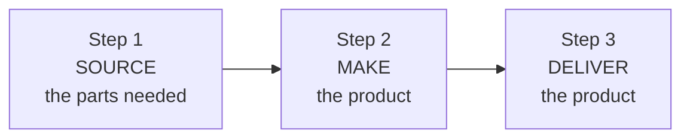

**Key terms (from the slides):**

| Term | Meaning | Example |
|---|---|---|
| **Lead time** | The time needed to respond to a customer order | A customer orders a custom sofa; it arrives 3 weeks later, so lead time is 3 weeks |
| **Customer order decoupling point** | Where inventory is positioned so that entities in the supply chain can operate independently | A bike maker keeps frames and wheels in stock; assembly starts only when an order arrives, so the decoupling point is at components |
| **Lean manufacturing** | A means of achieving high levels of customer service with minimal inventory investment | Toyota-style flow: produce what is needed, when needed |

**Why the decoupling point matters:** everything *upstream* of it is run on forecasts (push); everything *downstream* is run on actual customer orders (pull). Moving the point closer to the customer gives faster delivery but more inventory cost; moving it back gives lower inventory but longer lead time.

### Q&A

**Q1. What are the three high-level steps of a manufacturing process?**
Source the parts, make the product, deliver the product.

**Q2. Define lead time.**
The time needed to respond to a customer order.

**Q3. What is the customer order decoupling point?**
The place in the process where inventory is positioned so that stages of the supply chain can operate independently of one another.

**Q4. How does the position of the decoupling point affect a firm?**
It affects speed, flexibility, inventory cost, and many trade-offs. Positioned late (finished goods), delivery is fast but inventory is high and flexibility is low. Positioned early (raw materials), inventory is low and flexibility is high, but lead time is long.

**Q5. What is lean manufacturing?**
Achieving high customer service levels with minimal inventory investment.

---

## 2. Types of Firms: MTS, ATO, MTO, ETO

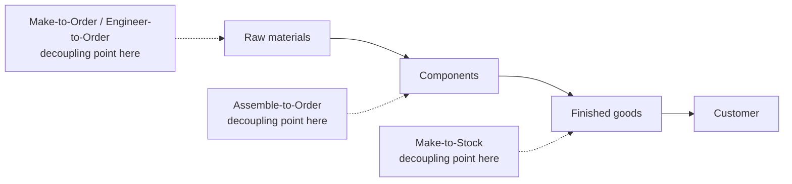

| Type | How it works | Decoupling point | Examples (slides) | Lead time | Inventory risk |
|---|---|---|---|---|---|
| **Make-to-Stock (MTS)** | Serve customers from finished-goods inventory | Finished goods | TVs, clothing, packaged food | Shortest | Highest (forecast risk) |
| **Assemble-to-Order (ATO)** | Combine pre-assembled modules to meet a customer's specifications | Components/modules | (e.g., Dell-style computers, custom bikes) | Medium | Medium |
| **Make-to-Order (MTO)** | Make the customer's product from raw materials, parts, components | Raw materials or supplier inventory | Boeing aircraft (slides) | Long | Low |
| **Engineer-to-Order (ETO)** | Work with the customer to design and then make the product | Raw materials/design stage | Boeing commercial aircraft, custom ships | Longest | Lowest |

### 2.1 Make-to-Stock (MTS)

- The essential issue is **balancing the level of inventory against the level of customer service**.
- That is easy with unlimited inventory, but **inventory costs money**; a trade-off between inventory cost and service level must be made.
- Use **lean manufacturing** to reach higher service levels for a given inventory investment.

### 2.2 Assemble-to-Order (ATO)

- Primary task: **define a customer's order in terms of alternative components**, because components are what is carried in inventory.
- Required capability: a **design that allows maximum flexibility in combining components** (modular design).
- Big advantage: moving the decoupling point **from finished goods to components**.

**Example (not on slides):** A PC maker stocks processors, RAM, drives, and cases. When you configure and order, it assembles in a day or two. It never has to guess which of thousands of finished configurations will sell.

### 2.3 Make-to-Order / Engineer-to-Order (MTO/ETO)

- **Boeing's** commercial aircraft process is the example given.
- The decoupling point can be in **raw materials at the manufacturing site or in supplier inventory**.
- Depending on how similar the products are, it may **not even be possible to preorder parts**.

### Q&A

**Q6. Name the four types of firms based on order fulfilment.**
Make-to-stock, assemble-to-order, make-to-order, engineer-to-order.

**Q7. What is the central trade-off in make-to-stock?**
Inventory cost versus customer service level.

**Q8. Why can a firm not simply hold unlimited inventory to give perfect service in MTS?**
Inventory costs money (holding, obsolescence, capital tied up), so the cost would exceed the benefit.

**Q9. What must an assemble-to-order firm get right?**
Defining customer orders in terms of alternative components, and having a modular design that allows maximum flexibility in combining them.

**Q10. What is the advantage of moving the decoupling point from finished goods to components?**
Fewer end-product variants to forecast and stock, lower inventory risk, and still quick delivery because only final assembly remains.

**Q11. Why is Boeing described as make-to-order/engineer-to-order?**
Each aircraft is built to a customer's specification, often with joint design work, so it cannot be built to stock and parts may not be pre-ordered.

**Q12. Classify: (a) packaged biscuits (b) a custom-built yacht (c) a laptop configured online (d) a bespoke suit.**
(a) MTS; (b) ETO; (c) ATO; (d) MTO.

**Q13. Which type has the longest lead time and which has the shortest?**
Longest: ETO. Shortest: MTS.

---

## 3. How Manufacturing Processes Are Organized

Five basic process/layout types:

| Type | Definition (slides) | Everyday example |
|---|---|---|
| **Project layout** | Product remains in a fixed location; manufacturing equipment is moved to the product | Building a bridge or a ship |
| **Workcenter (job shop)** | Similar equipment or functions are grouped together | Hospital departments; a machine shop with a lathe area, a milling area |
| **Manufacturing cell** | A dedicated area where products with similar processing requirements are produced | A cell producing all brake-component variants |
| **Assembly line** | Work processes are arranged according to the progressive steps by which the product is made | Car or phone assembly |
| **Continuous process** | Like an assembly line, but the flow is continuous, such as with liquids | Oil refinery, soft-drink syrup, cement |

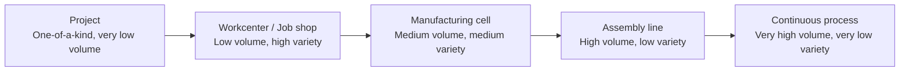

**Details per type (from the slides):**

- **Project:** a high degree of task ordering is common; the layout may be built by arranging materials according to their assembly priority.
- **Workcenter:** the usual approach is to arrange workcenters to **optimize material movement**; centres with **large interdepartmental traffic are placed adjacent**. Also called a department, focused on one type of operation.
- **Manufacturing cell:** formed by **allocating dissimilar machines** to cells designed for **similar products** (shape, processing, etc.); dedicated to a **limited range of products**.
- **Assembly line:** the path for each part is, in effect, a **straight line**; **discrete products** move from workstation to workstation.
- **Continuous/flow process:** the product moves continuously through the process; often a **liquid or chemical** that actually "flows".

### Q&A

**Q14. List the five ways manufacturing processes are organized.**
Project layout, workcenter (job shop), manufacturing cell, assembly line, continuous process.

**Q15. In a project layout, what moves and what stays?**
The product stays fixed; equipment, workers, and materials move to it.

**Q16. Why are workcenters with heavy mutual traffic placed next to each other?**
To minimize material-handling distance and cost.

**Q17. How does a manufacturing cell differ from a workcenter?**
A workcenter groups *similar machines* together (by function); a cell groups *dissimilar machines* together to process a *family of similar products*.

**Q18. How does a continuous process differ from an assembly line?**
An assembly line makes discrete units moving from station to station; a continuous process has an uninterrupted flow, typically liquids, chemicals, or powders.

**Q19. Give one example each of the five types.**
Project: shipbuilding. Workcenter: custom machine shop. Cell: a dedicated cell for gearbox parts. Assembly line: car assembly. Continuous: oil refining.

---

## 4. Product-Process Matrix

The matrix links **product standardization** (vertical axis) and **product volume** (horizontal axis) to the best process/layout.

```
 Product                     Product Volume
 Standardization     Low  <------------------------->  High
 Low (one-of-a-kind)  [Project]
                         [Workcenter]
                           [ Manufacturing Cell ]
                                          [Assembly Line]
 High (commodity)                                  [Continuous Process]
```

**Reading the matrix (from the slide figure):**
- **Top-left:** one-of-a-kind, low volume → **Project**, then **Workcenter**
- **Middle:** the large oval **Manufacturing cell** spans a wide range of volume and standardization
- **Bottom-right:** standardized, high volume → **Assembly line**, then **Continuous process**

**Rule of thumb:** as you move from top-left to bottom-right, **volume rises, variety falls, flexibility falls, and unit cost falls.** Choosing a process far from this diagonal usually means a poor fit (for example, running a one-of-a-kind product on a high-volume assembly line is wasteful).

### Q&A

**Q20. What two variables define the product-process matrix?**
Product standardization (one-of-a-kind to commodity) and product volume (low to high).

**Q21. Which process is suitable for a standardized, very high-volume product?**
Continuous process (or assembly line for discrete items).

**Q22. Which process suits one-of-a-kind, low-volume work?**
Project or workcenter.

**Q23. What happens to cost per unit and flexibility as you move toward the high-volume end?**
Cost per unit falls (scale and specialization) while flexibility falls.

**Q24. What is the risk of choosing an off-diagonal process?**
Mismatch: too much flexibility for a standard product wastes money; too little flexibility for varied products makes it impossible to meet customer needs.

---

## 5. Comparison of Process Types

| Aspect | Project | Job shop | Manufacturing cell | Assembly line | Continuous |
|---|---|---|---|---|---|
| **Layout organization** | Fixed position: product stays, resources come to the site | Process-oriented: machines grouped by function | Product-oriented: machines grouped by product family | Linear: equipment in a sequence of operations | Flow-oriented: equipment arranged for continuous production |
| **Volume & variety** | Unique, one-of-a-kind (ships, buildings) | Low volume, high variety | Medium volume, medium variety | High volume, low variety | Very high volume, very low variety |
| **Flexibility** | Low (designed for a specific large project) | High | Moderate | Low | Very low |
| **Skill requirement** | Very high (specialized labor) | High (skilled workers for diverse tasks) | Moderate (team-based, specialized tasks) | Low to moderate (repetitive tasks) | Low (mostly automated) |
| **Applications** | Construction, shipbuilding, aerospace | Custom manufacturing, repair shops, prototyping | Lean manufacturing, auto parts, repetitive production | Automotive assembly, electronics, consumer goods | Chemicals, oil refining, food and beverage, power generation |

*(Note: the slide's "Flexibility" entry for Project says "Low"; this reflects that a project is built for one specific design, even though projects are one-of-a-kind. Learn it as given.)*

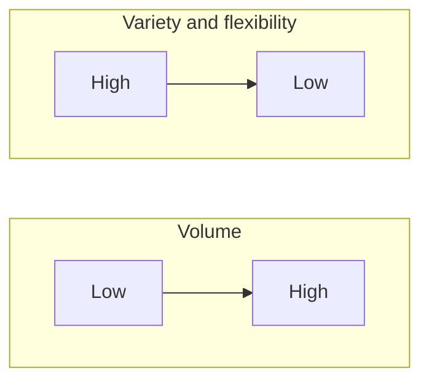

### Q&A

**Q25. Compare job shop and assembly line on volume, variety, flexibility, and skill.**
Job shop: low volume, high variety, high flexibility, high skill. Assembly line: high volume, low variety, low flexibility, low-to-moderate skill.

**Q26. Why does a continuous process need low labor skill?**
It is highly automated with minimal human intervention.

**Q27. Why is the project layout's skill requirement "very high"?**
Each project is unique and needs specialized labor to meet its requirements.

**Q28. Which layout suits lean manufacturing and product families?**
The manufacturing cell.

**Q29. Pick the process: (a) petrol refining (b) a bridge (c) a dental-implant lab (d) a smartphone line.**
(a) Continuous; (b) Project; (c) Job shop/workcenter; (d) Assembly line.

---

## 6. Break-Even Analysis

**Purpose:** choose among alternative processes or equipment by comparing cost trade-offs; each option is cheapest over some range of volume.

**Total cost of an option:** $TC = FC + VC \times Demand$

**Break-even point between two options (set the costs equal):**

$$FC_1 + VC_1 \times D = FC_2 + VC_2 \times D \;\;\Rightarrow\;\; D = \frac{FC_1 - FC_2}{VC_2 - VC_1}$$

### 6.1 Slide example

| Option | Fixed cost | Variable cost per unit | Total cost |
|---|---|---|---|
| **Purchase** | $0 | $200 | 200 × D |
| **Lathe** | $80,000 | $75 | 80,000 + 75 × D |
| **Machining center** | $200,000 | $15 | 200,000 + 15 × D |

**Point A: Lathe vs Machining center**
80,000 + 75D = 200,000 + 15D
60D = 120,000 → **D = 2,000 units**

**Point B: Purchase vs Lathe**
200D = 80,000 + 75D
125D = 80,000 → **D = 640 units**

**Decision rule (derived):**

| Annual demand | Cheapest option |
|---|---|
| Below 640 | **Purchase** |
| 640 to 2,000 | **Lathe** |
| Above 2,000 | **Machining center** |

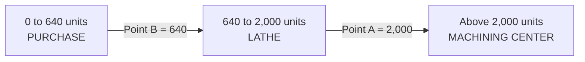

**Check at sample volumes:**

| Demand | Purchase | Lathe | Machining center | Best |
|---|---|---|---|---|
| 500 | $100,000 | $117,500 | $207,500 | Purchase |
| 1,500 | $300,000 | $192,500 | $222,500 | Lathe |
| 2,500 | $500,000 | $267,500 | $237,500 | Machining center |

*The slide graph also shows a **revenue line at $300/unit**. Profit = revenue − cost. At 2,000 units on the machining center: revenue $600,000 − cost $230,000 = **$370,000 profit**. Point C on the graph marks revenue at 1,000 units ($300,000).*

*Why isn't "purchase vs machining center" a decision point? They cross at 200,000 ÷ 185 ≈ 1,081 units, but the lathe is cheaper than both in that region, so the crossover never matters.*

### Q&A

**Q30. What is break-even analysis used for in process selection?**
To compare the costs of alternative processes/equipment and find the volume at which each becomes the least-cost option.

**Q31. Write the total cost equation and the break-even demand between two options.**
TC = FC + VC × D. Break-even D = (FC₁ − FC₂) ÷ (VC₂ − VC₁).

**Q32. Why does the high-fixed-cost, low-variable-cost option win at high volumes?**
Its large fixed cost is spread over many units and its low variable cost saves money on every additional unit.

**Q33. In the slide example, what should the firm do if demand is 1,000 units?**
Lathe: cost = 80,000 + 75,000 = $155,000, versus $200,000 to purchase and $215,000 on the machining center.

**Q34. What are the limitations of break-even analysis?** *[Supplementary]*
It assumes costs are linear and known, demand is certain, and ignores quality, flexibility, risk, learning effects, and strategic factors.

**Q35. Option X: FC = $50,000, VC = $20. Option Y: FC = $120,000, VC = $8. Find the break-even volume.**
D = (120,000 − 50,000) ÷ (20 − 8) = 70,000 ÷ 12 = **5,833 units**. Below that, X is cheaper; above, Y.

**Q36. For the slide example, at what volume does the lathe itself break even against revenue of $300/unit?**
300D = 80,000 + 75D → 225D = 80,000 → **D ≈ 356 units**.

---

## 7. Manufacturing Process Flow Design

**Definition:** a method to evaluate the specific processes that material follows as it moves through the plant.

**Common tools:** assembly drawings, assembly charts, route sheets, and flow process charts.

**Focus:** identify activities that can be **minimized or eliminated**, especially **movement and storage**. *The fewer the moves, delays, and storage, the better the flow.*

| Chart | What it shows |
|---|---|
| **Assembly drawing** | An exploded view of the product showing its component parts |
| **Assembly chart (Gozinto chart)** | How parts go together, order of assembly, overall flow pattern |
| **Operation and route sheet** | Specifies operations and process routing |
| **Process flowchart** | What happens to the product as it progresses through the facility |

### 7.1 Reading the Gozinto chart (plug assembly, slide figure)

"Gozinto" is a play on "the part that goes into". In the slide's plug example:

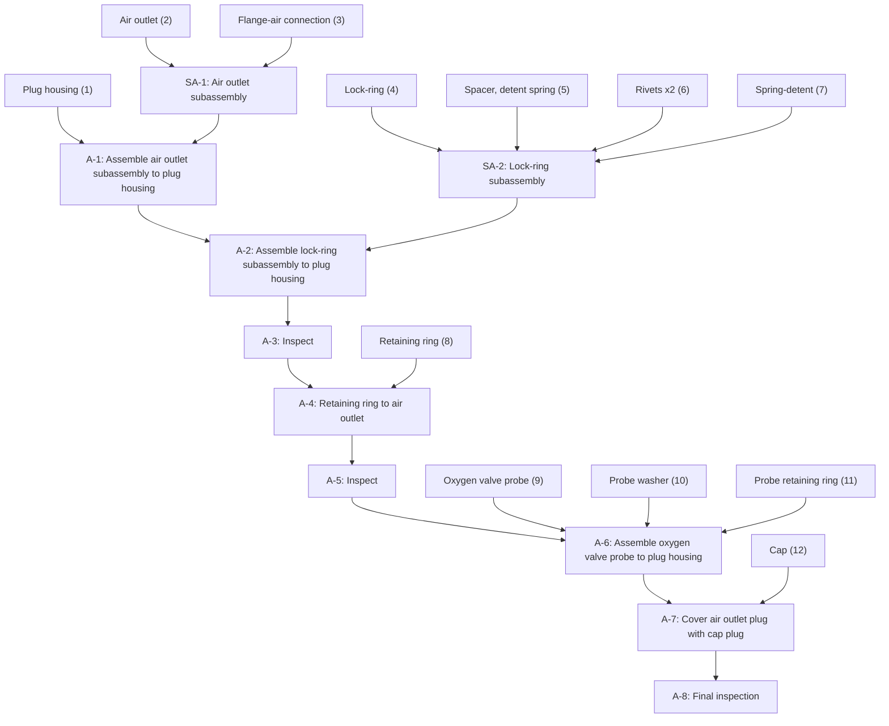

Reading rule: each numbered input is a part; circles are assembly operations; green boxes are inspections; the main vertical line is the order of assembly.

### 7.2 Process flowchart symbols (from the slide figure)

| Symbol | Meaning |
|---|---|
| Rectangle | Task or operation |
| Diamond | Decision point |
| Inverted triangle | Storage area or queue (waiting line) |
| Arrow | Flow of material or customers |

### Q&A

**Q37. What is process flow design?**
A method to evaluate the specific processes material follows as it moves through the plant, using charts to find activities that can be minimized or eliminated.

**Q38. Name the four charts used and what each shows.**
Assembly drawing (exploded view), assembly/Gozinto chart (order of assembly), operation and route sheet (operations and routing), process flowchart (what happens to the product through the facility).

**Q39. Why should the number of moves, delays, and storages be minimized?**
They add time and cost without adding value to the product.

**Q40. What is a Gozinto chart and what does it help with?**
An assembly chart showing which parts go into which subassemblies and the sequence of assembly; it helps plan assembly order, inspections, and flow.

**Q41. What symbol shows a queue or storage in a flowchart?**
An inverted triangle.

---

## 8. Process Analysis: Capacity and Cost Example (Example 7.2)

### 8.1 Data

**Molding (stage 1):**
- 11 machines, one usually down (so 10 usable)
- 8-hour shift, one operator per machine
- 25 parts per hour per machine
- Labor paid 20¢ per good part; overtime 30¢ per part
- Employment is flexible: **6 operators available now, 4 more can be made available**

**Assembly (stage 2):**
- 15 workers, 8-hour shift, 150 components per hour
- Labor paid 30¢ per good part, divided equally among workers
- Can hire 15 more workers for a **second shift**

**Other costs per week:** building rent $100; supervision/admin/maintenance $1,000; depreciation $50.
**Per-part costs:** raw material 10¢, electricity 2¢, purchased part 30¢.
*(The data slide writes amounts with "C" for cents; the cost slides then use dollars, e.g., $0.10.)*

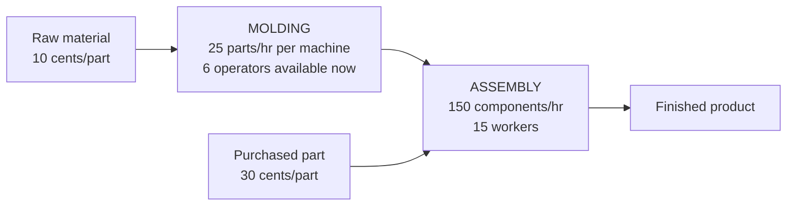

### 8.2 (a) Capacity of the process

- **Molding:** 6 machines × 25 parts/hr × 8 hr/day × 5 days = **6,000 parts/week** (only 6 operators available, so 6 machines)
- **Assembly:** 150 × 8 × 5 = **6,000 components/week**
- **Capacities are balanced.**

### 8.3 (b) Molding with 10 machines

- Molding: 10 × 25 × 8 × 5 = **10,000/week**
- Assembly is still 6,000, so **system capacity = 6,000**. The capacities are **no longer balanced**.
- **Principle:** in the long run, overall capacity **cannot exceed the slowest stage** (the bottleneck).

### 8.4 (c) Second shift in assembly

- Assembly: 150 × 16 × 5 = **12,000/week**
- Molding (10 machines): 10,000/week
- **New system capacity = 10,000/week**, and molding is now the bottleneck.

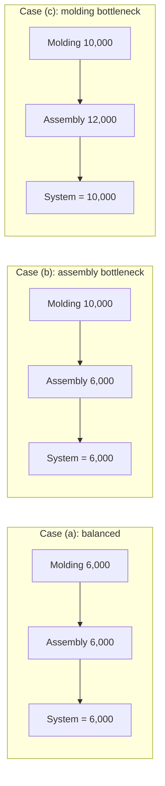

### 8.5 (d) Cost per unit

| Item | Basis | 6,000 parts/wk | 10,000 parts/wk |
|---|---|---|---|
| Raw material | $0.10/part | $600 | $1,000 |
| Purchased parts | $0.30/component | 1,800 | 3,000 |
| Electricity | $0.02/part | 120 | 200 |
| Molding labor | $0.20/part | 1,200 | 2,000 |
| Assembly labor | $0.30/part | 1,800 | 3,000 |
| Rent | $100/week | 100 | 100 |
| Supervision | $1,000/week | 1,000 | 1,000 |
| Depreciation | $50/week | 50 | 50 |
| **Total cost** | | **$6,670** | **$10,350** |
| **Cost per unit** | | **$1.11** | **$1.04** |

**Why cost per unit falls with volume:** variable cost per unit is constant at $0.92 (0.10 + 0.30 + 0.02 + 0.20 + 0.30), while fixed cost is $1,150/week. So

$$\text{Cost per unit} = 0.92 + \frac{1{,}150}{Q}$$

At Q = 6,000: 0.92 + 0.192 = $1.11. At Q = 10,000: 0.92 + 0.115 = $1.04. ✔ This is the **economy of scale** effect: fixed cost spread over more units.

### Q&A

**Q42. In Example 7.2, why is molding capacity based on 6 machines even though 10-11 exist?**
Only 6 operators are available now (one operator per machine), so only 6 machines can run.

**Q43. What is the capacity of the system, and why does the slowest stage decide it?**
6,000/week at the start. Output of the whole system cannot exceed the capacity of its bottleneck stage because downstream stages receive only what the bottleneck passes on, and upstream excess just piles up.

**Q44. If molding went to 10 machines but assembly stayed at one shift, what is the capacity? Is it balanced?**
6,000/week; not balanced (molding 10,000 vs assembly 6,000).

**Q45. After adding a second assembly shift with 10 molding machines, what is the capacity and the bottleneck?**
10,000/week; molding is now the bottleneck.

**Q46. Explain why cost per unit falls from $1.11 to $1.04.**
Fixed costs of $1,150 per week are spread over 10,000 units instead of 6,000, while variable cost per unit ($0.92) is unchanged.

**Q47. Moulding has 8 machines (and operators) and assembly one shift. What is the system capacity?**
Molding = 8 × 25 × 8 × 5 = 8,000; assembly = 6,000. System = **6,000** (assembly bottleneck).

**Q48. Moulding has 6 machines and assembly gets a second shift. What is the system capacity?**
Molding = 6,000; assembly = 12,000. System = **6,000** (molding bottleneck). Adding assembly capacity alone achieved nothing.

**Q49. What is the lesson about adding capacity?**
Add capacity at the bottleneck; improving a non-bottleneck stage does not raise system output.

**Q50. Compute total weekly cost and cost per unit at 8,000 units, assuming the same fixed and variable costs.**
Total = 1,150 + 0.92 × 8,000 = 1,150 + 7,360 = $8,510; cost per unit = **$1.064**. *(Practicality caveat: with the original staffing, only 6,000 can actually be assembled, so 8,000 is feasible only with more assembly capacity.)*

---

# PART B: Sessions 6-7, Managing Process

## 9. Process Flowcharting

**Process flowcharting** = using a diagram to present the **major elements of a process**.

- Basic elements: **tasks/operations, flows of materials or customers, decision points, and storage areas or queues.**
- Splitting a diagram into **horizontal or vertical bands** (swimlanes) is sometimes useful.
- It is the **ideal starting point** for analyzing a process.

### Slide example: a slot-machine process

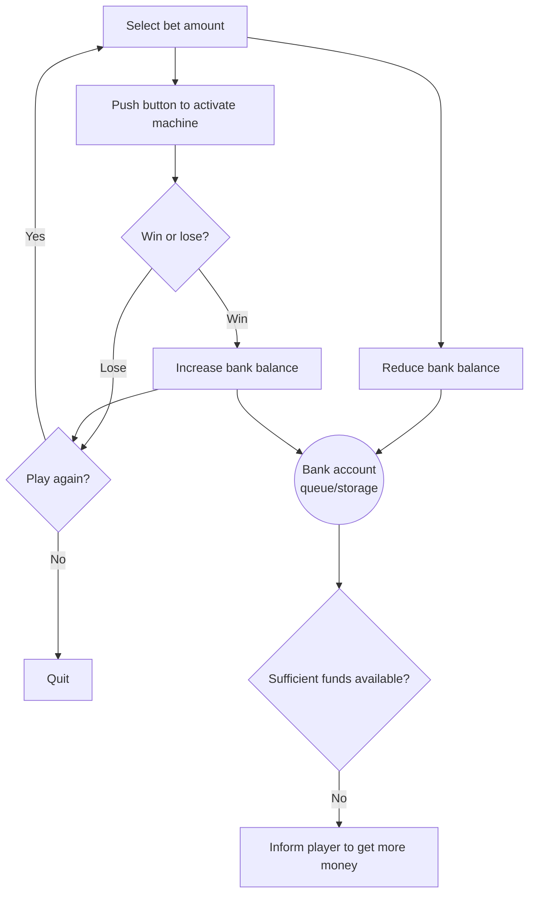

The slide separates **player activities** from **internal machine activities** with a dashed line (swimlanes), which clarifies who does what.

### Q&A

**Q51. What is process flowcharting?**
Using a diagram to show the major elements of a process: tasks, flows, decision points, and storage/queues.

**Q52. Why are bands (swimlanes) useful in a flowchart?**
They separate responsibilities (for example, customer actions versus internal operations) so you can see who does what and where hand-offs occur.

**Q53. Why is flowcharting the first step in process analysis?**
You must understand the current process before you can measure it, find bottlenecks, or redesign it.

**Q54. Draw a flowchart (in words) for withdrawing cash at an ATM.**
Insert card → enter PIN → [decision: PIN valid? no → retry/end] → select amount → [decision: sufficient balance? no → message/end] → dispense cash → return card → end.

---

## 10. Single-Stage vs Multiple-Stage; Buffering, Blocking, Starving

- **Single-stage process:** all activities can be collapsed and analyzed using a **single cycle time** to represent speed.
- **Multiple-stage process:** multiple groups of activities linked through flows. A **stage** = multiple activities pulled together for analysis.

| Term | Definition |
|---|---|
| **Buffer** | Storage area between stages where output of a stage is placed before use by a downstream stage |
| **Blocking** | A stage must **stop because there is no place to deposit the item** (downstream is full) |
| **Starving** | A stage must **stop because there is no work** (upstream is empty) |
| **Bottleneck** | A resource that **limits the capacity** of the process |

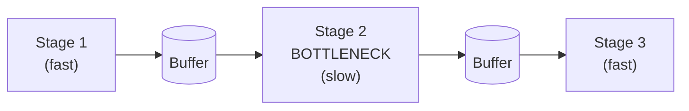

- **Stage 1 gets BLOCKED** when the buffer before the bottleneck is full (it has nowhere to put its output).
- **Stage 3 gets STARVED** because the bottleneck cannot feed it fast enough.
- Buffers **decouple** stages so small disruptions in one do not immediately stop the next.

**Everyday analogy:** a petrol station with one pump (bottleneck). Cars queue (buffer); the highway before it is "blocked"; the exit lane after it is "starved".

### Q&A

**Q55. Differentiate blocking and starving.**
Blocking: a stage stops because its output has nowhere to go. Starving: a stage stops because it has no input to work on.

**Q56. What is a buffer and why is it used?**
A storage area between stages. It absorbs variability and prevents blocking and starving, letting stages run more independently.

**Q57. What is a bottleneck?**
The resource that limits the capacity of the whole process.

**Q58. In a three-stage line with rates 10, 6, and 8 units/hr, which stage is blocked/starved, and what is system output?**
Stage 2 (6/hr) is the bottleneck, so system output = **6/hr**. Stage 1 will be blocked once the buffer fills; stage 3 will be starved part of the time.

**Q59. Can adding a very large buffer fix a bottleneck?**
No. A buffer smooths variability but does not raise the bottleneck's long-run rate; it only adds inventory and delay.

---

## 11. Make-to-Stock vs Make-to-Order (Process View)

| | Make-to-order | Make-to-stock | Hybrid |
|---|---|---|---|
| **Trigger** | Only activated in response to an actual order | Activated to meet expected/forecasted demand | Combines the features of both |
| **Inventory** | WIP and finished goods kept to a minimum | Orders served from a target stocking level | Part-built stock, final step on order |
| **Response time** | Slow | Fast | Moderate |

### Hamburger example (slide figure: McDonald's, Burger King, Wendy's)

| Chain/process | Flow | Type |
|---|---|---|
| **McDonald's (old)** | Raw material → Cook → Assemble → **Finished goods inventory** → Deliver (customer order triggers at the end) | Make-to-stock |
| **Burger King** | Raw material → Cook → **WIP** → [customer order] → custom? Yes: assemble to order → Deliver; standard: assemble to finished goods → Deliver | Hybrid |
| **Wendy's** | Customer order → Raw material → Cook → Assemble → Deliver (chill storage only for raw materials) | Make-to-order |
| **McDonald's (current)** | Raw material → Cook → **WIP** → [customer order] → Assemble → Deliver | Assemble-to-order (decoupling at cooked patties) |

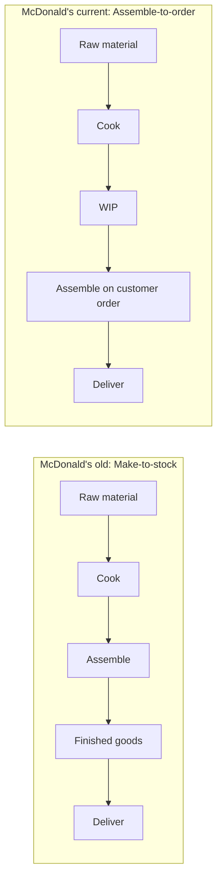

**Takeaway:** moving the decoupling point from finished goods to WIP lets McDonald's keep **fresh, customizable** burgers while still being **fast**; it reduces waste from unsold finished burgers.

### Q&A

**Q60. What triggers production in make-to-order vs make-to-stock?**
Make-to-order: an actual customer order. Make-to-stock: forecast demand.

**Q61. Why is response time slow in make-to-order?**
Work starts only after the order arrives, so the customer waits for the entire process.

**Q62. How has McDonald's changed its process, and why?**
Old: assemble burgers ahead into finished-goods stock (fast but stale/wasteful). Current: hold cooked patties as WIP and assemble to order (fresher, customizable, less waste, still fast).

**Q63. Where is the decoupling point for Wendy's, Burger King, and McDonald's (current)?**
Wendy's: at raw material (make-to-order). Burger King: at WIP and finished goods (hybrid). McDonald's current: at cooked WIP.

**Q64. What is a hybrid process?**
One that combines make-to-order and make-to-stock features, for example standard items from stock and customized items made on order.

---

## 12. Flow Metrics and Definitions

| Term | Definition | Unit |
|---|---|---|
| **Cycle time** | Time between the completion of two successive units coming out of the process (set by the **bottleneck** step in a serial line) | min/unit |
| **Flow rate / Throughput rate** | Number of units produced or processed per unit of time | units/min |
| **Flow time** | Total time a unit spends in the system from entry to exit, including processing **and waiting** | min |
| **Inventory (WIP)** | Number of units currently in the system (being processed, not yet completed) | units |
| **Takt time** | Maximum allowable time to produce one unit to meet customer demand | min/unit |
| **Value-added time** | The portion of total time spent on activities that directly transform the product | min |

$$\text{Takt time} = \frac{\text{Available time}}{\text{Customer demand}}$$

**Relationships:**
- Flow rate (capacity) = 1 ÷ cycle time
- **Little's Law:** Inventory = Flow rate × Flow time
- Compare **cycle time** with **takt time**: if cycle time ≤ takt time, the process can meet demand; if cycle time > takt time, it cannot.
- Non-value-added time = Flow time − Value-added time

### Q&A

**Q65. Define cycle time, flow time, and flow rate.**
Cycle time: time between successive completions. Flow time: total time one unit spends in the system. Flow rate: units processed per unit time.

**Q66. What is takt time and how is it calculated?**
The maximum time allowed per unit to meet demand: available time ÷ customer demand.

**Q67. How are cycle time and takt time compared?**
If cycle time is less than or equal to takt time, the process can meet demand; if it is greater, it falls short and needs more capacity.

**Q68. Why can flow time be much longer than the sum of processing times?**
Because units also wait in queues and buffers; flow time includes waiting.

**Q69. What is value-added time? Give an example.**
Time spent on activities that transform the product in a way the customer values, such as cooking, assembling, or toasting a sandwich. Order taking and packing are typically non-value-added or support steps.

---

## 13. Worked Example: "SubFast" Sandwich Shop

**Setting:** 8 hours/day (480 minutes), four sequential steps.

| Step | Description | Time (min) |
|---|---|---|
| 1. Take order | Staff takes order | 1 |
| 2. Assemble | Ingredients placed | 2 |
| 3. Toasting | Sandwich toasted | **3** (bottleneck) |
| 4. Packing | Wrapped and handed over | 1 |

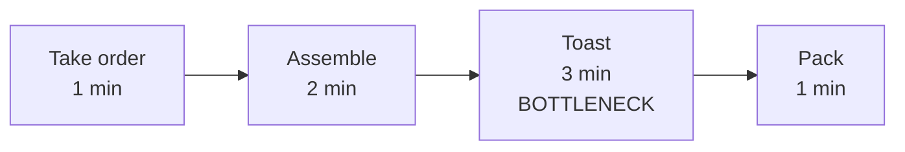

| Metric | Calculation | Result |
|---|---|---|
| **Cycle time** | Longest step (bottleneck) | **3 min** |
| **Flow time** | 1 + 2 + 3 + 1 | **7 min** |
| **Flow rate** | 1 sandwich per 3 min = 60/3 | **20 sandwiches/hour** |
| **Inventory (Little's Law)** | (1/3 per min) × 7 min | **≈ 2.33 sandwiches** |
| **Takt time** (demand 120/day) | 480 ÷ 120 | **4 min/sandwich** |
| **Value-added time** | Assemble (2) + Toast (3) | **5 min** |
| **Non-value-added time** | 7 − 5 | **2 min** |

**Extra analysis (not on slides):**
- **Maximum daily output** = 480 ÷ 3 = **160 sandwiches**.
- Since cycle time (3) < takt time (4), the shop **can meet demand of 120/day**. Toaster utilization at 120/day = 120 × 3 ÷ 480 = **75%**.
- **Utilization of each step** at 120/day: order (1×120/480 = 25%), assemble (50%), toast (75%), pack (25%).
- If demand rose to 200/day, takt = 2.4 min < cycle time 3 min, so the shop **could not** keep up. Options: add a second toaster (toasting capacity 2 per 3 min = 1.5 min/unit; the next bottleneck becomes assemble at 2 min, so cycle time 2 min and capacity 240/day).

> **Careful:** the 7-minute flow time assumes **no waiting**. If sandwiches queue before the toaster (the bottleneck), actual flow time is longer.

### Q&A

**Q70. Identify the bottleneck in SubFast and its effect.**
Toasting (3 min). It sets the cycle time at 3 minutes and the capacity at 20 sandwiches/hour.

**Q71. Can SubFast meet demand of 120 sandwiches/day? How do you know?**
Yes. Takt time is 4 min and cycle time is 3 min (≤ 4); capacity is 160/day, above 120.

**Q72. Why is the average WIP only about 2.33 sandwiches?**
Little's Law: flow rate (1/3 per min) × flow time (7 min) = 2.33.

**Q73. Which steps are non-value-added in the slide solution?**
Taking the order and packing (2 minutes total).

**Q74. If a second toaster is added, what is the new cycle time and daily capacity?**
Toasting becomes 1.5 min/sandwich effective; new bottleneck is assembling (2 min). Cycle time = 2 min; capacity = 480 ÷ 2 = 240/day.

---

## 14. Little's Law

$$\boxed{\text{Inventory (WIP)} = \text{Throughput rate} \times \text{Flow time}}$$

This is a **long-term (average) relationship** that holds for any stable process, whatever its details. You can find any one of the three if you know the other two.

**Method:** (1) define the **unit of analysis** (what is flowing: a student, a pound, an application); (2) keep all three variables in **consistent time units**; (3) solve.

### 14.1 Slide examples

**Example 1: College cafeteria**
500 students/hour arrive; average stay 40 minutes (= 0.667 hour). Average students inside?
Inventory = 500 × 0.667 = **≈ 333 students**.
*(The slide rounds 0.67 and writes "334 approximately"; exact is 333.3. See Part E.)*

**Example 2: Inventory of a consumable (slide mixes "olive oil" and "coffee")**
Average inventory 20 gallons; usage 15 per day. How long does a unit stay in inventory?
20 = 15 × Flow time → Flow time = **1.33 days**.

**Example 3: Admissions office**
200 applications in process on average; decision in 30 days on average. Required completion rate?
200 = Flow rate × 30 → Flow rate = **6.67 ≈ 7 applications/day**.

### 14.2 Extra practice

| # | Problem | Solution |
|---|---|---|
| 1 | An ER admits 12 patients/hour; average stay 2.5 hours. Average patients inside? | 12 × 2.5 = **30 patients** |
| 2 | A bank branch holds 40 customers on average; 20 customers/hour are served. Average time in branch? | 40 = 20 × T → **2 hours** |
| 3 | A factory has 600 units of WIP and flow time of 5 days. What is throughput? | 600 ÷ 5 = **120 units/day** |
| 4 | A shop must keep WIP at or below 90 units and completes 30 units/day. Maximum average flow time? | 90 ÷ 30 = **3 days** |

### Q&A

**Q75. State Little's Law and define each term.**
Inventory (average units in the system) = throughput rate (units per time) × flow time (average time a unit spends in the system).

**Q76. Why must time units be consistent in Little's Law?**
Throughput per hour × flow time in minutes gives wrong WIP. Convert so both use the same time unit.

**Q77. If management wants to cut WIP by half at the same throughput, what must happen to flow time?**
It must be cut by half.

**Q78. How does Little's Law connect inventory to speed?**
For a given throughput, lower inventory means lower flow time; reducing flow time reduces inventory (the core idea behind lean).

**Q79. A hospital has 120 inpatients on average and discharges 20 per day. Average length of stay?**
120 = 20 × T → **6 days**.

---

## 15. Example: Automobile Assembly Plant

**Data:** battery costs $45; 12 hours to make a car; 200 cars per 8-hour shift (one shift); 8,000 batteries held on average in raw-material inventory (one battery per car).

**Step 1: Throughput** = 200 cars ÷ 8 hr = **25 batteries/hour**

**Step 2: WIP (batteries inside cars being built)**
WIP = throughput × flow time = 25 × 12 = **300 batteries**

**Step 3: Total average inventory** = 8,000 + 300 = **8,300 batteries**

**Step 4: Value** = 8,300 × $45 = **$373,500**

**Step 5: Flow time of raw inventory** = inventory ÷ throughput = 8,000 ÷ 200 per day = **40 days**, i.e., a **40-day supply** of batteries.
*(Using the total 8,300 gives 41.5 days; the slide uses raw inventory only, so 40 days.)*

**Insight:** 40 days of battery stock is huge compared with the 12 hours needed to build a car. Cutting raw inventory (for example, to 5 days) would free cash: 5 days × 200 batteries = 1,000 batteries = $45,000 instead of $360,000 tied up in raw batteries.

### Q&A

**Q80. Why is WIP 300 batteries?**
Throughput 25/hour × 12 hours of flow time (each car's build time) = 300.

**Q81. What is the average dollar value of battery inventory?**
8,300 × $45 = $373,500.

**Q82. What does "40-day supply" mean and why is it a concern?**
At current usage (200/day), raw inventory lasts 40 days. It ties up cash ($360,000 for 8,000 batteries), risks obsolescence and damage, and hints at over-ordering.

**Q83. If the plant adds a second shift (400 cars/day), what happens to the days of supply with the same 8,000 batteries?**
Days of supply = 8,000 ÷ 400 = **20 days**.

---

## 16. Process Flow Time Reductions

Three ways to cut flow time (from the slides):

1. **Perform activities in parallel** (e.g., do credit check while preparing the contract)
2. **Change the sequence of activities** (e.g., put the quick rejection test first)
3. **Reduce interruptions** (setups, breakdowns, waiting)

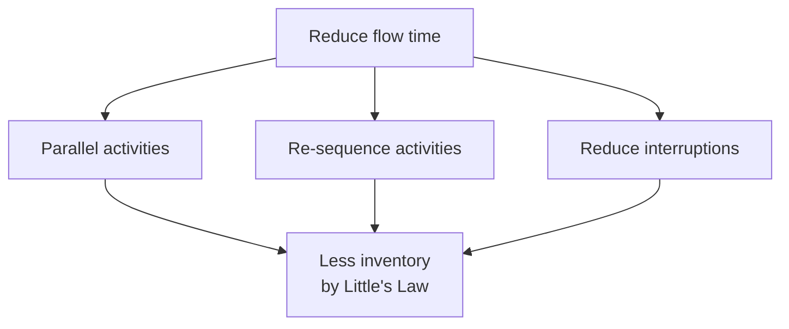

### Q&A

**Q84. Name three methods to reduce process flow time.**
Do activities in parallel, change the sequence of activities, reduce interruptions.

**Q85. Give a service example of parallel processing.**
A hospital runs blood tests and imaging at the same time instead of one after the other.

**Q86. Why would re-sequencing reduce flow time?**
Doing the most selective or quickest checks first screens out rejects early and avoids wasted downstream work.

---

# PART C: Sessions 8-9, Facility Layout

## 17. Objectives of Facility Layout

**Learning objectives:** describe advantages/disadvantages of layout types in manufacturing and services; visualize work flow and use algorithmic methods to lay out a facility; create and evaluate hybrid layouts.

**Objectives of a layout:**

| Efficiency | Flow and access | Safety, quality, flexibility |
|---|---|---|
| Minimize material-handling costs | Facilitate entry, exit, and placement of material, products, people | Incorporate safety and security measures |
| Utilize space efficiently | Facilitate communication and interaction | Promote product and service quality |
| Utilize labor efficiently | Eliminate wasted or redundant movement | Encourage proper maintenance |
| Eliminate bottlenecks | Reduce manufacturing cycle time | Provide visual control of activities |
| Increase capacity | Reduce customer service time | Provide flexibility to adapt to changing conditions |

### Q&A

**Q87. List any six objectives of facility layout.**
Minimize material-handling cost, efficient use of space, efficient use of labor, eliminate bottlenecks, reduce cycle time, ensure safety and security, promote quality, provide flexibility.

**Q88. How can layout affect quality and maintenance?**
Good layout gives easy access for inspection and maintenance and reduces handling damage.

**Q89. Why is "visual control of activities" an objective?**
Seeing the status of work (inventory, queues, problems) at a glance makes it easy to spot and fix issues.

---

## 18. Basic Layouts and Comparison

Three basic layouts:

- **Process layouts**: group **similar activities** together by process or function
- **Product layouts**: arrange activities **in a line** according to the sequence of operations for a particular product or service
- **Fixed-position layouts**: for projects where the **product cannot be moved**

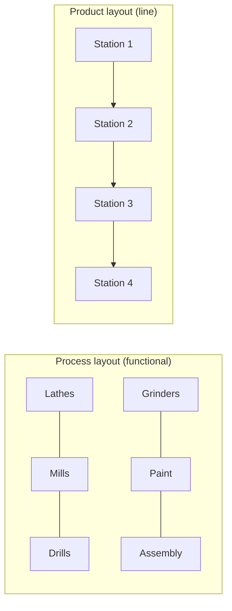

### Comparison table

| Feature | Product layout | Process layout |
|---|---|---|
| **Description** | Sequential arrangement of activities | Functional grouping of activities |
| **Type of process** | Continuous, mass production, mainly assembly | Intermittent, job shop, batch production, mainly fabrication |
| **Product** | Standardized, made to stock | Varied, made to order |
| **Demand** | Stable | Fluctuating |
| **Volume** | High | Low |
| **Equipment** | Special purpose | General purpose |
| **Workers** | Limited skills | Varied skills |
| **In-process inventory** | Low | High |
| **Finished-goods inventory** | High | Low |
| **Storage space** | Small | Large |
| **Material handling** | Fixed path (conveyor) | Variable path (forklift) |
| **Aisles** | Narrow | Wide |
| **Scheduling** | Part of balancing | Dynamic |
| **Layout decision** | Line balancing | Machine location |
| **Goal** | Equalize work at each station | Minimize material-handling cost |
| **Advantage** | **Efficiency** | **Flexibility** |

### Process layout examples

- **Manufacturing:** machine shop with separate departments for turning, milling, drilling, and finishing.
- **Service (slide figure: department store):** departments such as women's dresses, sportswear, shoes, cosmetics and jewelry, housewares, children's, men's, with an entry and display area. Customers move between departments by function.

### Q&A

**Q90. Define process layout, product layout, fixed-position layout.**
Process: groups similar activities. Product: arranges activities in sequence for a product/service. Fixed-position: product stays in one place and resources come to it.

**Q91. Give two advantages of product layout and two of process layout.**
Product: efficiency, low in-process inventory, simple scheduling. Process: flexibility, adapts to varied products, less vulnerable to single machine breakdown (general-purpose equipment).

**Q92. Why does a process layout need more storage space and wider aisles?**
High work-in-process inventory and variable material flow (forklifts) require space.

**Q93. What is the main layout goal for a product layout? For a process layout?**
Product: line balancing (equalize work at each station). Process: minimize material-handling cost.

**Q94. Which layout would you choose for (a) a car assembly plant (b) a custom furniture workshop (c) a hospital?**
(a) Product layout; (b) Process layout; (c) Process layout (departments by function), with fixed-position elements for surgery.

**Q95. Why is the product layout efficient but inflexible?**
Special-purpose equipment is arranged for one fixed sequence, so changing the product requires rearranging the line.

---

## 19. Fixed-Position Layouts

- Typical of **projects**
- Used for **fragile, bulky, heavy** items
- **Equipment, workers, and materials are brought to the site**
- **Low equipment utilization**
- **Highly skilled labor**
- Typically **low fixed cost**
- Often **high variable costs**

**Examples:** building a bridge, shipbuilding, constructing a dam, heart surgery (patient fixed, team and equipment come to him/her).

### Q&A

**Q96. Why is equipment utilization low in fixed-position layouts?**
Equipment is brought in only for the specific tasks at certain times and then sits idle or is moved away.

**Q97. Why are variable costs high in fixed-position layouts?**
Bringing in labor, equipment, and materials for each unique project involves heavy transport and coordination.

---

## 20. Designing Process Layouts: Block Diagramming

**Goal:** minimize material-handling cost.

- **Block diagramming:** minimize **nonadjacent loads**; use when **quantitative data** is available.
- **Relationship diagramming:** based on **location preference** between areas; use when **quantitative data is not available** (Section 21).

**Terms:**
- **Unit load:** the quantity in which material is normally moved
- **Nonadjacent load:** a movement over a distance farther than the next block

**Steps:**
1. Create a **load summary chart**
2. Calculate **composite (two-way) movements**
3. Develop **trial layouts** minimizing the number of nonadjacent loads

### 20.1 Worked example (5 departments)

**Load summary chart (From/To), as read from the slide:**

| From \ To | 1 | 2 | 3 | 4 | 5 |
|---|---|---|---|---|---|
| 1 | n/a | 100 | 50 | | |
| 2 | | n/a | 200 | 50 | |
| 3 | 60 | | n/a | 40 | 50 |
| 4 | | 100 | | n/a | 60 |
| 5 | | 50 | | | n/a |

**Composite (two-way) loads between each pair** (sum both directions):

| Pair | Loads |
|---|---|
| 2-3 | **200** |
| 2-4 | **150** (50 + 100) |
| 1-3 | **110** (50 + 60) |
| 1-2 | **100** |
| 4-5 | **60** |
| 3-5 | **50** |
| 2-5 | **50** |
| 3-4 | **40** |
| 1-4 | 0 |
| 1-5 | 0 |

**Trial layout 1** (grid: departments 1-2-3 on top, 4-5 below):

```
 [ 1 ]-100-[ 2 ]-200-[ 3 ]
   |   \     |   \     |
  [ 4 ]-60-[ 5 ]
```
Nonadjacent pairs: **1-3 (110)** and **3-4 (40)** → total nonadjacent load = **150**.

**Trial layout 2** (grid: 1-2-4 on top, 3-5 below):

```
 [ 1 ]-100-[ 2 ]-150-[ 4 ]
   |110       |200 \50   |60
 [  3  ]-----50-----[ 5 ]
```
Every pair with traffic is adjacent (diagonal neighbours count as adjacent in the slide) → **nonadjacent load = 0**. This is the best layout.

**Final block diagram** (with space requirements): Dept 1 (top-left, large), Dept 2 (small, centre-top, between 1 and 4), Dept 4 (top-right), Dept 3 (bottom-left), Dept 5 (bottom-right).

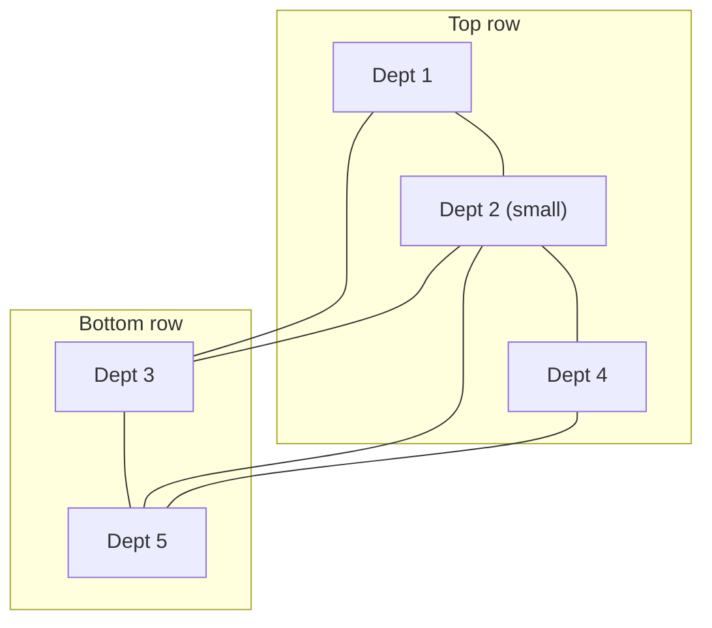

**Step logic:** place the pair with the **heaviest traffic (2-3: 200)** adjacent first, then the next heaviest (2-4: 150, then 1-3: 110, 1-2: 100...), checking that no loaded pair is left non-adjacent.

### Q&A

**Q98. What is the goal of designing a process layout?**
To minimize material-handling cost (equivalently, minimize loads times distances).

**Q99. Define unit load and nonadjacent load.**
Unit load: the quantity in which material is normally moved. Nonadjacent load: a load that has to travel farther than the next block.

**Q100. List the three steps in block diagramming.**
Create the load summary chart; calculate composite two-way movements; develop trial layouts minimizing nonadjacent loads.

**Q101. In the example, what are the composite loads for pairs 2-4 and 1-3?**
2-4: 50 + 100 = 150. 1-3: 50 + 60 = 110.

**Q102. Why is trial layout 2 better than trial layout 1?**
Trial layout 1 has 150 loads traveling nonadjacent (1-3 and 3-4), while trial layout 2 has none.

**Q103. When do we use block diagramming versus relationship diagramming?**
Block diagramming when quantitative flow data is available; relationship diagramming when it is not and managers rely on preferences.

**Q104. Why do we sum both directions to get composite movements?**
Adjacency is symmetric. Two departments are either next to each other or not, so what matters is total traffic between the pair in both directions.

**Q105. Solve this: three departments with composite loads A-B 80, B-C 30, A-C 10, in a row of three blocks. Which arrangement has the lowest nonadjacent load?**
Put A-B-C in a row (middle B): A-B and B-C adjacent; only A-C (10) nonadjacent → **cost 10**. Any arrangement with A-B non-adjacent would cost at least 80.

---

## 21. Relationship Diagramming (Muther's Grid)

- A **schematic diagram that uses weighted lines to denote location preference**
- **Muther's grid** = format for showing managers' preferences for department locations

**Closeness rating key (slide figure):**

| Code | Meaning | Weight (as lines) |
|---|---|---|
| **A** | Absolutely necessary (must be adjacent) | Heaviest |
| **E** | Especially important | |
| **I** | Important | |
| **O** | Okay | |
| **U** | Unimportant | |
| **X** | Undesirable (keep apart) | |

**Slide example departments:** Production, Offices, Stockroom, Shipping and receiving, Locker room, Toolroom.

- **(a) Original layout:** Offices | Locker room | Shipping and receiving on top; Stockroom | Toolroom | Production on the bottom, which has closeness problems (e.g., Stockroom far from Shipping and receiving, Production far from the Toolroom).
- **(b) Revised layout:** Stockroom placed next to Shipping and receiving; Production next to the Toolroom; Offices separated from noisy areas; Locker room kept away or as "okay".

**How to build one:** list the department pairs, assign A/E/I/O/U/X by manager judgment (reason codes are often added), then place **A pairs adjacent first** and **X pairs apart**; then E, I, and so on.

### Q&A

**Q106. What is a relationship diagram and when is it used?**
A schematic using weighted lines to show location preference between departments; used when quantitative flow data is unavailable.

**Q107. What do the letters A, E, I, O, U, X mean?**
A absolutely necessary, E especially important, I important, O okay, U unimportant, X undesirable.

**Q108. Give an example of an X relationship and an A relationship.**
X: paint shop and electronics assembly (fumes, dust). A: shipping and receiving with the stockroom (constant movement of goods).

**Q109. How does the placement procedure work?**
Satisfy the A relationships first, avoid X relationships, then fit E, I, O pairs as far as the layout allows.

---

## 22. Designing Service Layouts

Service layouts must be **both attractive and functional**.

| Layout | Characteristics (slides) | Best for |
|---|---|---|
| **Free-flow** | Encourage browsing, increase impulse purchasing, flexible, visually appealing | Fashion/department stores, boutiques |
| **Grid** | Encourage customer familiarity, low cost, easy to clean and secure, good for repeat customers | Supermarkets, convenience stores |
| **Loop** | Increases customer sightlines and exposure to products; encourages circulating through the whole store | IKEA-style stores |
| **Spine** | Same sightline/exposure benefits as loop; customers move along a central spine with branches | Department stores with distinct sections |


*(The slide figure shows free-flow as scattered fixtures, grid as parallel aisles, spine as a central aisle with angled branches, and loop as a circulating path with islands.)*

### Q&A

**Q110. Why is the grid layout common in supermarkets?**
It is low-cost, easy to clean and secure, and familiar to repeat customers who find items quickly.

**Q111. What is the main benefit of a free-flow layout?**
It encourages browsing and impulse purchases and is flexible and attractive.

**Q112. How do loop and spine layouts increase sales?**
They improve sightlines and exposure to products and encourage customers to circulate through the entire store.

**Q113. Which layout would you recommend for (a) a boutique (b) a grocery chain (c) a furniture megastore?**
(a) Free-flow; (b) Grid; (c) Loop.

---

## 23. Hybrid Layouts

| Hybrid | Description (slides) |
|---|---|
| **Cellular layout** | Groups **dissimilar machines** into work centers (cells) that process **families of parts** with similar shapes or processing requirements |
| **Production flow analysis (PFA)** | Reorders part-routing matrices to **identify families of parts** with similar processing requirements |
| **Flexible manufacturing system (FMS)** | **Automated machining and material-handling systems** that can produce an enormous variety of items |
| **Mixed-model assembly line** | Processes **more than one product model** in one line |

**Steps to create cellular layouts (slides):**
1. Identify families of parts with similar flow paths
2. Group machines into cells based on part families
3. Arrange cells so material movement is minimized
4. Locate large shared machines at the point of use

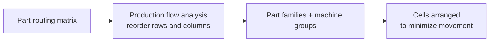

**Example (not on slides):** a small PFA matrix (X = part needs machine)

| Part \ Machine | M1 | M2 | M3 | M4 |
|---|---|---|---|---|
| P1 | X | X | | |
| P2 | | | X | X |
| P3 | X | X | | |
| P4 | | | X | X |

Reordering shows two blocks: **Cell A = {M1, M2} for {P1, P3}** and **Cell B = {M3, M4} for {P2, P4}**.

### Q&A

**Q114. What is a hybrid layout and why use it?**
A layout combining features of product and process layouts to get the efficiency of the former and the flexibility of the latter.

**Q115. Explain a cellular layout.**
Dissimilar machines grouped into cells to process families of similar parts, giving line-like flow for medium-volume, medium-variety work.

**Q116. What does production flow analysis do?**
Reorders part-routing matrices to identify part families with similar processing needs, which defines the cells.

**Q117. What is an FMS?**
An automated system of machines and material handling that can produce a wide variety of parts with little changeover.

**Q118. What is a mixed-model assembly line?**
An assembly line that makes more than one product model on the same line (for example, different car models on one line).

**Q119. What are the benefits of cellular manufacturing?**
Less material handling, shorter flow time, lower WIP, easier scheduling, and team ownership; the trade-off is duplicated machines and lower flexibility than a job shop.

---

# PART D

## 24. Key Takeaways

1. Manufacturing has three steps: **source, make, deliver**; the **decoupling point** decides where forecast-driven work ends and order-driven work begins.
2. Firm types by order fulfilment: **MTS → ATO → MTO → ETO** (moving right: longer lead time, lower inventory, more customization).
3. Five process types (**project, job shop, cell, assembly line, continuous**) fit the product-process matrix: **volume rises and variety falls** moving toward continuous.
4. **Break-even analysis** compares fixed and variable costs: $D = (FC_1 - FC_2)/(VC_2 - VC_1)$. Slide example: purchase below 640, lathe 640-2,000, machining center above 2,000.
5. **System capacity = capacity of the bottleneck stage**; balance stages, and add capacity only at the bottleneck. Example 7.2: 6,000 → 6,000 → 10,000.
6. **Cost per unit falls with volume** because fixed costs are spread: $0.92 + 1,150/Q.
7. Flow charts (**assembly drawing, Gozinto chart, route sheet, process flowchart**) expose unnecessary moves, delays, and storage.
8. **Buffer, blocking, starving, bottleneck** describe how stages interact.
9. **Cycle time, flow time, flow rate, WIP, takt time, value-added time**, and **Little's Law (I = R × T)** are the core quantitative tools of process analysis.
10. To cut flow time: **parallelize, re-sequence, reduce interruptions**.
11. **Layouts:** process (flexibility), product (efficiency), fixed-position (projects), plus hybrids (cells, FMS, mixed-model).
12. Design process layouts with **block diagramming** (quantitative: minimize nonadjacent loads) or **relationship diagramming** (A/E/I/O/U/X preferences).
13. **Service layouts** (free-flow, grid, loop, spine) must balance attractiveness and function.

---

## 25. QUESTION BANK

### 25.1 Quick-fire (answers in brackets)

1. Three steps in a manufacturing process? *[Source, make, deliver]*
2. Decoupling point in make-to-stock? *[Finished goods]*
3. Which firm type has the longest lead time? *[Engineer-to-order]*
4. Which process has very high volume and very low variety? *[Continuous]*
5. In which layout does the product stay in one place? *[Fixed-position/project]*
6. Break-even formula for two options? *[D = (FC₁ − FC₂)/(VC₂ − VC₁)]*
7. In the slide, break-even for purchase vs lathe? *[640 units]*
8. In the slide, break-even for lathe vs machining center? *[2,000 units]*
9. What limits the capacity of a multi-stage process? *[The bottleneck]*
10. Stage stops because there is no place to put output: name it. *[Blocking]*
11. Stage stops because no work arrives: name it. *[Starving]*
12. Formula for takt time? *[Available time ÷ demand]*
13. Little's Law? *[Inventory = throughput × flow time]*
14. Cycle time of a serial line is set by? *[The slowest step]*
15. Three ways to cut flow time? *[Parallel activities, re-sequence, reduce interruptions]*
16. What does the A rating in Muther's grid mean? *[Absolutely necessary]*
17. Which service layout suits repeat grocery shoppers? *[Grid]*
18. Cellular layouts group which kind of machines? *[Dissimilar machines for part families]*
19. What does PFA identify? *[Part families with similar processing]*
20. Which layout has the goal of line balancing? *[Product layout]*

### 25.2 Descriptive questions

**D1. Explain the four types of firms by order fulfilment and where the decoupling point lies in each.** See Section 2 table; explain the trade-off between lead time and inventory.

**D2. Compare the five manufacturing process types using volume, variety, flexibility, skill, and examples.** See Section 5 table.

**D3. Explain the product-process matrix and its implications for choosing a process.** Axes, diagonal, cost of off-diagonal choices (Section 4).

**D4. A firm can buy a component for $200 or make it on a lathe (FC $80,000, VC $75) or a machining center (FC $200,000, VC $15). Determine the best option over the demand range and explain.** Points B = 640 and A = 2,000; purchase < 640 < lathe < 2,000 < machining center.

**D5. Explain how the four process-flow charts help identify improvements.** Section 7.

**D6. Define buffer, blocking, starving, and bottleneck with an example.** Section 10.

**D7. Explain Little's Law and demonstrate its use on the car battery example.** Section 14 and 15.

**D8. Differentiate cycle time, flow time, and takt time. How do you decide whether a process can meet demand?** Section 12.

**D9. Compare product and process layouts. Which would you choose for a hospital, and why?** Section 18.

**D10. Explain block diagramming with the five-department example.** Section 20.

**D11. When would a manager use relationship diagramming instead of block diagramming?** Section 21.

**D12. Compare free-flow, grid, loop, and spine store layouts.** Section 22.

**D13. What are hybrid layouts and why are they used? Describe cells, FMS, and mixed-model lines.** Section 23.

**D14. Explain how McDonald's changed its production process and the role of the decoupling point.** Section 11.

**D15. Discuss how capacity should be balanced in a multi-stage process, using Example 7.2.** Section 8.

### 25.3 Multiple-choice questions

**1.** The customer order decoupling point for make-to-stock is at:
a) Raw materials b) Components c) Finished goods d) Design stage **Answer: c**

**2.** A firm that combines preassembled modules to a customer's specification is:
a) Make-to-stock b) Assemble-to-order c) Engineer-to-order d) Continuous **Answer: b**

**3.** Boeing aircraft production is typically:
a) Make-to-stock b) Assemble-to-order c) Make/Engineer-to-order d) Continuous **Answer: c**

**4.** An oil refinery is best described as:
a) Project b) Job shop c) Assembly line d) Continuous process **Answer: d**

**5.** Machines grouped by product family describes:
a) Job shop b) Manufacturing cell c) Project d) Continuous **Answer: b**

**6.** Which has high flexibility and high variety?
a) Job shop b) Assembly line c) Continuous d) Project (one-off design) **Answer: a**

**7.** In the slide's break-even example, for demand of 1,200 units the cheapest option is:
a) Purchase b) Lathe c) Machining center d) All equal **Answer: b** (lathe 170,000 vs purchase 240,000 vs MC 218,000)

**8.** The break-even point between purchase and lathe is:
a) 320 b) 640 c) 1,080 d) 2,000 **Answer: b**

**9.** The fixed cost of the machining center in the example is:
a) $0 b) $80,000 c) $200,000 d) $15 **Answer: c**

**10.** A stage that stops because the next stage is full is:
a) Starved b) Blocked c) Idle by design d) Balanced **Answer: b**

**11.** In a serial process with step times 2, 5, 3, 4 minutes, the cycle time is:
a) 2 b) 5 c) 14 d) 3.5 **Answer: b**

**12.** The flow time (no waiting) for the process in Q11 is:
a) 5 b) 10 c) 14 d) 4 **Answer: c**

**13.** If demand is 100 units in 400 minutes, takt time is:
a) 0.25 min b) 4 min c) 40 min d) 100 min **Answer: b**

**14.** Average WIP when throughput is 10 units/hr and flow time is 3 hr:
a) 0.3 b) 3.33 c) 13 d) 30 **Answer: d**

**15.** Which is NOT a way to reduce flow time?
a) Parallel activities b) Re-sequencing c) Reducing interruptions d) Increasing batch size and waiting **Answer: d**

**16.** Block diagramming is used when:
a) Only qualitative preferences are known b) Quantitative flow data is available c) Designing store displays d) Balancing a line **Answer: b**

**17.** In Muther's grid, X means:
a) Excellent b) Extra c) Undesirable d) Okay **Answer: c**

**18.** Which layout has narrow aisles and a fixed material path (conveyor)?
a) Process b) Product c) Fixed-position d) Free-flow **Answer: b**

**19.** Which service layout encourages impulse purchasing?
a) Grid b) Free-flow c) Spine d) Fixed **Answer: b**

**20.** A flexible manufacturing system is:
a) Manual machines in a row b) Automated machining and material handling producing many items c) A project layout d) A relationship chart **Answer: b**

**21.** In Example 7.2(c), the system capacity after adding a second assembly shift (with 10 molding machines) is:
a) 6,000 b) 10,000 c) 12,000 d) 22,000 **Answer: b**

**22.** Which of the following is an ETO product?
a) Soft drink b) Packaged biscuit c) Custom ship d) Jeans in a shop **Answer: c**

**23.** A pharmaceutical plant makes tablets in continuous batches of a single standardized drug at huge volume. The process is closest to:
a) Project b) Assembly/continuous c) Job shop d) Fixed-position **Answer: b**

**24.** Which statement about the manufacturing cell is TRUE?
a) Groups similar machines b) Groups dissimilar machines for similar products c) Used only for projects d) Has very low skill **Answer: b**

**25.** Flow time of raw material inventory (8,000 batteries; 200/day):
a) 8 days b) 25 days c) 40 days d) 400 days **Answer: c**

### 25.4 Numerical problems (with solutions)

**N1. Break-even.** Option 1: FC $30,000, VC $50. Option 2: FC $90,000, VC $20. Find the break-even volume and decide for 1,500 units.
- D = (90,000 − 30,000) ÷ (50 − 20) = 60,000 ÷ 30 = **2,000**
- At 1,500: Option 1 = 30,000 + 75,000 = $105,000; Option 2 = 90,000 + 30,000 = $120,000 → **Option 1**.

**N2. Three-way choice.** Purchase $120/unit; Make A: FC $40,000, VC $60; Make B: FC $100,000, VC $20. Find all break-even points and the decision ranges.
- Purchase vs A: 120D = 40,000 + 60D → D = **667**
- A vs B: 40,000 + 60D = 100,000 + 20D → 40D = 60,000 → D = **1,500**
- Check purchase vs B: 120D = 100,000 + 20D → D = 1,000 (but A is cheaper in that region, so it doesn't matter).
- **Decision:** Purchase < 667; A for 667-1,500; B above 1,500.

**N3. Capacity.** Stage 1: 4 machines × 30 units/hr; Stage 2: 100 units/hr; Stage 3: 5 machines × 25 units/hr. Single 8-hr shift, 5 days. Find the weekly capacity per stage and the system.
- Stage 1: 120/hr → 4,800/week; Stage 2: 100/hr → 4,000; Stage 3: 125/hr → 5,000.
- **System = 4,000/week**, bottleneck Stage 2.

**N4. Cost per unit.** Fixed cost $2,000/week, variable $1.50/unit. Find cost per unit at 1,000 and at 4,000 units.
- 1,000: (2,000 + 1,500) ÷ 1,000 = **$3.50**
- 4,000: (2,000 + 6,000) ÷ 4,000 = **$2.00**

**N5. SubFast variant.** Steps: 2, 4, 3, 1 minutes. Find cycle time, flow time, capacity/hr, WIP, and whether 100 sandwiches/day (480 min) can be met.
- Cycle time = 4 (bottleneck); flow time = 10; capacity = 60/4 = 15/hr; WIP = (1/4) × 10 = 2.5.
- Takt = 480/100 = 4.8 min; cycle 4 ≤ 4.8 → **can meet demand** (capacity 120/day).

**N6. Utilization.** In N5 at demand 100/day, find the utilization of each step.
- Utilization of a step = demand × step time ÷ available time (steps are 2, 4, 3, 1 min).
- Step 1: 100 × 2 ÷ 480 = **41.7%**; Step 2: 100 × 4 ÷ 480 = **83.3%** (bottleneck); Step 3: 100 × 3 ÷ 480 = **62.5%**; Step 4: 100 × 1 ÷ 480 = **20.8%**.

**N7. Little's Law.** A call center has 25 calls in the system on average and handles 150 calls/hour. Find average time per call.
- 25 = 150 × T → T = 0.1667 hr = **10 minutes**.

**N8. Little's Law inverse.** A bakery wants WIP of at most 60 loaves while baking 40 loaves/hr. Maximum flow time?
- 60 ÷ 40 = **1.5 hours**.

**N9. Inventory value.** A plant uses 500 units/day of a $20 component and holds an average of 4,000 units. Find days of supply and value.
- Days = 4,000 ÷ 500 = **8 days**; value = 4,000 × 20 = **$80,000**.

**N10. Line balancing check.** Tasks A (2 min), B (3), C (5), D (4) in sequence on four stations. Find cycle time, idle time per unit across stations, and efficiency.
- Cycle time = 5. Total work = 14. Station-time available = 4 × 5 = 20. Idle = 20 − 14 = **6 min/unit**. Efficiency = 14 ÷ 20 = **70%**.

**N11. Block diagram.** Composite loads: A-B 100, A-C 20, B-C 60, B-D 40, C-D 90. Layout (2×2 grid): A B / C D with adjacency including diagonals. Is any load nonadjacent?
- In a 2×2 grid every block touches every other (sides or diagonal), so **nonadjacent load = 0**. To find a layout that matters, use at least 3 blocks in a row.

**N12. Row layout.** Four departments in a row (positions 1-4); loads: A-B 50, B-C 10, C-D 40, A-D 5, A-C 0, B-D 0. Choose an order minimizing nonadjacent load (adjacent = neighbours in the row).
- Order **A-B-C-D**: adjacent pairs are A-B (50), B-C (10), C-D (40); nonadjacent = A-D 5 → **total 5**. This is minimal.

**N13. Process flow time.** Three sequential activities take 4, 6, and 5 days. If the first two can be done in parallel, what is the new flow time?
- Parallel (4, 6): takes 6 days, then 5 → **11 days** (from 15 days). Reduction 26.7%.

**N14. Automobile plant.** A plant builds 300 cars/day, each car takes 8 hours of flow time (24-hour operation), with 3,000 engines in inventory. Engine cost $2,000. Find WIP (engines in cars), total inventory value, and days of supply.
- Throughput = 300/day = 12.5/hr; WIP = 12.5 × 8 = **100 engines**.
- Total = 3,100 engines → value = 3,100 × 2,000 = **$6.2 million**.
- Days of supply (raw) = 3,000 ÷ 300 = **10 days**.

### 25.5 True / False

| # | Statement | T/F | Reason |
|---|---|---|---|
| 1 | Make-to-stock serves customers from finished-goods inventory | T | Definition |
| 2 | In ATO the decoupling point lies at components | T | Modules stocked |
| 3 | Engineer-to-order has the shortest lead time | F | Longest |
| 4 | Job shops are suited to low volume, high variety | T | Flexible, general-purpose |
| 5 | Continuous processes have high flexibility | F | Very low flexibility |
| 6 | A manufacturing cell groups similar machines | F | Groups dissimilar machines for similar products |
| 7 | Break-even point is where two options cost the same | T | Equating total costs |
| 8 | High fixed cost with low variable cost wins at low volume | F | Wins at high volume |
| 9 | System capacity can exceed the capacity of the bottleneck in the long run | F | Limited by bottleneck |
| 10 | Adding capacity at a non-bottleneck stage raises output | F | No effect on system output |
| 11 | Starving means a stage lacks input | T | Definition |
| 12 | Flow time includes waiting | T | Total time in system |
| 13 | Little's Law applies only to manufacturing | F | Any stable flow system |
| 14 | If cycle time exceeds takt time, demand can be met | F | Capacity is too low |
| 15 | Parallelizing activities can cut flow time | T | Overlaps the time |
| 16 | Process layouts have narrow aisles and conveyors | F | That's product layout |
| 17 | Fixed-position layouts have low equipment utilization | T | Equipment comes and goes |
| 18 | Block diagramming is used when only qualitative preferences exist | F | Use relationship diagramming |
| 19 | An "X" rating means departments should be close | F | Undesirable (keep apart) |
| 20 | Grid layouts suit repeat customers | T | Familiarity, low cost |
| 21 | FMS is a manual layout | F | Automated system |
| 22 | A mixed-model line produces more than one model | T | By definition |

### 25.6 Application and case-style questions

**C1. A bakery in Panaji sells breads daily and wedding cakes to order. Classify each in terms of firm type and process and recommend decoupling points.**
Bread: MTS, batch/assembly-like process, finished-goods stock (small, daily). Wedding cakes: MTO/ETO, job-shop style; hold baked sponge bases and fondant (ATO-like) to cut lead time.

**C2. A garment exporter makes 50 styles in small lots. Which process and layout suit it, and how could it improve?**
Job shop/process layout for flexibility; adopt cells for repeat families; use flowcharts and Little's Law to reduce WIP; consider an ATO approach (stock cut fabric and trims).

**C3. A paint company has cycle time 5 min and takt time 4 min. What must it do?**
Capacity (12/hr) is below required (15/hr). Options: add parallel capacity at the bottleneck, reduce its time, add shifts or overtime, or reallocate work.

**C4. A restaurant's kitchen has stages: prep (2 min), cook (6 min), plate (2 min). Customers wait 25 minutes on busy nights. Diagnose using process analysis.**
Cook is the bottleneck (6 min → 10 dishes/hr per cook line). Queue builds before cook (waiting inflates flow time); prep is blocked, plating starved. Fix: add a cook/station, pre-cook components (move decoupling point), and parallelize.

**C5. Use Little's Law to evaluate a hospital with 200 beds always full where average stay is 4 days.**
Throughput = 200 ÷ 4 = 50 discharges/day. Reducing stay to 3 days frees capacity: 200 ÷ 3 ≈ 67 patients/day at the same bed count.

**C6. A firm is choosing between buying a part at $12 and making it with a machine (FC $60,000, VC $4). Annual demand is 6,000. Decide, and discuss non-cost factors.**
Break-even = 60,000 ÷ (12 − 4) = 7,500. Demand 6,000 < 7,500, so **buy**: buy cost $72,000 vs make $84,000. Non-cost factors: quality control, supplier reliability, lead time, IP, growth in demand (if demand will exceed 7,500, making becomes cheaper), flexibility.

**C7. Design a layout approach for a university library with reading rooms, book stacks, a cafe, and offices.**
Use relationship diagramming: stacks and reading rooms rated A/E; cafe far (X) from stacks (food/noise); offices near the entrance (I). Service layout: free-flow or loop for browsing.

**C8. A mobile-phone assembly line makes three models. Which hybrid layout idea fits, and what difficulty arises?**
Mixed-model assembly line. Difficulty: balancing work content across models and sequencing to avoid overloading stations.

**C9. Compare a supermarket's grid layout and a fashion boutique's free-flow layout on cost, sales and customer behavior.**
Grid: low cost, efficient, quick shopping, predictable; supports repeat purchase of staples. Free-flow: higher design cost, supports browsing and impulse purchases, suits discretionary items.

**C10. A factory holds 8,000 units of raw inventory and uses 200/day. Suggest ways to cut it and estimate savings if unit cost is $45.**
Move to just-in-time delivery, supplier-managed inventory, smaller and more frequent orders, improved forecasting. If reduced to 5 days (1,000 units): savings = 7,000 × $45 = **$315,000** of working capital.

### 25.7 Match the following

| Item | Match |
|---|---|
| Shipbuilding | Project (fixed-position) layout |
| Machine shop | Job shop / process layout |
| Brake-parts family area | Manufacturing cell |
| Car assembly | Assembly line (product layout) |
| Oil refinery | Continuous process |
| Dell-style configure-to-order PC | Assemble-to-order |
| Boeing 787 | Engineer/Make-to-order |
| Packaged noodles | Make-to-stock |
| Department store | Process layout in services (free-flow/spine) |
| Muther's grid | Relationship diagramming |

### 25.8 Discussion / viva prompts

1. Where would you place the decoupling point for a pizza chain, and why?
2. How does Little's Law explain why Toyota focuses on reducing flow time?
3. When is it better to buy than to make, beyond cost?
4. Why do hospitals use both process and fixed-position layouts?
5. How can data analytics help in layout design and process analysis (relevant to PGDM-BDA)? *e.g., use sensor/ERP data to build load charts, simulate flow, estimate bottlenecks.*
6. Why is "balanced capacity" rarely achieved in real operations, and how do buffers help?

---

# PART E

## 26. Errors, Inconsistencies, and Points to Verify

| # | Location (slide) | Issue | Correct handling |
|---|---|---|---|
| 1 | Slide 35 and 53 (session title slides) | Dated "2nd Nov 2024" and "16th & 17th Nov 2024", which look like leftovers from an earlier course run (this term is Sept-Oct 2026) | Ignore dates; treat as template artifacts |
| 2 | Slide 8-9 sessions | The first deck's course outline lists Sessions 8-9 as *Strategic Capacity Planning*; this deck uses them for *Facility Layout*. Possibly the session plan was reshuffled | Check the final syllabus table or ask the professor which topic is examined under "capacity planning" |
| 3 | Slide 47, Little's Law Example 1 | 500 × 0.67 = 335, but slide says "334"; exact value with 40/60 hr is 333.3 | Say "about 333" |
| 4 | Slide 47, Example 2 | Text mixes **olive oil, gallons, pounds, coffee** in one example | Treat as a generic "20 units of inventory, usage 15/day → 1.33 days" |
| 5 | Slide 50 | Flow time of 40 days uses only the 8,000 raw batteries, not the total 8,300 (which gives 41.5 days) | Know both; the slide's answer is 40 days |
| 6 | Slide 44 | Flow time 7 min assumes no queueing | Real flow time is longer if units wait before the bottleneck |
| 7 | Slide 27 | Cost data written with "C" (cents) while later slides use "$" | 20 C = $0.20 |
| 8 | Slide 27 | "Moulding: 11 machines, one usually down" vs capacity example using 6 and 10 machines | 6 = operators available now; 10 = usable machines (11 − 1) with 4 more operators |
| 9 | Slide 15 | Project layout flexibility is "Low" although projects are unique | Learn as given: designed for one specific project |
| 10 | Slide 44 | "Value-added" classification (order taking and packing as non-value-added) is a simplification | In a real analysis, packing may be value-adding to the customer |
| 11 | Slides 9, 23-26, 37, 41, 69-75 | These are figures; I interpreted them visually. Verify the figure details (e.g., arrangement in the final block diagram, relationship-chart letters) against the original slides | |

---

*Prepared from the combined Sessions 4-9 slide deck (Dr. Radha Mohan Gupta) and the GIM PGDM-BDA Term 2 syllabus. Part of a session-by-session series for the GitHub repo. Previous files: `Session_01_02_Notes.md`, `Session_03_Notes.md`.*
